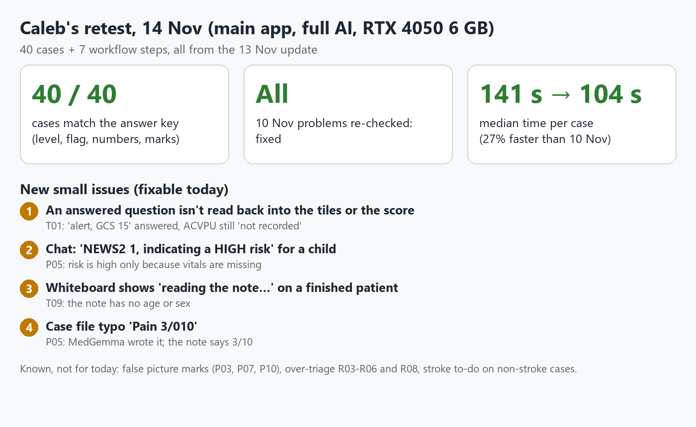
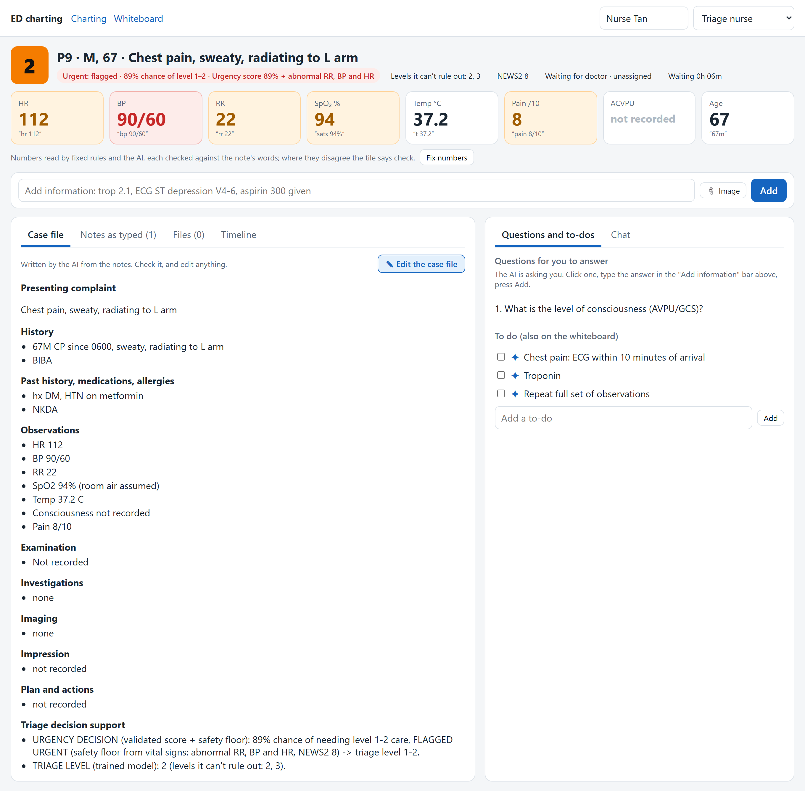

# BN4601A group project: handover (Sat 14 Nov 2026)

Everything still to do before the deadline, checked against the brief
(`Raye 2026-27 - BN4601A Group Project Briefing.pdf`, slides 31-34). Our topic: **Emergency medicine**
(images + vitals + history): an ED triage app that reads messy nurse notes and X-rays/CTs.

**Hard deadline: Mon 16 Nov 23:59.** The live showcase is the same day, **11:00-12:30, E4-04-02 ALC**.



---

## 1. Deliverables from the brief, and where each one stands

| # | Deliverable (as the brief says) | Where it goes | Due | Owner | Status |
|---|---|---|---|---|---|
| 1 | **Report**: arXiv format, **PDF only, 10 pages max** (figures and tables count; references and appendix don't), **Arial 12 pt, single-spaced**, publication-quality figures, cite every dataset/model/software, one citation style, **individual contributions section**. Demo link may be included | Canvas, Group Project folder | Mon 16 Nov 23:59 | Caleb (writing), Alex (QC of results) | In progress. Model 3 numbers are in `reasoning/REPORT_NOTES.md` (5t feedback fixes, 5u retraining). Caleb's 14 Nov retest numbers are in section 3 below |
| 2 | **Video**: MP4 only, **max 3 min**, focus on the **working app** (not slides), no copyrighted media, will be peer-viewed | Canvas, Group Project folder | Mon 16 Nov 23:59 | Alex | Starting (Alex, 14 Nov) |
| 3 | **Hugging Face Space**: the **final version** of the app, in the **Medical AI HF organisation** | Hugging Face | Mon 16 Nov 23:59 | Alex | **Ready to upload.** `app/build/space` rebuilt from `main` on 14 Nov (with SBAR); model repo updated. Alex: upload on 16 Nov (steps in section 6) |
| 4 | **Showcase demo**: max **10 min**, max **3 slides**, mostly **live app demo**. Order: Background (why it matters), Application (what we built), Live demo | In person, E4-04-02 | Mon 16 Nov 11:00 | Cato (slides), Alex (live demo) | Slides: Cato making them. Demo: plan in section 5 |
| 5 | **Peer review** of each team member | Canvas | Fri 20 Nov 23:59 | Everyone | After the deadline |

**Marks:** Demo 15% (performance, presentation), Report 20% (design, analysis, organisation, individual
section), Video 15% (performance, creativity, popularity), plus peer review.

---

## 2. What the brief asks the app to do, and what shows it in our app

| Brief requirement | Our app | Show it with | Gap |
|---|---|---|---|
| **Core 1 EXAMINE**: find and **localise** findings in an image (detection, segmentation) | Picture sorter, then the trained model for that kind: fracture detector (adult and child cut-offs), chest X-ray detector + CheXpert, head-CT bleed. Red boxes + MedSAM outline + MedGemma (Cato's adapter) description + ED checklist | P01 (ankle fracture: box + outline), P06 (pneumothorax), P11 (head CT bleed) | Known false marks on P03, P07, P10: say "a mark means look here" |
| **Core 2 EXPLAIN**: multi-turn chat, follow-ups, **lay-language version**, memory, uses earlier info, doesn't present uncertain findings as definite | Chat tab: reads the whole case file, including later notes and fixed numbers | T01: ask "why is he urgent?", then add "trop 85, ST depression", then ask again. Ask "explain this to the patient in simple words" | Practise the lay-language question before the demo |
| **Core 3 REPORT**: structured specialty output built from **everything gathered in the conversation**, not just the first input | Case file under standard ED headings; every later note, answer and number fix is added and the new **SBAR handover** tab | T01 after Add + Fix numbers + a chat question: the case file shows the troponin, the answer and "Corrected by ..."; then **Write SBAR handover** | None (the SBAR takes ~1-2 min on the laptop: press it before you talk about it) |
| **+1 Creative task** | **Live priority from all three inputs**: vitals (safety floor), the note's words (trained urgency score) and pictures (picture rule: a red pneumothorax or head-CT bleed moves the patient up). "Clinical detective": the AI asks for the next most useful information ("Questions for you to answer"), then re-scores when it is answered. Also: safety mode (refuses a photo that isn't a scan, P18; drops impossible numbers, T08), and the whiteboard | T09 (no vitals: it asks for them), P18 | Pick ONE name for the slides and report (suggest Clinical Detective) |
| **Base vs adapted model** (accuracy AND style/verbosity) | Done: `REPORT_NOTES.md` 5h (MedQA, val loss, SBAR headings, words per turn, hedging); urgency heads base vs retrained (5u) | Report section "Experiments" | None |
| **Own metrics** | AUROC, sensitivity at the 9-in-10 cut-off, NEWS2 floor, flag flips under rewording, pathways caught / false flags per patient, Dice for outlines, time per case | Report | None |

---

## 3. Latest results (for the report)

From Caleb's retest of the 13 Nov version, full AI, RTX 4050 6 GB laptop
(`reasoning/outputs/feedback_14nov/`):

- **40 / 40 cases match the answer key** (level, urgent flag, numbers, picture marks).
- **Every 10 Nov problem re-checked: fixed** (pathways, missing vitals, children, small cuts, ambulance numbers,
  CT, labels, chat reasons).
- **Speed: 104 s median per case** (73-161 s), was 141 s on 10 Nov. Chat answer ~20 s, add/answer ~20 s, fix
  numbers ~1 s.
- Retrained models (13 Nov, `REPORT_NOTES.md` 5u):
  - Steadier urgency score: urgent-flag flips with reworded notes 15% to 8%, same AUROC (0.828).
  - Children's urgency score: AUROC 0.79 vs 0.70 on 270 children.
  - Pathway retrain failed the rule, not used.
- These numbers do **not** change with the 14 Nov fixes below, so the report can use them now.

---

## 4. App fixes from Caleb's retest (14 Nov)

| # | Problem | Fix | State (14 Nov, afternoon) |
|---|---|---|---|
| 1 | An answered question ("alert, GCS 15") didn't update the tiles or the score | Later notes are read by MedGemma + rules like the first note; empty tiles filled, score re-run; a different value for a filled tile is flagged "please check", never overwritten | **Done, in `main`.** Full AI (T01): ACVPU became alert, timeline "Numbers from a later note" |
| 2 | Chat: "NEWS2 1, indicating a HIGH risk" | The record the chat reads now says "a LOW score; risk treated as HIGH only because vitals are missing" (the scores are unchanged) | **Done, in `main`.** Full AI (P05): "NEWS2 is low … risk treated as high because these vital signs are missing" |
| 3 | Whiteboard "reading the note…" on a finished patient | "age/sex not recorded" once the AI is done | **Done, in `main`** (React + Gradio) |
| 4 | Case file "Pain 3/010" | Clean-up rule | **Done, in `main`** |
| + | No SBAR handover (Core task 3) | "SBAR handover" tab with a **Write SBAR handover** button, Copy and Download (React and Gradio). The AI writes the SBAR; every later note and chat question is copied word for word under it, because in 3 full-AI runs MedGemma kept dropping the troponin | **Done, in `main`.** ~70-130 s on the laptop |

| + | Pictures never changed the priority (only vitals and words did) | **Picture rule**: a red pneumothorax or a red bleed on head CT (trained image models) flags the patient urgent, level at most 2, with the reason "Moved up: CT shows bleeding inside the skull (picture model)" on the pill, whiteboard, case file and chat. Only moves UP; not fractures, effusion, shadowing or amber marks | **Done, in `main`.** None of the 40 answer-key levels change (P06, P11, P12 were already level 2) |

| + | Only the AI could set the priority | **Doctor's priority**: a Doctor or Organising doctor can lower or raise the level (reason optional) ("Change priority" on the case file). The AI's level stays underneath; a red "please review" warning shows if new information makes the AI more worried. Screenshots below | **Done, in `main`** |

| + | Caleb's 2nd retest (14 Nov 13:27): SBAR and T01 chat said "obtain urgent ECG and troponin" with both already done; SBAR opened "Okay, here is…"; case file kept "Consciousness not recorded" next to "Consciousness alert" | Tests whose results are in a later note are listed for the chat; any AI sentence still asking for one gets "(already done: troponin at 11:05, see the notes)" (repeat/serial requests left alone). The "Okay, here is" opening is cut. "X not recorded" is removed once a later note gives X | **Done, in `main`** |

| + | Only two groups (urgent / not urgent) | **Three groups** under the level on the whiteboard and case file: **Urgent** (flagged, or level 1-2; same 9-in-10 cut-off), **Can wait** (level 3), **Minor** (level 4-5). A label only: nothing is re-scored | **Done, in `main`** (React + Gradio) |

| + | Board clock only counted from arrival; a patient could only be cleared after setting where they went | **Time** column: "waiting to be seen" from arrival; **Gone for imaging** (new stage) or a decision to leave starts the clock again ("at imaging 12m · total 1h 05m"). **✕ Remove from board** in one step for the triage nurse / organising doctor (case file kept under "Left the ED") | **Done, in `main`** (React + Gradio) |

| + | Caleb's final QC (14 Nov 17:14, on 437ca2e): a worse later note (BP 78/50, HR 128, drowsy) after a doctor lowered T01 changed nothing on screen; "trop 85" read as age 85; chat + SBAR called ST depression + trop 85 a STEMI; SBAR asked for "cardiac enzymes" | A vital sign in a later note is a newer reading: the tile updates ("HR 128 (was 112)"), the patient is re-scored and the review warning fires; 'please check' lines now show on the case page; age/sex never read from later notes; with ST depression and no elevation 'STEMI' is corrected to NSTEMI (and said so); "cardiac enzymes" counts as troponin | **Done, in `main`.** Full-AI QC of T01 (14 Nov 20:36): 12/12 after one fix (the STEMI rule had turned a correct "non-ST-elevation… (NSTEMI)" into "non-non-…"); "trop 85" no longer read as arrival by ambulance either. Screenshots `docs/handover/qc_final_*.png` |

| + | The three groups were only a label from the level | The **level classifier's own chances for the three groups** are shown on the case file ("Classifier: Urgent 6% · Can wait 51% · Minor 44%" = levels 1-2 / 3 / 4-5 added up from its 1-5 output). Full AI: T01 70/30/0, T07 6/51/44, T04 0/1/99. No retraining, so no reported number changes | **Done, in `main`** (React + Gradio) |

Test-mode checks: `python app/tests/test_app.py` = **122 PASS, 0 FAIL**.

Doctor's priority, full-AI screenshots (T01 as Dr Lim, Doctor), in `docs/handover/`:
- `priority_override_a_before.png`: case file before, with the **Change priority** button
- `priority_override_a_board_before.png`: whiteboard before (T01 urgent, level 2)
- `priority_override_b_filled.png`: level 3 picked, reason typed
- `priority_override_c_after.png`: "Level 3, set by Dr Lim … (AI + safety rules said 2)", AI's level shown next to it
- `priority_override_c_board_after.png`: whiteboard: T01 moved below the urgent patient
- `priority_override_c_timeline.png`: the timeline entry
- `priority_override_d_review.png`: after a worse note: red "New information since Dr Lim's change … please review"
- `priority_override_d_board_review.png`: the same warning on the whiteboard Details: `reasoning/REPORT_NOTES.md` 5v.

**Caleb: one more retest, please** (pull `main`; ask your Claude to read this section and run it): T01, answer the
consciousness question ("alert, GCS 15") and check the ACVPU tile and the timeline; Add "trop 85, ECG ST depression
V4-6", ask the chat a question, then press **Write SBAR handover**; P05 + `child_wrist_normal.png`, ask "Why is this
child flagged urgent?"; check P05's whiteboard row and the case-file pain line.

Not fixing before the deadline (known; say so in the report's Limitations section):
- false picture marks (P03, P07, P10);
- over-triage of some real level-3 patients (R03-R06, R08), from the 9-in-10 cut-off;
- stroke to-do on some non-stroke cases (kept on purpose: missing a stroke is worse).

**Still to do for the app:** only the Space upload (section 6, Alex on 16 Nov).

---

## 5. Demo plan (10 min, 3 slides)



1. **Slide 1, Background (1 min):** EDs triage under pressure; notes are messy; under- and over-triage both cost.
2. **Slide 2, What we built (1.5 min):** messy note + pictures → numbers with their source → trained urgency
   score + safety floor → case file, questions, to-dos, chat, whiteboard. Three models: images (Cato), vitals
   (Caleb), reasoning (Alex).
3. **Slide 3, Results (1 min):** 40/40 answer key, 104 s per case, steadier score, children's score, base vs
   adapted.
4. **Live demo (6 min):**
   - **T01** chest pain: urgent + why, then the case file, then Add troponin, then the chat.
   - **P01** ankle X-ray: box + outline.
   - **T09** no vitals: the AI asks for them.
   - Whiteboard: set stage and doctor.
5. **Backup:** the full AI takes about 2 min a case on a laptop. **Submit T01 and P01 before you start talking**,
   or have them already on the board, and keep the guide screenshots (`app/build/guide_shots/`) open in case the
   laptop or the Space is slow.

---

## 6. Hugging Face Space (Alex, by 16 Nov)

**Done (14 Nov):** `app/build/space` rebuilt from `main` (with the SBAR tab, new urgency and children's scores);
the private model repo `likingood/bn4601a-ed-models` updated with `install_models.py --upload`. **Not done:** the
Space itself (Alex, 16 Nov, once you have the org name).

Steps (in the repo folder, env `bn4601a`, `PYTHONUTF8=1`):

1. Get the course's **Medical AI organisation** name and check you are a member:
   `hf auth whoami` lists your orgs (on 14 Nov it showed `orgs=BN4601A`; check that is the course one, or ask).
2. Rebuild from the latest `main` and upload, as a public ZeroGPU Space in the org:
   ```
   git checkout main && git pull
   python app/tools/make_space_bundle.py --push --space <ORG>/bn4601a-ed-triage --public
   ```
   It creates the Space (Gradio, `app_file = app/gradio/app.py`), uploads `app/build/space` and asks for ZeroGPU
   (`zero-a10g`). If ZeroGPU can't be set ("couldn't switch"), pick it in the Space's **Settings -> Hardware** (the
   org must have ZeroGPU; otherwise a paid GPU such as T4 small).
3. **Settings -> Variables and secrets -> New secret**: name `HF_TOKEN`, value a **Read** token from
   huggingface.co/settings/tokens (your account: it can read the private model repo). Without it the Space starts in
   test mode and says so at the top; **testers must never see test mode**, so check the banner says "Full AI".
4. Wait for the build (first start downloads MedGemma + our models, several minutes). Test with T01 (then answer the
   consciousness question, Add the troponin, ask the chat, **Write SBAR handover**) and P01 (ankle X-ray: box +
   outline).
5. Put the link (`https://huggingface.co/spaces/<ORG>/bn4601a-ed-triage`) in the report and on the slides.

---

## 7. Report checklist (Caleb)

- [ ] arXiv layout; Arial 12 pt; single-spaced; **≤ 10 pages** (without references and appendix)
- [ ] Headings: Abstract, Introduction, Related Work, Dataset & Data Preparation, Methods, Experiments &
      Evaluation, Results & Discussion, **Limitations**, Conclusion
- [ ] Base vs adapted comparison, with both **accuracy** and **style/verbosity**
- [ ] Every dataset, model and software cited:
      KTAS, NHAMCS 2022, MultiCaRe, FracAtlas, GRAZPEDWRI-DX, Kermany, VinDr-CXR, RSNA, MedGemma 1.5,
      YOLO11, MedSAM, Unsloth, Gradio, React
- [ ] **Individual contributions** section
- [ ] Demo link (HF Space) and video link
- [ ] Figures publication quality (no screenshots of terminals)

## 8. Video checklist (Alex)

- [ ] MP4, ≤ 3:00
- [ ] Shape: the problem (15 s), then the app working (2 min), then what's special (45 s)
- [ ] App, not slides; no copyrighted music or images (the test pictures are CC BY 4.0: credit them on screen or
      at the end)
- [ ] Use the new full-AI screenshots and screen recording; show the "Full AI" banner

---

## Where things are

| Thing | Path |
|---|---|
| App (main) | `app/server.py` + `app/frontend/` (`python server.py`) |
| App (Gradio, for the Space) | `app/gradio/app.py` |
| Install the models | `app/install_models.py` |
| Test pack + answer key | `app/build/ED_app_test_pack.zip` |
| Guides | `app/build/ED_app_user_guide.pdf`, `ED_app_gradio_guide.pdf`, `ED_app_retest_steps.pdf` |
| All Model 3 results | `reasoning/REPORT_NOTES.md` |
| Feedback and retests | `reasoning/outputs/feedback_10nov/`, `reasoning/outputs/feedback_14nov/` |
| Code | GitHub `likingood16/BN4601A`, branch `main` |
