# Held-out annotated cases (green = expected box, red = model box)

## fracatlas / IMG0002600.jpg (x_ray)

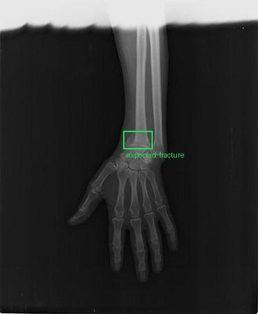

| | Expected | Model |
|---|---|---|
| Finding | fracture | none |
| Location | box (green) | - (IoU 0.0) |
| Text | - | X-ray of the left wrist. Impression: The patient was diagnosed with a left wrist fracture and was treated with a cast. Suggested next steps (most to least suitable): 1. Immediate stabilisation: The patient was treated with a splint and discharged. 2. Investigate: A CT scan was performed, and the fracture was classified as a type 2-3-4 fracture (Fig. 3. Definitive treatment: The patient was treated with a cast. 4. Definitive treatment: The patient was treated with a cast. |

## fracatlas / IMG0002486.jpg (x_ray)

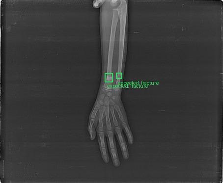

| | Expected | Model |
|---|---|---|
| Finding | fracture | none |
| Location | box (green) | - (IoU 0.0) |
| Text | - | X-ray of the left forearm. Impression: The patient was diagnosed with a left forearm fracture and was treated with a cast. Suggested next steps (most to least suitable): 1. Investigate: A CT scan was performed to evaluate the fracture and the presence of a foreign body. 2. Definitive treatment: The patient was treated with a cast. 3. Definitive treatment: The patient was treated with a cast. |

## fracatlas / IMG0002319.jpg (x_ray)

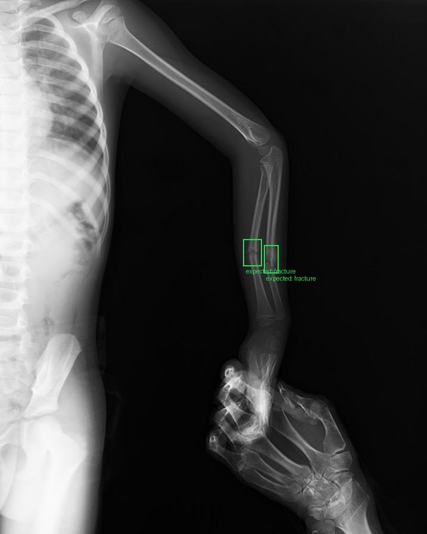

| | Expected | Model |
|---|---|---|
| Finding | fracture | none |
| Location | box (green) | - (IoU 0.0) |
| Text | - | Anteroposterior radiograph of the left arm. Impression: The patient was diagnosed with a left-sided brachial plexus injury at 36 weeks of gestation. Suggested next steps (most to least suitable): 1. Immediate stabilisation: The patient was born via cesarean section and was intubated and ventilated. 2. Immediate stabilisation: The patient was intubated and ventilated. 3. Immediate stabilisation: The patient was intubated and ventilated. 4. Immediate stabilisation: The patient was intubated and... |

## fracatlas / IMG0003234.jpg (x_ray)

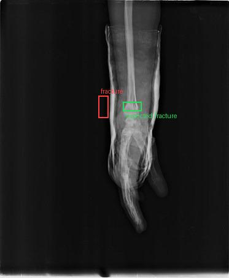

| | Expected | Model |
|---|---|---|
| Finding | fracture | fracture |
| Location | box (green) | middle third, centre; box covers about 0% of the image (IoU 0.0) |
| Text | - | Anteroposterior radiograph of the left hand. Impression: The patient was diagnosed with a left hand fracture and was referred to hospital. The patient was diagnosed with a left hand fracture and was referred to hospital. Suggested next steps (most to least suitable): 1. Definitive treatment: The patient was treated with a splint and discharged. 2. Definitive treatment: The patient was treated with a splint and discharged. |

## fracatlas / IMG0003564.jpg (x_ray)

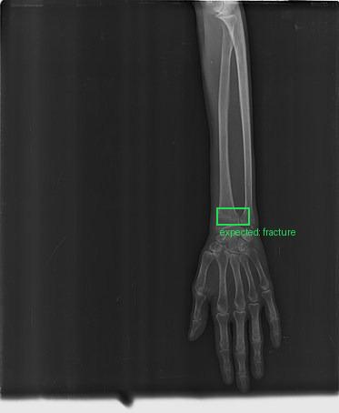

| | Expected | Model |
|---|---|---|
| Finding | fracture | none |
| Location | box (green) | - (IoU 0.0) |
| Text | - | X-ray of the left forearm. Impression: The patient was diagnosed with a left forearm fracture and was treated with a cast. Suggested next steps (most to least suitable): 1. Definitive treatment: the patient with a [history not provided]. 2. Definitive treatment: The patient was treated with a cast. |

## fracatlas / IMG0003925.jpg (x_ray)

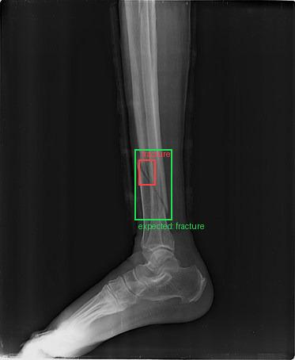

| | Expected | Model |
|---|---|---|
| Finding | fracture | fracture |
| Location | box (green) | middle third, centre; box covers about 0% of the image (IoU 0.16477836714919278) |
| Text | - | Anteroposterior radiograph of the left ankle showing a displaced fracture of the fibula. Impression: The patient was diagnosed with a displaced fibular fracture and was referred to hospital for surgery. Suggested next steps (most to least suitable): 1. Definitive treatment: The patient was treated with a fibular external fixator. 2. Definitive treatment: The patient was treated with a fibular external fixator. 3. Definitive treatment: The patient was treated with a fibular external fixator. 4.... |

## fracatlas / IMG0002484.jpg (x_ray)

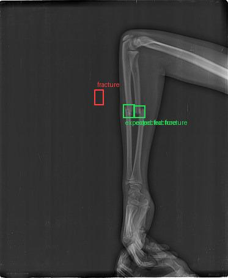

| | Expected | Model |
|---|---|---|
| Finding | fracture | fracture |
| Location | box (green) | middle third, centre; box covers about 0% of the image (IoU 0.0) |
| Text | - | Anteroposterior radiograph of the left forearm showing a comminuted fracture of the distal radius. Impression: The patient was diagnosed with a comminuted fracture of the distal radius (Fig. Suggested next steps (most to least suitable): 1. Immediate stabilisation: The patient was immobilized in a long arm splint for 6 weeks. 2. Definitive treatment: The patient was treated with a closed reduction and percutaneous pinning (CRPP) of the distal radius fracture (Fig. |

## fracatlas / IMG0002372.jpg (x_ray)

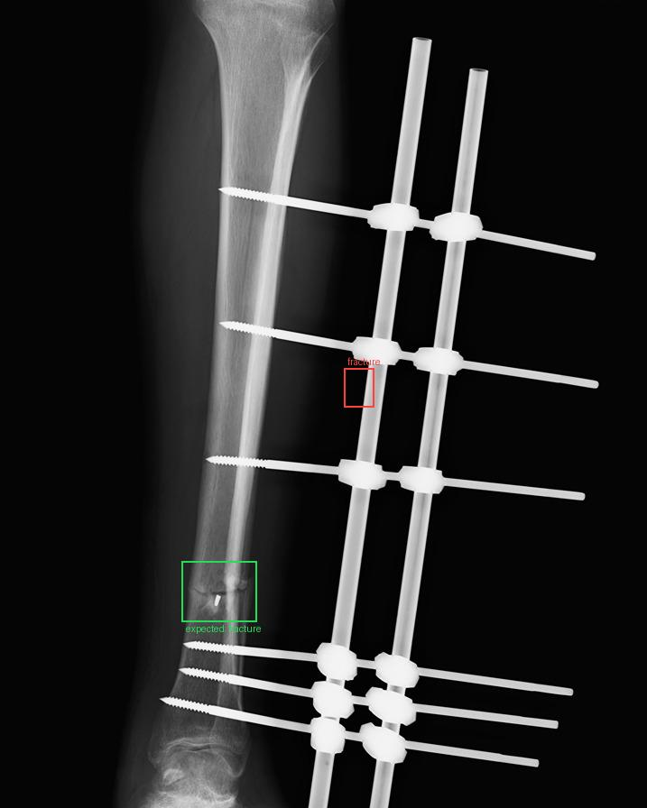

| | Expected | Model |
|---|---|---|
| Finding | fracture | fracture |
| Location | box (green) | middle third, centre; box covers about 0% of the image (IoU 0.0) |
| Text | - | Radiograph of the left lower leg after open reduction and internal fixation. Impression: The patient was diagnosed with a left tibial shaft fracture and was treated with open reduction and internal fixation (ORIF) (Fig. Suggested next steps (most to least suitable): 1. Definitive treatment: The patient was treated with ORIF using a 1.5-mm locking plate and screws (Synthes, Paoli, PA, USA). 2. Definitive treatment: The patient was treated with ORIF using a 1.5-mm locking plate and screws... |

## fracatlas / IMG0002403.jpg (x_ray)

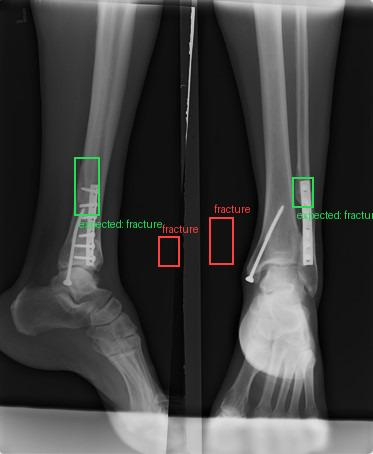

| | Expected | Model |
|---|---|---|
| Finding | fracture | fracture, fracture |
| Location | box (green) | middle third, centre; box covers about 1% of the image \| middle third, centre; box covers about 0% of the image (IoU 0.0) |
| Text | - | Anteroposterior and lateral radiographs of the left ankle. Impression: The patient was diagnosed with a left ankle fracture and was treated with a cast. Suggested next steps (most to least suitable): 1. Definitive treatment: the patient with a [history not provided]. 2. Definitive treatment: The patient was treated with open reduction and internal fixation (ORIF) of the left ankle fracture. 3. Definitive treatment: The patient was treated with ORIF of the left ankle fracture. 4. Definitive... |

## fracatlas / IMG0004262.jpg (x_ray)

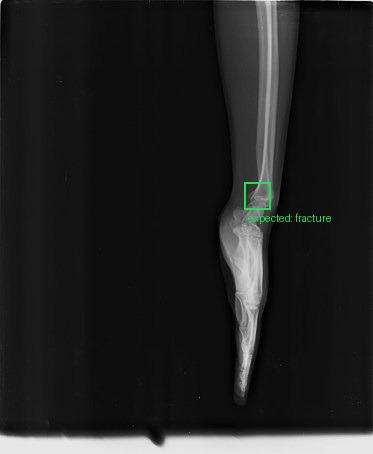

| | Expected | Model |
|---|---|---|
| Finding | fracture | none |
| Location | box (green) | - (IoU 0.0) |
| Text | - | Anteroposterior radiograph of the left foot. Impression: The patient was diagnosed with a left foot fracture and was referred to hospital. The patient was diagnosed with a left foot fracture and was referred to hospital. Suggested next steps (most to least suitable): 1. Immediate stabilisation: The patient was treated with a plaster cast and was discharged. 2. Investigate: The patient was referred to hospital for further examination. 3. Investigate: The patient was referred to hospital for... |

## fracatlas / IMG0002311.jpg (x_ray)

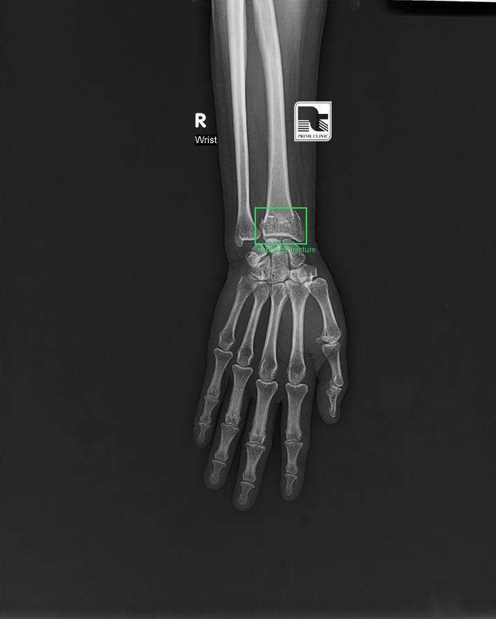

| | Expected | Model |
|---|---|---|
| Finding | fracture | none |
| Location | box (green) | - (IoU 0.0) |
| Text | - | Anteroposterior radiograph of the right wrist. Impression: The patient was diagnosed with a right wrist fracture and was treated with a cast. Suggested next steps (most to least suitable): 1. Immediate stabilisation: The patient was treated with a splint. 2. Investigate: A radiograph of the right wrist was taken (Figure 1). 3. Definitive treatment: The patient was treated with a cast. |

## fracatlas / IMG0002619.jpg (x_ray)

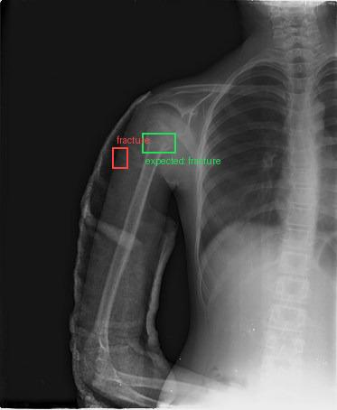

| | Expected | Model |
|---|---|---|
| Finding | fracture | fracture |
| Location | box (green) | middle third, centre; box covers about 0% of the image (IoU 0.0) |
| Text | - | Radiograph of the right humerus showing a comminuted fracture of the proximal humerus. Impression: The patient was diagnosed with a comminuted fracture of the proximal humerus (Figure 1). Suggested next steps (most to least suitable): 1. Definitive treatment: The patient was treated with a proximal humerus fracture prosthesis (Figure 2). |

## fracatlas / IMG0002664.jpg (x_ray)

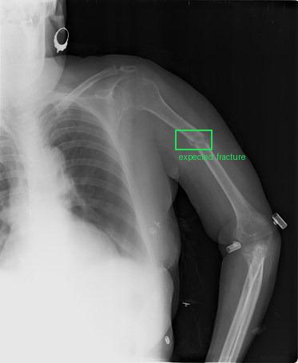

| | Expected | Model |
|---|---|---|
| Finding | fracture | none |
| Location | box (green) | - (IoU 0.0) |
| Text | - | Anteroposterior radiograph of the left shoulder. Impression: The patient was diagnosed with a left shoulder dislocation and was treated with closed reduction and percutaneous pinning (Fig. Suggested next steps (most to least suitable): 1. Definitive treatment: The patient was treated with closed reduction and percutaneous pinning (Fig. 2. Definitive treatment: The patient was treated with closed reduction and percutaneous pinning (Fig. 3. Definitive treatment: The patient was treated with... |

## fracatlas / IMG0002373.jpg (x_ray)

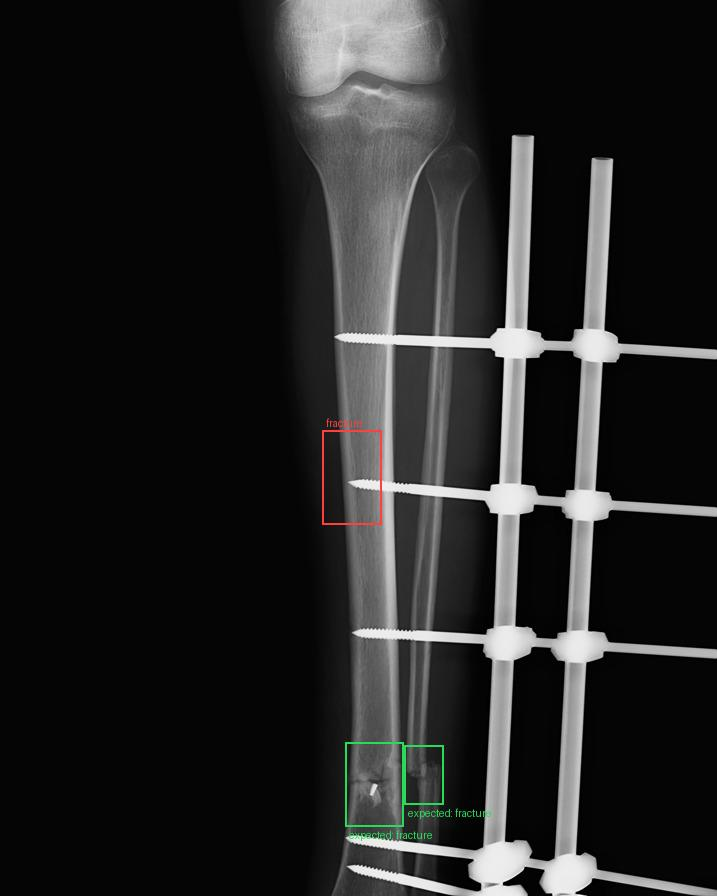

| | Expected | Model |
|---|---|---|
| Finding | fracture | fracture |
| Location | box (green) | middle third, centre; box covers about 1% of the image (IoU 0.0) |
| Text | - | Anteroposterior radiograph of the left lower leg showing the fracture fixation. Impression: The patient was diagnosed with a left tibial shaft fracture and was treated with open reduction and internal fixation (ORIF) (Fig. Suggested next steps (most to least suitable): 1. Definitive treatment: The patient was treated with ORIF using a 1.5-mm locking plate and screws (Fig. 2. Definitive treatment: The patient was treated with ORIF using a 1.5-mm locking plate and screws (Fig. |

## fracatlas / IMG0002501.jpg (x_ray)

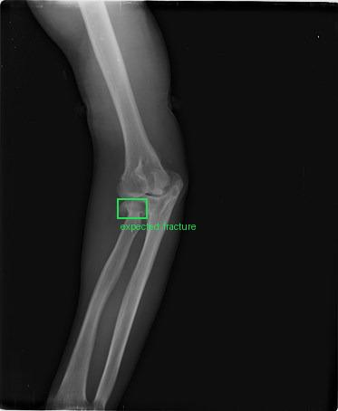

| | Expected | Model |
|---|---|---|
| Finding | fracture | none |
| Location | box (green) | - (IoU 0.0) |
| Text | - | Anteroposterior radiograph of the left elbow. Impression: The patient was diagnosed with a left elbow dislocation and was treated with closed reduction and percutaneous pinning (Fig. Suggested next steps (most to least suitable): 1. Definitive treatment: The patient was treated with closed reduction and percutaneous pinning (Fig. |

## fracatlas / IMG0000479.jpg (x_ray)

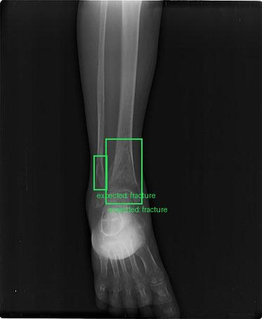

| | Expected | Model |
|---|---|---|
| Finding | fracture | none |
| Location | box (green) | - (IoU 0.0) |
| Text | - | Anteroposterior radiograph of the right ankle. Impression: The patient was diagnosed with a right ankle fracture and was treated with a cast. Suggested next steps (most to least suitable): 1. Immediate stabilisation: The patient was treated with a cast and was discharged. 2. Investigate: A radiograph of the right ankle was taken (Fig. 3. Investigate: A radiograph of the right ankle was taken (Fig. 4. Investigate: A radiograph of the right ankle was taken (Fig. |

## fracatlas / IMG0002528.jpg (x_ray)

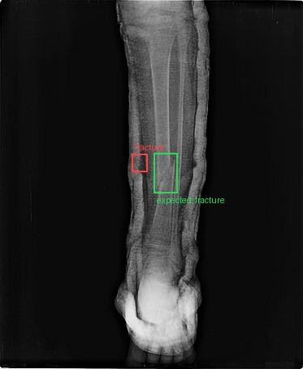

| | Expected | Model |
|---|---|---|
| Finding | fracture | fracture |
| Location | box (green) | middle third, centre; box covers about 0% of the image (IoU 0.0) |
| Text | - | Anteroposterior radiograph of the left lower extremity. Impression: The patient was diagnosed with a left lower extremity fracture. Suggested next steps (most to least suitable): 1. Immediate stabilisation: The patient was treated with a long leg plaster splint and was discharged on the same day. 2. Immediate stabilisation: The patient was treated with a long leg plaster splint and was discharged on the same day. 3. Immediate stabilisation: The patient was treated with a long leg plaster splint... |

## fracatlas / IMG0002405.jpg (x_ray)

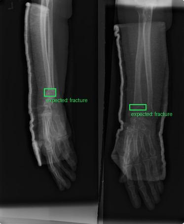

| | Expected | Model |
|---|---|---|
| Finding | fracture | none |
| Location | box (green) | - (IoU 0.0) |
| Text | - | Radiograph of the left forearm and wrist. Impression: The patient was diagnosed with a left forearm and wrist fracture. Suggested next steps (most to least suitable): 1. Definitive treatment: The patient was treated with a cast. |

## fracatlas / IMG0002935.jpg (x_ray)

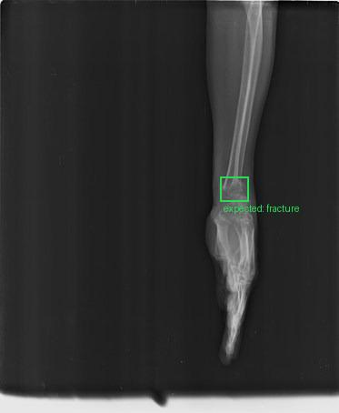

| | Expected | Model |
|---|---|---|
| Finding | fracture | none |
| Location | box (green) | - (IoU 0.0) |
| Text | - | Anteroposterior radiograph of the left hand. Impression: The patient was diagnosed with a left hand fracture. Suggested next steps (most to least suitable): 1. Immediate stabilisation: The patient was treated with a splint and discharged. 2. Investigate: A radiograph was taken and showed a fracture of the left hand (Fig. 3. Definitive treatment: The patient was treated with a splint and discharged. 4. Definitive treatment: The patient was treated with a splint and discharged. |

## fracatlas / IMG0002353.jpg (x_ray)

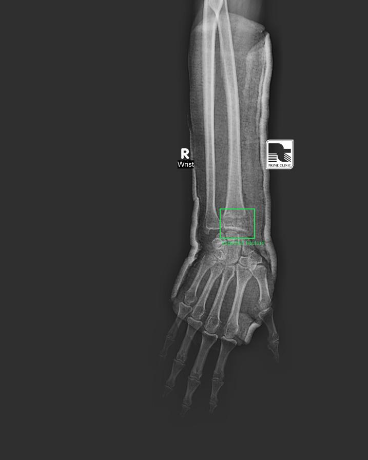

| | Expected | Model |
|---|---|---|
| Finding | fracture | none |
| Location | box (green) | - (IoU 0.0) |
| Text | - | Radiograph of the right wrist showing a comminuted fracture of the distal radius. Impression: The patient was diagnosed with a comminuted fracture of the distal radius (Fig. Suggested next steps (most to least suitable): 1. Immediate stabilisation: The patient was immobilized in a below-elbow splint. 2. Definitive treatment: The patient was treated with a closed reduction and percutaneous pinning (CRPP) of the distal radius fracture (Fig. 3. Definitive treatment: The patient was treated with a... |

## fracatlas / IMG0001461.jpg (x_ray)

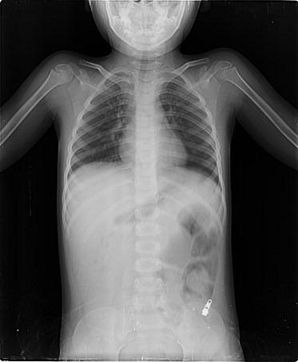

| | Expected | Model |
|---|---|---|
| Finding | no abnormality | none |
| Location | box (green) | - (IoU -) |
| Text | - | Chest X-ray showing no abnormality. Impression: The patient was diagnosed with a left-sided diaphragmatic hernia at the patient. The patient was diagnosed with a left-sided diaphragmatic hernia at the patient. Suggested next steps (most to least suitable): 1. Immediate stabilisation: The patient was intubated and mechanically ventilated. 2. Immediate stabilisation: The patient was intubated and mechanically ventilated. 3. Immediate stabilisation: The patient was intubated and mechanically... |

## fracatlas / IMG0001608.jpg (x_ray)

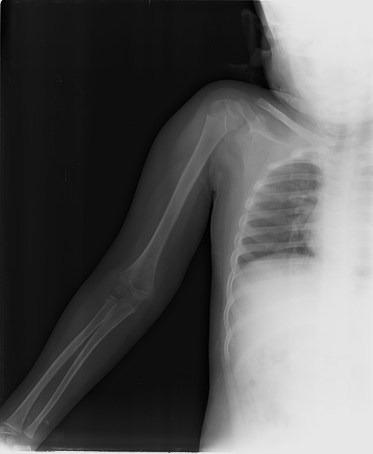

| | Expected | Model |
|---|---|---|
| Finding | no abnormality | none |
| Location | box (green) | - (IoU -) |
| Text | - | Radiograph of the left shoulder showing a fracture of the proximal humerus. Impression: The patient was diagnosed with a fracture of the proximal humerus (Fig. Suggested next steps (most to least suitable): 1. Definitive treatment: The patient was treated with a shoulder immobilizer for 6 weeks. |

## fracatlas / IMG0003237.jpg (x_ray)

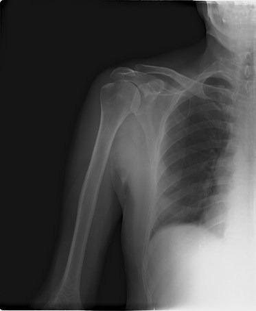

| | Expected | Model |
|---|---|---|
| Finding | no abnormality | none |
| Location | box (green) | - (IoU -) |
| Text | - | Anteroposterior radiograph of the left shoulder. Impression: The patient was diagnosed with a left shoulder dislocation and was treated with closed reduction and percutaneous pinning (Fig. Suggested next steps (most to least suitable): 1. Definitive treatment: The patient was treated with closed reduction and percutaneous pinning (Fig. 2. Definitive treatment: The patient was treated with closed reduction and percutaneous pinning (Fig. |

## fracatlas / IMG0002003.jpg (x_ray)

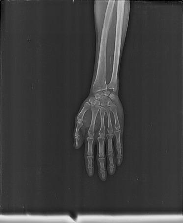

| | Expected | Model |
|---|---|---|
| Finding | no abnormality | none |
| Location | box (green) | - (IoU -) |
| Text | - | X-ray of the left hand showing a fracture of the distal phalanx of the index finger. Impression: The patient was diagnosed with a fracture of the distal phalanx of the index finger (Fig. Suggested next steps (most to least suitable): 1. Definitive treatment: The patient was treated with a splint and discharged. |

## fracatlas / IMG0003506.jpg (x_ray)

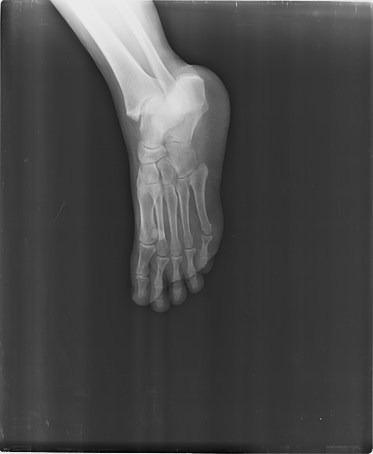

| | Expected | Model |
|---|---|---|
| Finding | no abnormality | none |
| Location | box (green) | - (IoU -) |
| Text | - | Anteroposterior radiograph of the left foot. Impression: The patient was diagnosed with a left foot fracture and was referred to hospital. The patient was diagnosed with a left foot fracture and was referred to hospital. Suggested next steps (most to least suitable): 1. Immediate stabilisation: The patient was diagnosed with a left foot fracture and was referred to hospital. 2. Immediate stabilisation: The patient was diagnosed with a left foot fracture and was referred to hospital. 3.... |

## nih_cxr14 / 00020113_017.png (x_ray)

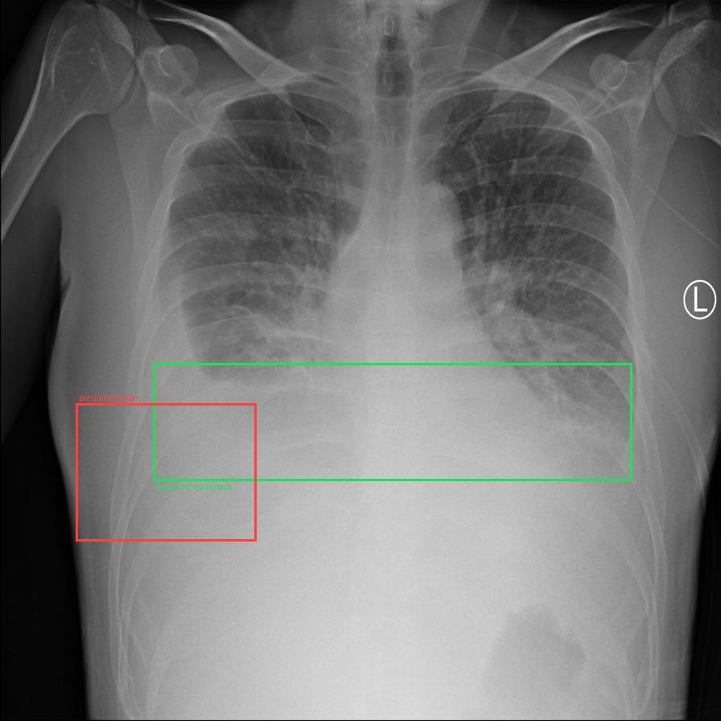

| | Expected | Model |
|---|---|---|
| Finding | atelectasis | pleural effusion |
| Location | box (green) | middle third, image-left (on a standard frontal chest radiograph or axial CT this is usually the patient's right); box covers about 5% of the image (IoU 0.10878690465987344) |
| Text | - | Chest X-ray showing bilateral pleural effusions. Impression: The patient was diagnosed with HIV infection and was started on antiretroviral therapy (ART). A chest X-ray revealed bilateral pleural effusions (Figure 1). Suggested next steps (most to least suitable): 1. Immediate stabilisation: The patient was started on intravenous (IV) fluids and was given a chest X-ray which showed bilateral pleural effusions (Figure 1). 2. Immediate stabilisation: The patient was started on IV fluids and was... |

## nih_cxr14 / 00025969_000.png (x_ray)

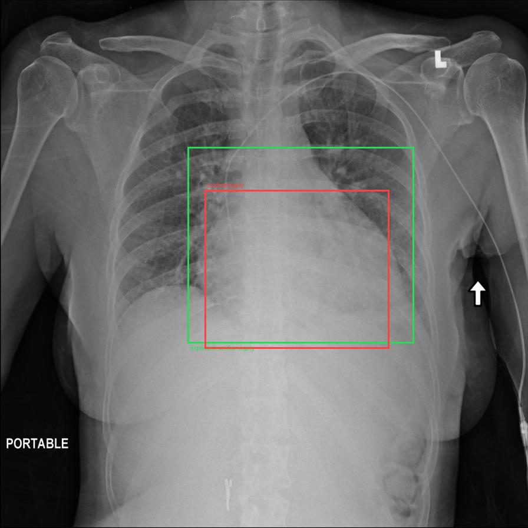

| | Expected | Model |
|---|---|---|
| Finding | cardiomegaly | cardiomegaly |
| Location | box (green) | middle third, centre; box covers about 11% of the image (IoU 0.6255378231597235) |
| Text | - | Chest X-ray showing cardiomegaly and pulmonary edema. Impression: The patient with a [history not provided].73 m2) on hemodialysis (HD) [history not provided]. She was diagnosed with heart failure (HF) and was started on intravenous (IV) metolazone and IV... Suggested next steps (most to least suitable): 1. Immediate stabilisation: She was started on IV furosemide and IV nitroglycerin. 2. Immediate stabilisation: She was started on IV metolazone and IV nitroglycerin. 3. Immediate stabilisation:... |

## nih_cxr14 / 00020259_002.png (x_ray)

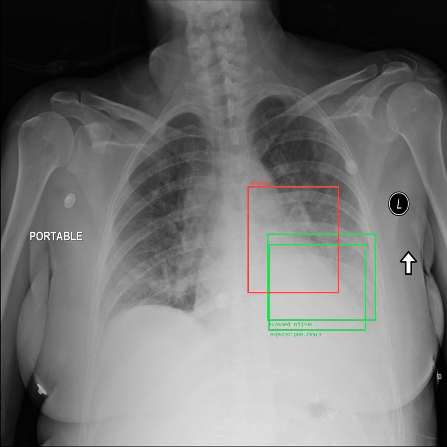

| | Expected | Model |
|---|---|---|
| Finding | infiltrate, pneumonia | infiltrate |
| Location | box (green) | middle third, centre; box covers about 5% of the image (IoU 0.26169764277897944) |
| Text | - | Portable chest radiograph demonstrating pulmonary edema. Impression: The patient was diagnosed with a left-sided pleural effusion and [history not provided]. A repeat chest radiograph revealed a new right-sided pleural effusion (Figure 1). Suggested next steps (most to least suitable): 1. Immediate stabilisation: The patient was started on intravenous (IV) fluids and was given a chest tube for drainage of the left-sided pleural effusion. 2. Immediate stabilisation: The patient was started on IV... |

## nih_cxr14 / 00028873_004.png (x_ray)

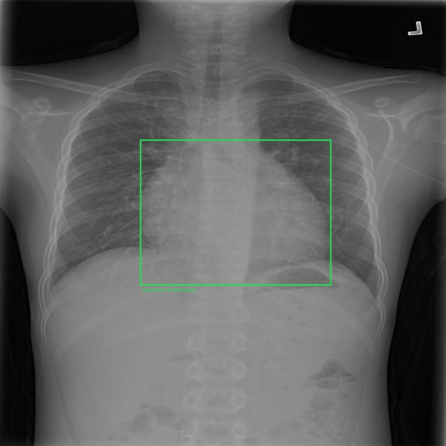

| | Expected | Model |
|---|---|---|
| Finding | cardiomegaly | none |
| Location | box (green) | - (IoU 0.0) |
| Text | - | Chest X-ray showing cardiomegaly. Impression: The patient was diagnosed with a left ventricular outflow tract obstruction (LVOTO) and was referred to hospital for further evaluation and management. A chest X-ray revealed cardiomegaly (Figure 1). Suggested next steps (most to least suitable): 1. Immediate stabilisation: The patient was started on intravenous fluids and was given a dose of 10 mg of furosemide. 2. Immediate stabilisation: The patient was started on intravenous fluids and was given... |

## nih_cxr14 / 00013471_002.png (x_ray)

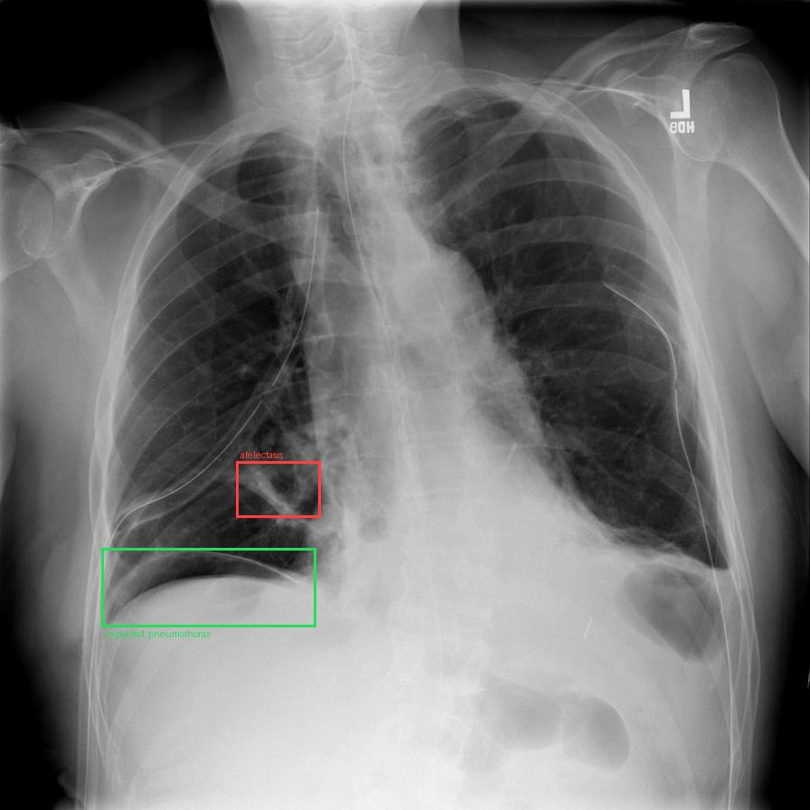

| | Expected | Model |
|---|---|---|
| Finding | pneumothorax | atelectasis |
| Location | box (green) | middle third, centre; box covers about 1% of the image (IoU 0.0) |
| Text | - | Chest X-ray showing a right pneumothorax. Impression: The patient was diagnosed with a left lung tumor and underwent left upper lobectomy. The patient was diagnosed with a right pneumothorax and underwent chest tube insertion. Suggested next steps (most to least suitable): 1. Immediate stabilisation: The patient was intubated and mechanically ventilated. 2. Immediate stabilisation: The patient was transferred to the ICU and was intubated and mechanically ventilated. 3. Immediate stabilisation:... |

## nih_cxr14 / 00021818_026.png (x_ray)

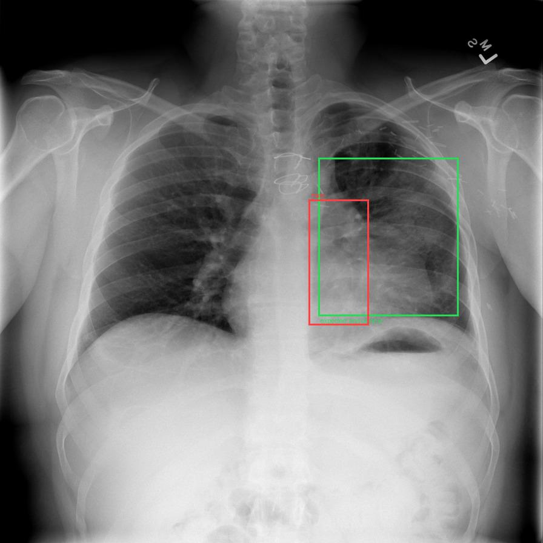

| | Expected | Model |
|---|---|---|
| Finding | pneumonia | mass |
| Location | box (green) | middle third, centre; box covers about 3% of the image (IoU 0.244029906636304) |
| Text | - | Chest X-ray showing a left upper lobe mass. Impression: The patient was diagnosed with a left upper lobe lung mass and was referred to hospital for further evaluation and treatment. The patient was diagnosed with a left upper lobe lung mass and was referred to hospital for further evaluation and treatment. Suggested next steps (most to least suitable): 1. Investigate: A chest CT scan was performed and showed a left upper lobe mass with a maximum diameter of 4.5 cm (Fig. 2. Investigate: A biopsy... |

## nih_cxr14 / 00020810_003.png (x_ray)

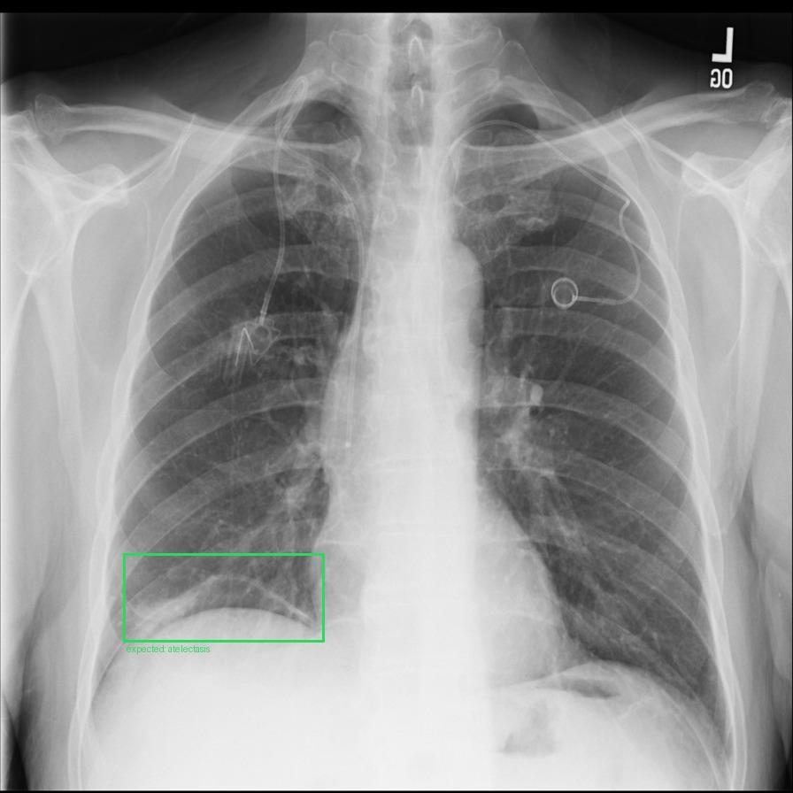

| | Expected | Model |
|---|---|---|
| Finding | atelectasis | none |
| Location | box (green) | - (IoU 0.0) |
| Text | - | Chest X-ray showing a right lower lobe opacity. Impression: The patient was diagnosed with a left-sided pleural effusion and a right lower lobe opacity on a chest X-ray. A computed tomography (CT) scan of the chest revealed a right lower lobe mass with a 1.5 cm nodule in the right upper lobe (Fig. Suggested next steps (most to least suitable): 1. Investigate: A biopsy of the right upper lobe nodule was performed. 2. Definitive treatment: The patient was started on a combination of chemotherapy... |

## nih_cxr14 / 00011023_004.png (x_ray)

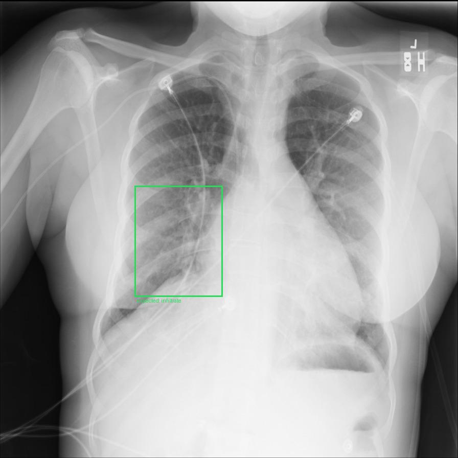

| | Expected | Model |
|---|---|---|
| Finding | infiltrate | none |
| Location | box (green) | - (IoU 0.0) |
| Text | - | Chest X-ray showing a normal heart size and clear lung fields. Impression: The patient was diagnosed with a left-sided diaphragmatic hernia at the patient and was asymptomatic. The patient was diagnosed with a left-sided diaphragmatic hernia at the patient and was asymptomatic. Suggested next steps (most to least suitable): 1. Immediate stabilisation: The patient [history not provided]. 2. Immediate stabilisation: The patient was intubated and mechanically ventilated. 3. Immediate... |

## nih_cxr14 / 00029596_018.png (x_ray)

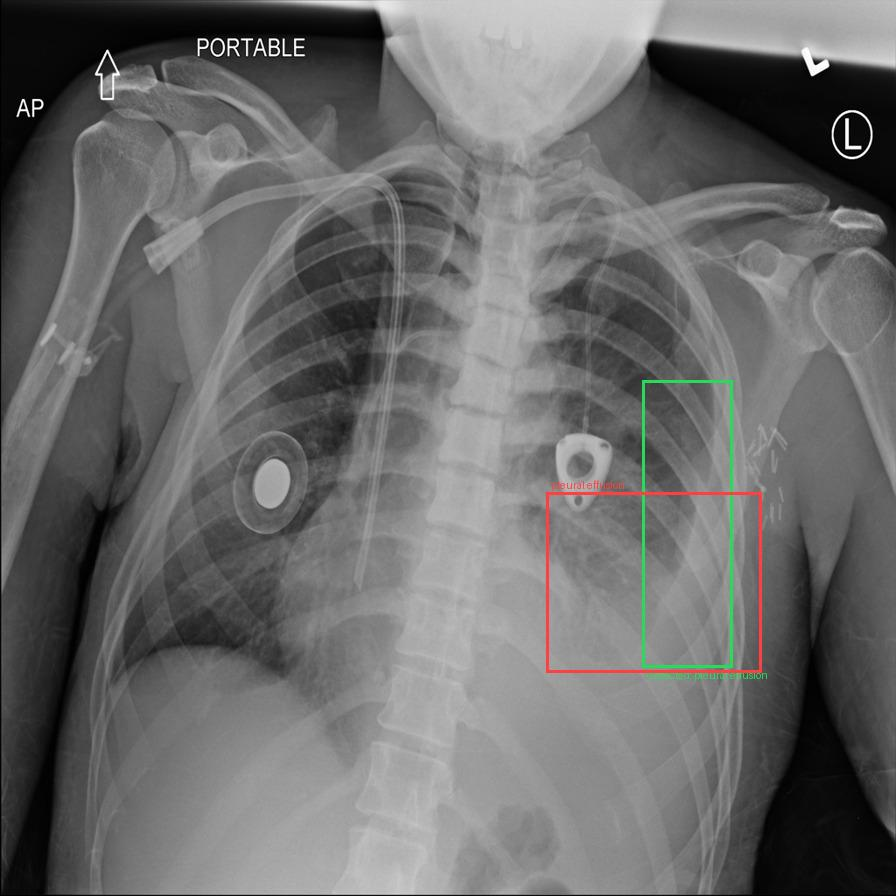

| | Expected | Model |
|---|---|---|
| Finding | pleural effusion | pleural effusion |
| Location | box (green) | middle third, image-right (on a standard frontal chest radiograph or axial CT this is usually the patient's left); box covers about 5% of the image (IoU 0.32187706543291494) |
| Text | - | Chest X-ray showing a left pleural effusion. Impression: The patient was diagnosed with a left pleural effusion and [history not provided]. The patient was diagnosed with a left pleural effusion and [history not provided]. Suggested next steps (most to least suitable): 1. Immediate stabilisation: The patient [history not provided]. 2. Immediate stabilisation: The patient was given oxygen therapy and was discharged. 3. Investigate: A chest X-ray was performed, and a left pleural effusion was... |

## nih_cxr14 / 00000193_019.png (x_ray)

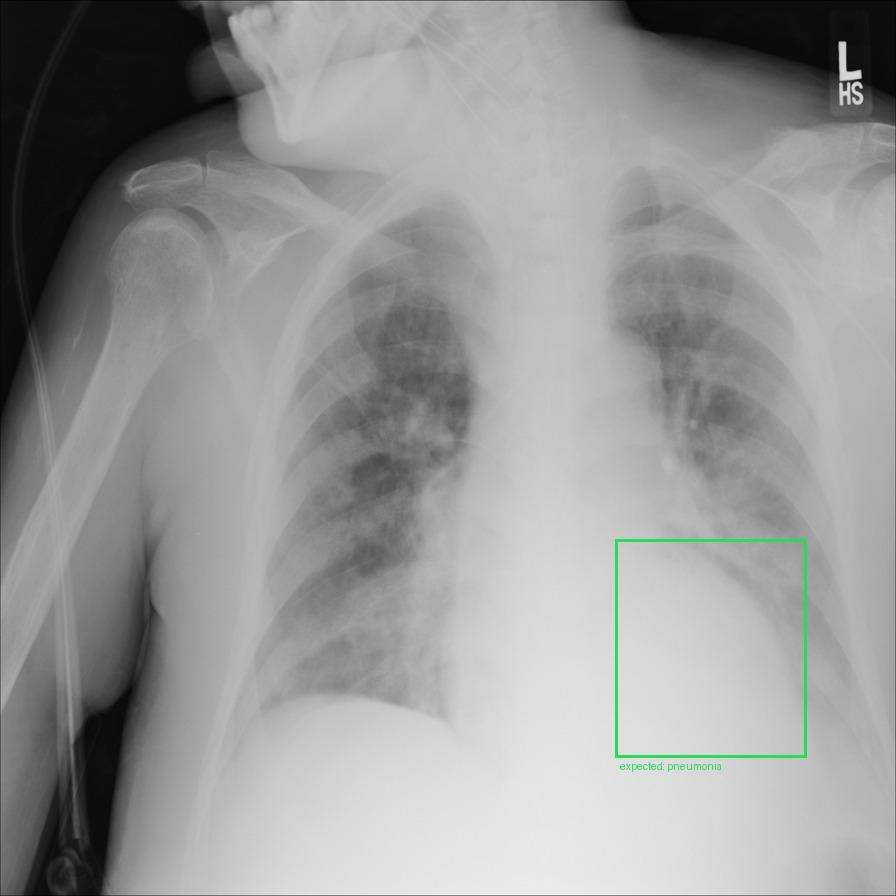

| | Expected | Model |
|---|---|---|
| Finding | pneumonia | none |
| Location | box (green) | - (IoU 0.0) |
| Text | - | Chest X-ray showing cardiomegaly and pulmonary edema. Impression: The patient was diagnosed with a left-sided pleural effusion and [history not provided]. The patient was diagnosed with a left-sided pleural effusion and [history not provided]. Suggested next steps (most to least suitable): 1. Immediate stabilisation: The patient [history not provided]. 2. Immediate stabilisation: The patient was given oxygen therapy and [history not provided]. 3. Immediate stabilisation: The patient was given... |

## nih_cxr14 / 00027357_014.png (x_ray)

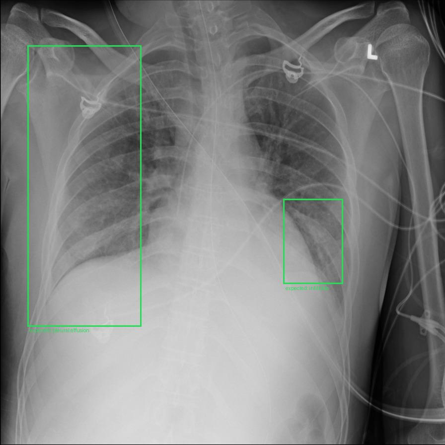

| | Expected | Model |
|---|---|---|
| Finding | infiltrate, pleural effusion | none |
| Location | box (green) | - (IoU 0.0) |
| Text | - | Chest X-ray showing bilateral pulmonary edema. Impression: The patient was diagnosed with a left-sided diaphragmatic hernia and was referred to hospital for further management. A chest X-ray revealed bilateral pulmonary edema (Figure 1). Suggested next steps (most to least suitable): 1. Immediate stabilisation: The patient was intubated and mechanically ventilated. 2. Immediate stabilisation: The patient was started on intravenous (IV) fluids and diuretics. 3. Immediate stabilisation: The... |

## nih_cxr14 / 00020564_000.png (x_ray)

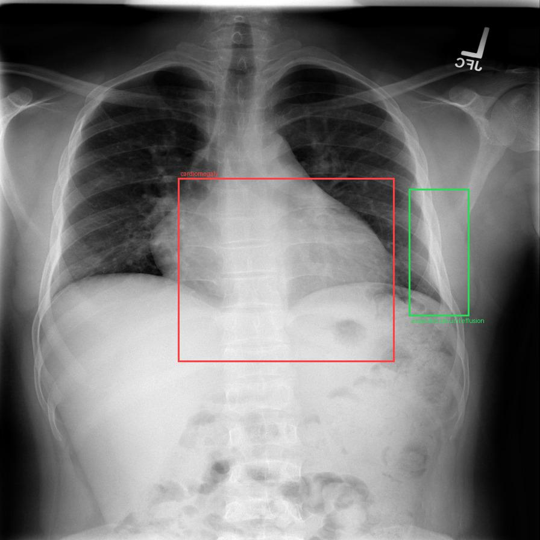

| | Expected | Model |
|---|---|---|
| Finding | pleural effusion | cardiomegaly |
| Location | box (green) | middle third, centre; box covers about 14% of the image (IoU 0.0) |
| Text | - | Chest X-ray showing cardiomegaly. Impression: The patient was diagnosed with a left ventricular outflow tract obstruction (LVOTO) and was referred to hospital for further evaluation and management. The patient was diagnosed with a left ventricular outflow tract obstruction (LVOTO) and was referred to hospital for further evaluation and management. Suggested next steps (most to least suitable): 1. Immediate stabilisation: The patient was intubated and mechanically ventilated. 2. Immediate... |

## nih_cxr14 / 00012288_000.png (x_ray)

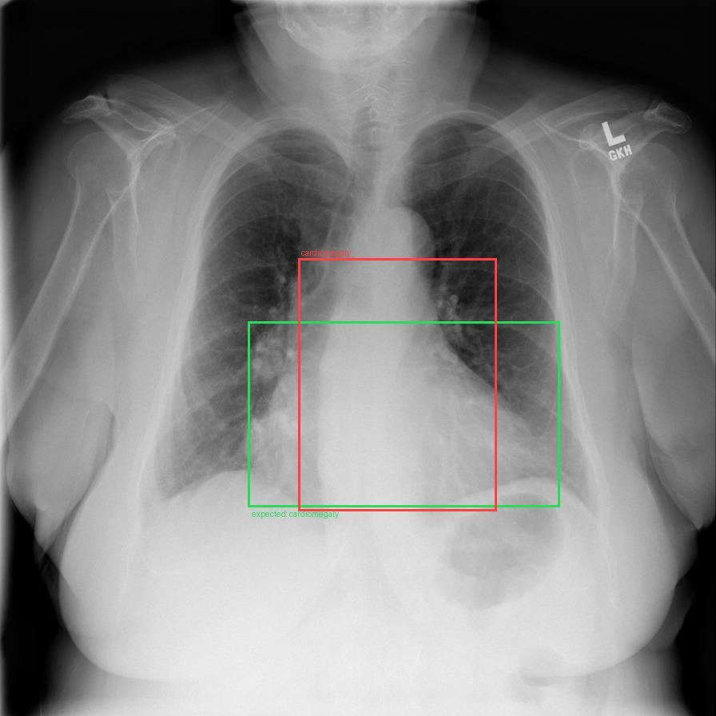

| | Expected | Model |
|---|---|---|
| Finding | cardiomegaly | cardiomegaly |
| Location | box (green) | middle third, centre; box covers about 10% of the image (IoU 0.5187017464957652) |
| Text | - | Chest X-ray showing cardiomegaly. Impression: The patient was diagnosed with a left breast carcinoma and underwent a modified radical mastectomy. The patient was diagnosed with a left breast carcinoma and underwent a modified radical mastectomy. Suggested next steps (most to least suitable): 1. Investigate: A chest X-ray was performed and showed cardiomegaly (Figure 1). 2. Investigate: A transthoracic echocardiogram was performed and showed a dilated left ventricle with a left ventricular... |

## nih_cxr14 / 00014022_054.png (x_ray)

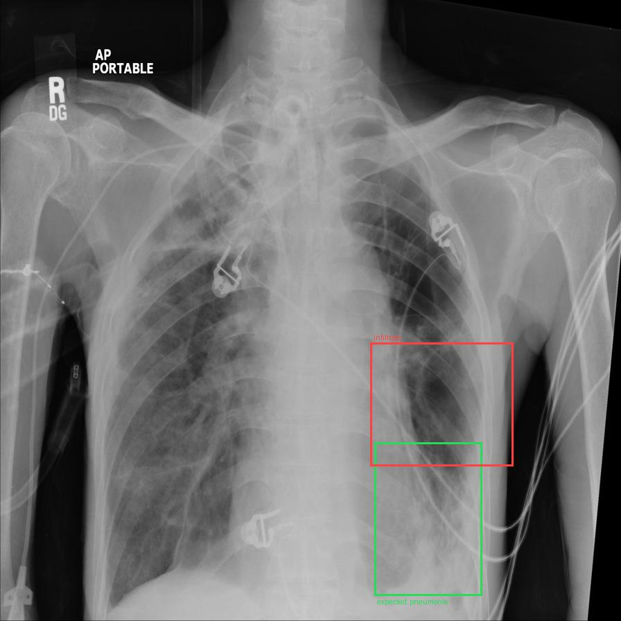

| | Expected | Model |
|---|---|---|
| Finding | pneumonia | infiltrate |
| Location | box (green) | middle third, image-right (on a standard frontal chest radiograph or axial CT this is usually the patient's left); box covers about 5% of the image (IoU 0.08023141017563723) |
| Text | - | Chest X-ray showing bilateral infiltrates. Impression: The patient with a [history not provided]. A chest X-ray revealed bilateral infiltrates (Figure 1). Suggested next steps (most to least suitable): 1. Immediate stabilisation: The patient was intubated and mechanically ventilated. 2. Immediate stabilisation: The patient was started on intravenous (IV) antibiotics (ceftriaxone and azithromycin) and IV fluids. 3. Immediate stabilisation: The patient was started on IV antibiotics (ceftriaxone... |

## nih_cxr14 / 00020857_008.png (x_ray)

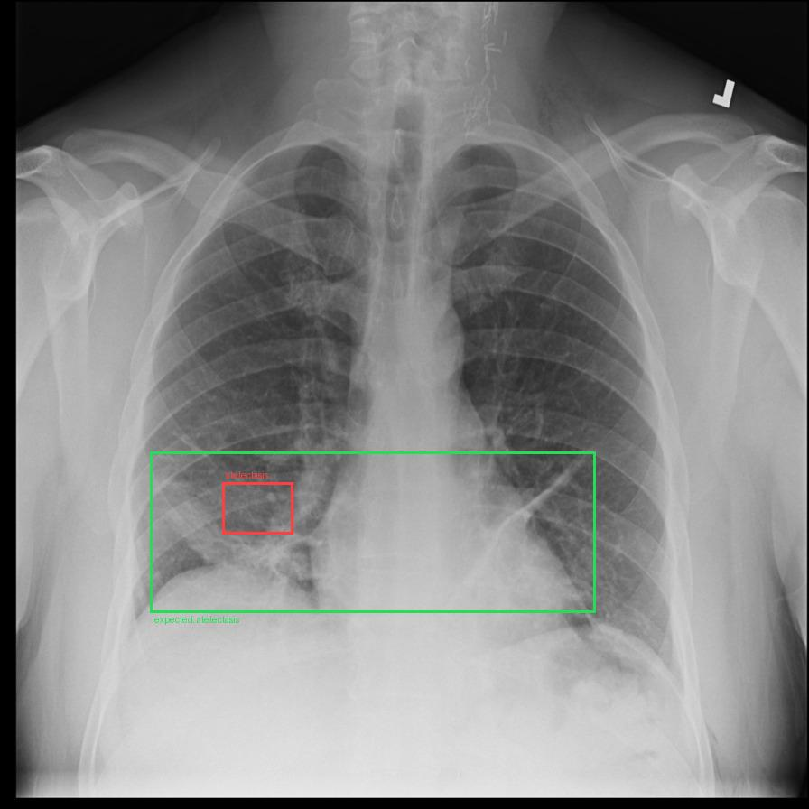

| | Expected | Model |
|---|---|---|
| Finding | atelectasis | atelectasis |
| Location | box (green) | middle third, image-left (on a standard frontal chest radiograph or axial CT this is usually the patient's right); box covers about 1% of the image (IoU 0.05233484931145625) |
| Text | - | Chest X-ray showing bilateral lower lobe infiltrates. Impression: The patient with a [history not provided]. A chest X-ray revealed bilateral lower lobe infiltrates (Fig. Suggested next steps (most to least suitable): 1. Immediate stabilisation: The patient was started on intravenous amphotericin B and [history not provided]. 2. Immediate stabilisation: The patient was started on intravenous vancomycin and piperacillin-tazobactam and [history not provided]. 3. Immediate stabilisation: The... |

## nih_cxr14 / 00019271_030.png (x_ray)

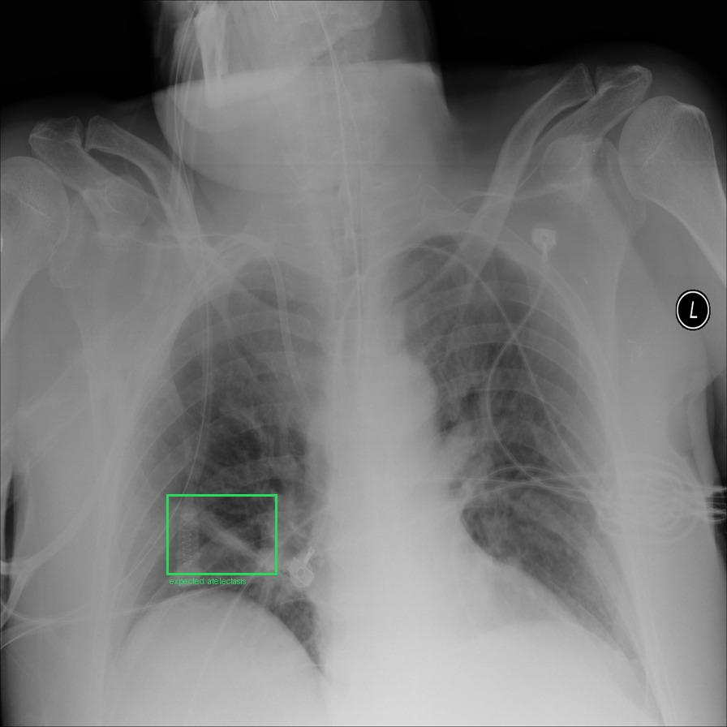

| | Expected | Model |
|---|---|---|
| Finding | atelectasis | none |
| Location | box (green) | - (IoU 0.0) |
| Text | - | Chest X-ray showing bilateral pulmonary edema. Impression: The patient was diagnosed with a left-sided cerebellar infarct and [history not provided]. Suggested next steps (most to least suitable): 1. Immediate stabilisation: The patient was intubated and mechanically ventilated. 2. Immediate stabilisation: The patient was started on a low-dose continuous infusion of fentanyl and midazolam. 3. Immediate stabilisation: The patient was started on a low-dose continuous infusion of fentanyl and... |

## nih_cxr14 / 00029532_005.png (x_ray)

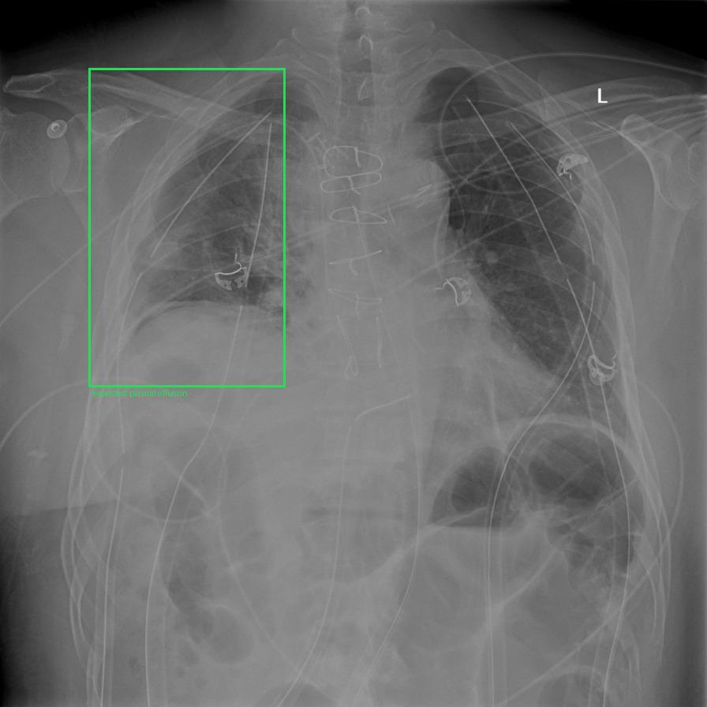

| | Expected | Model |
|---|---|---|
| Finding | pleural effusion | none |
| Location | box (green) | - (IoU 0.0) |
| Text | - | Chest X-ray showing a right pneumothorax. Impression: The patient was diagnosed with a left-sided pneumothorax and [history not provided]. A chest X-ray revealed a right pneumothorax (Figure 1). Suggested next steps (most to least suitable): 1. Immediate stabilisation: The patient was intubated and mechanically ventilated. 2. Immediate stabilisation: The patient was transferred to the ICU for further management. 3. Immediate stabilisation: The patient was intubated and mechanically ventilated.... |

## nih_cxr14 / 00018253_017.png (x_ray)

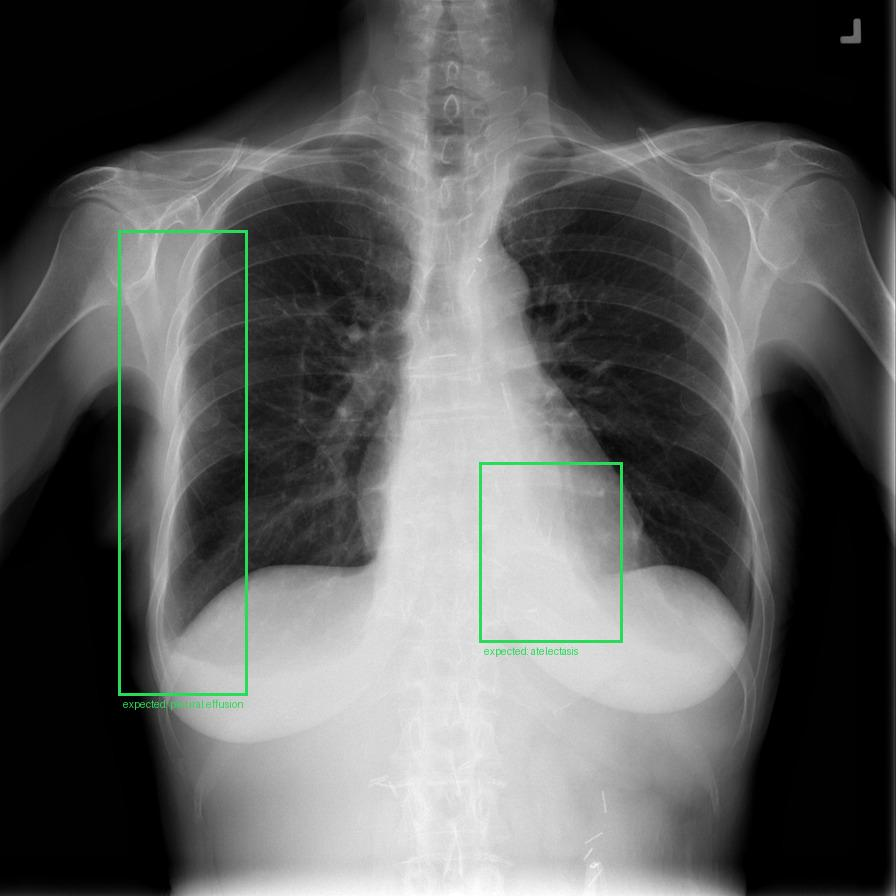

| | Expected | Model |
|---|---|---|
| Finding | atelectasis, pleural effusion | none |
| Location | box (green) | - (IoU 0.0) |
| Text | - | Chest X-ray showing a left-sided pleural effusion. Impression: The patient was diagnosed with a left-sided pleural effusion and was referred to hospital for further evaluation. A chest X-ray revealed a left-sided pleural effusion (Figure 1). Suggested next steps (most to least suitable): 1. Immediate stabilisation: The pleural fluid was exudative and contained a high level of adenosine deaminase (ADA) and a low level of glucose. 2. Investigate: A CT scan of the chest was performed to determine... |

## nih_cxr14 / 00020113_030.png (x_ray)

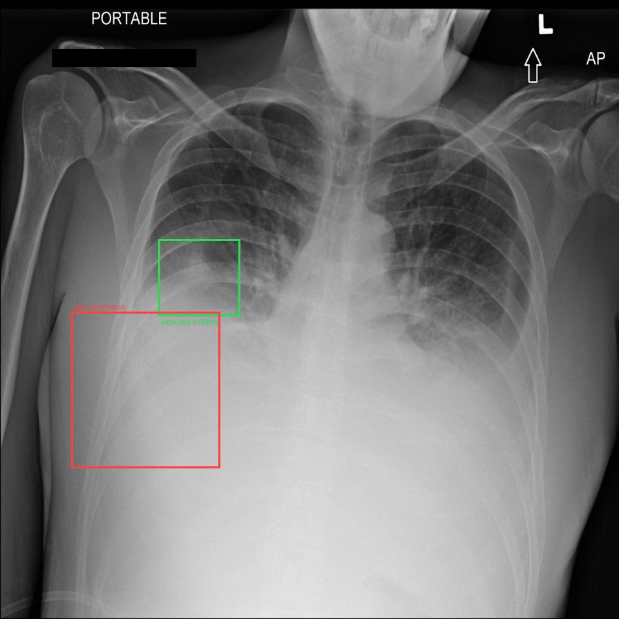

| | Expected | Model |
|---|---|---|
| Finding | infiltrate | pleural effusion |
| Location | box (green) | middle third, image-left (on a standard frontal chest radiograph or axial CT this is usually the patient's right); box covers about 6% of the image (IoU 0.009282735321574156) |
| Text | - | Chest X-ray showing bilateral pleural effusions. Impression: The patient was diagnosed with a left-sided pleural effusion and [history not provided]. A chest X-ray revealed bilateral pleural effusions (Figure 1). Suggested next steps (most to least suitable): 1. Immediate stabilisation: The pleural fluid was exudative, and the pleural fluid/serum protein ratio was 2.6. 2. Immediate stabilisation: The pleural fluid was exudative, and the pleural fluid/serum protein ratio was 2.6. 3. Immediate... |

## nih_cxr14 / 00028383_002.png (x_ray)

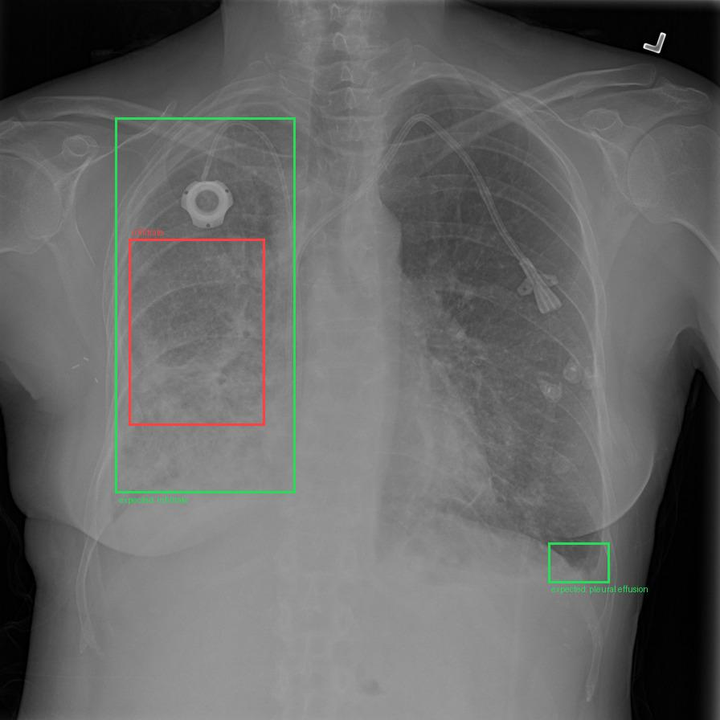

| | Expected | Model |
|---|---|---|
| Finding | infiltrate, pleural effusion | infiltrate |
| Location | box (green) | middle third, image-left (on a standard frontal chest radiograph or axial CT this is usually the patient's right); box covers about 5% of the image (IoU 0.18926323867996933) |
| Text | - | Chest X-ray showing right-sided pleural effusion and right-sided infiltrates. Impression: The patient was diagnosed with a left-sided breast cancer and underwent a left mastectomy with sentinel node biopsy. A chest X-ray revealed right-sided pleural effusion and right-sided infiltrates (Figure 1). Suggested next steps (most to least suitable): 1. Immediate stabilisation: She was started on a low-dose dexamethasone (0.1 mg/kg/day) and was given fluids and antibiotics. 2. Immediate stabilisation:... |

## nih_cxr14 / 00021818_006.png (x_ray)

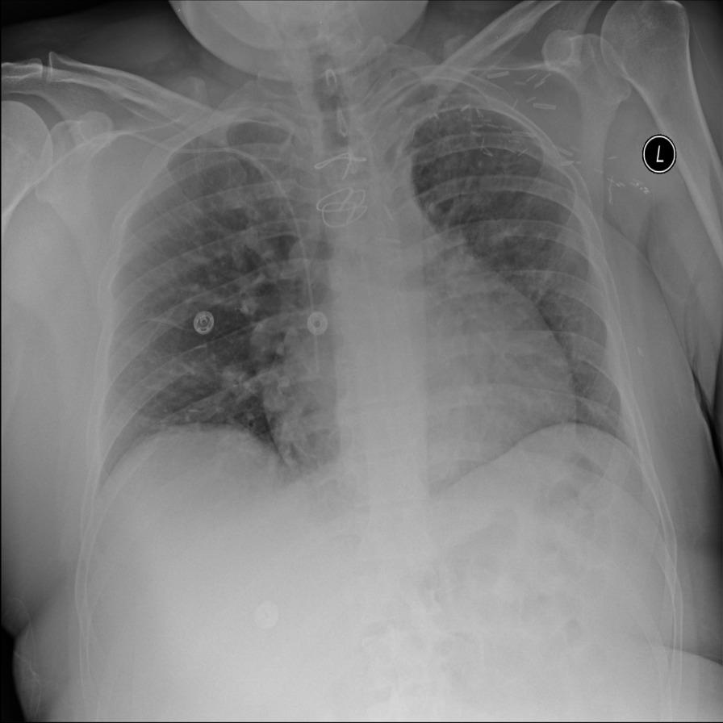

| | Expected | Model |
|---|---|---|
| Finding | no abnormality | none |
| Location | box (green) | - (IoU -) |
| Text | - | Chest X-ray showing cardiomegaly. Impression: The patient was diagnosed with a left ventricular outflow tract obstruction (LVOTO) and was referred to hospital for further evaluation and management. The patient was diagnosed with a left ventricular outflow tract obstruction (LVOTO) and was referred to hospital for further evaluation and management. Suggested next steps (most to least suitable): 1. Immediate stabilisation: The patient was started on a low-dose continuous infusion of fentanyl and... |

## nih_cxr14 / 00016647_000.png (x_ray)

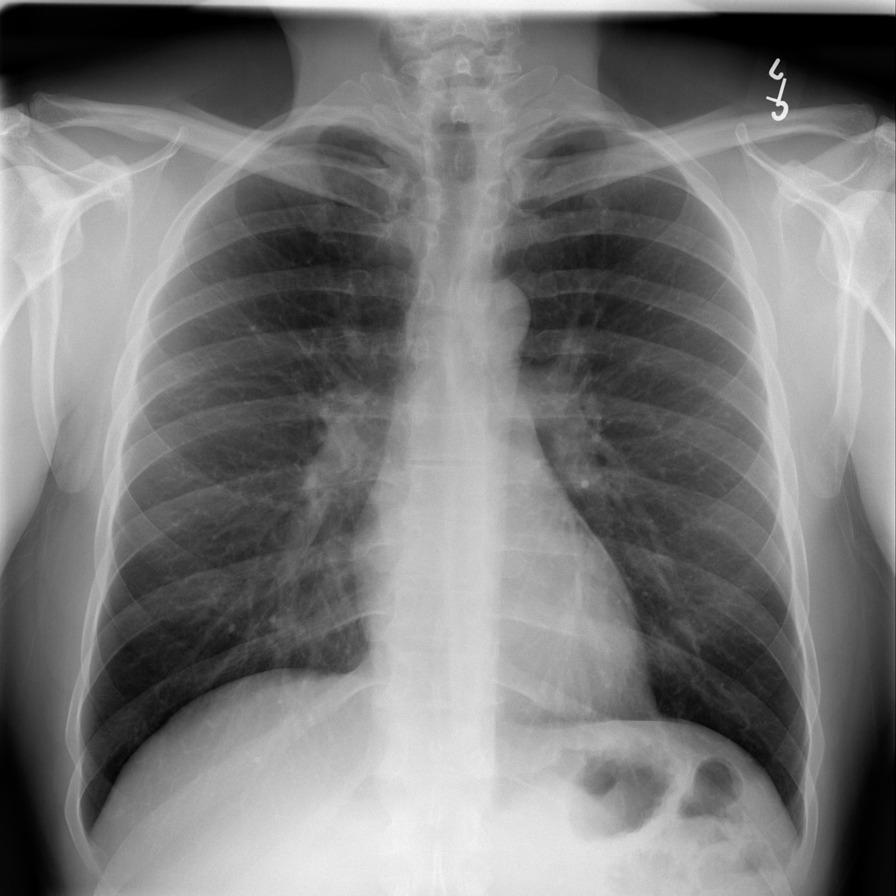

| | Expected | Model |
|---|---|---|
| Finding | no abnormality | none |
| Location | box (green) | - (IoU -) |
| Text | - | Chest X-ray showing normal findings. Impression: The patient was diagnosed with a left-sided pleural effusion and was referred to hospital for further evaluation. A chest X-ray revealed a left-sided pleural effusion (Figure 1). Suggested next steps (most to least suitable): 1. Immediate stabilisation: The pleural fluid was exudative, and the pleural fluid/serum protein ratio was 2.2. 2. Immediate stabilisation: The pleural fluid/serum lactate dehydrogenase ratio was 2.6. 3. Immediate... |

## nih_cxr14 / 00018253_030.png (x_ray)

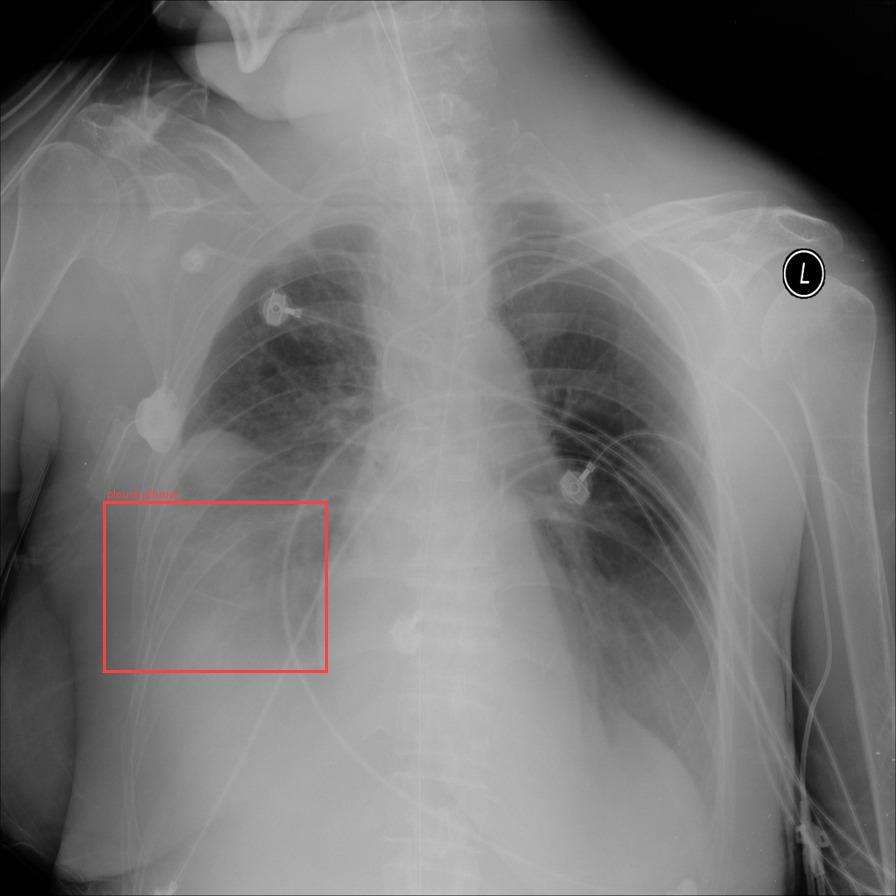

| | Expected | Model |
|---|---|---|
| Finding | no abnormality | pleural effusion |
| Location | box (green) | middle third, image-left (on a standard frontal chest radiograph or axial CT this is usually the patient's right); box covers about 5% of the image (IoU -) |
| Text | - | Chest X-ray showing right-sided pleural effusion. Impression: The patient with a [history not provided]. A chest X-ray revealed a right-sided pleural effusion (Figure 1). Suggested next steps (most to least suitable): 1. Immediate stabilisation: The patient was intubated and mechanically ventilated. 2. Immediate stabilisation: The patient was started on intravenous antibiotics and fluid resuscitation. 3. Immediate stabilisation: The patient was started on intravenous antibiotics and fluid... |

## nih_cxr14 / 00025534_005.png (x_ray)

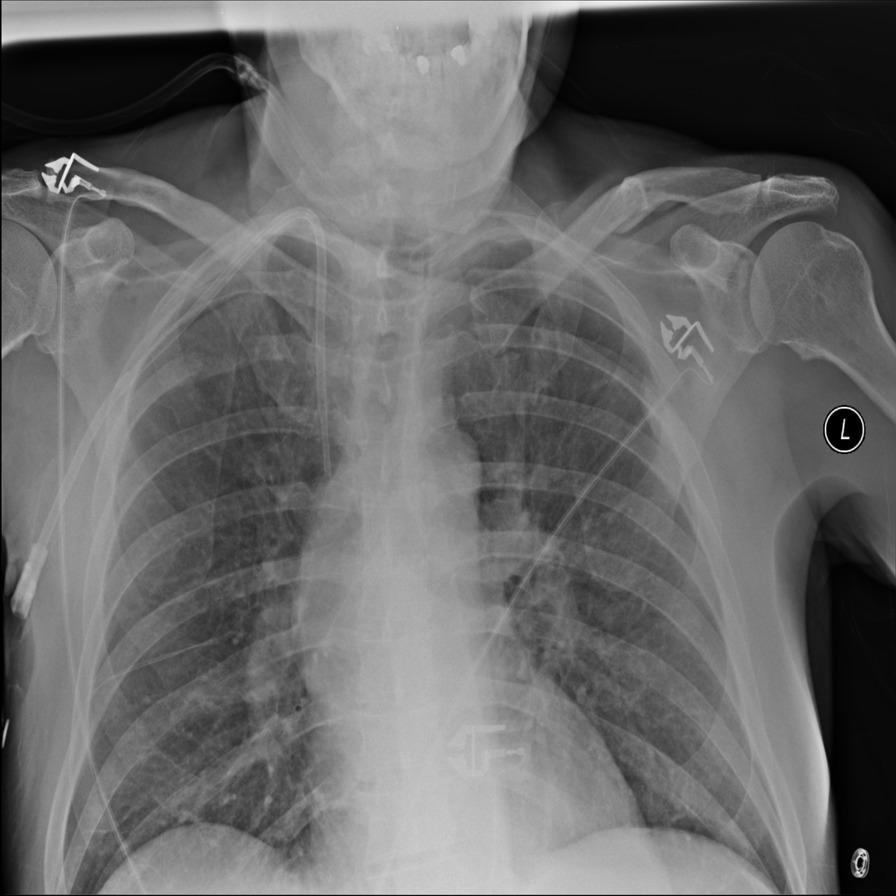

| | Expected | Model |
|---|---|---|
| Finding | no abnormality | none |
| Location | box (green) | - (IoU -) |
| Text | - | Chest X-ray showing no evidence of pulmonary edema. Impression: The patient was diagnosed with a left-sided pleural effusion and [history not provided]. The patient was diagnosed with a left-sided pleural effusion and [history not provided]. Suggested next steps (most to least suitable): 1. Immediate stabilisation: The patient [history not provided]. 2. Immediate stabilisation: The patient [history not provided]. 3. Immediate stabilisation: The patient [history not provided]. 4. Immediate... |

## nih_cxr14 / 00012176_006.png (x_ray)

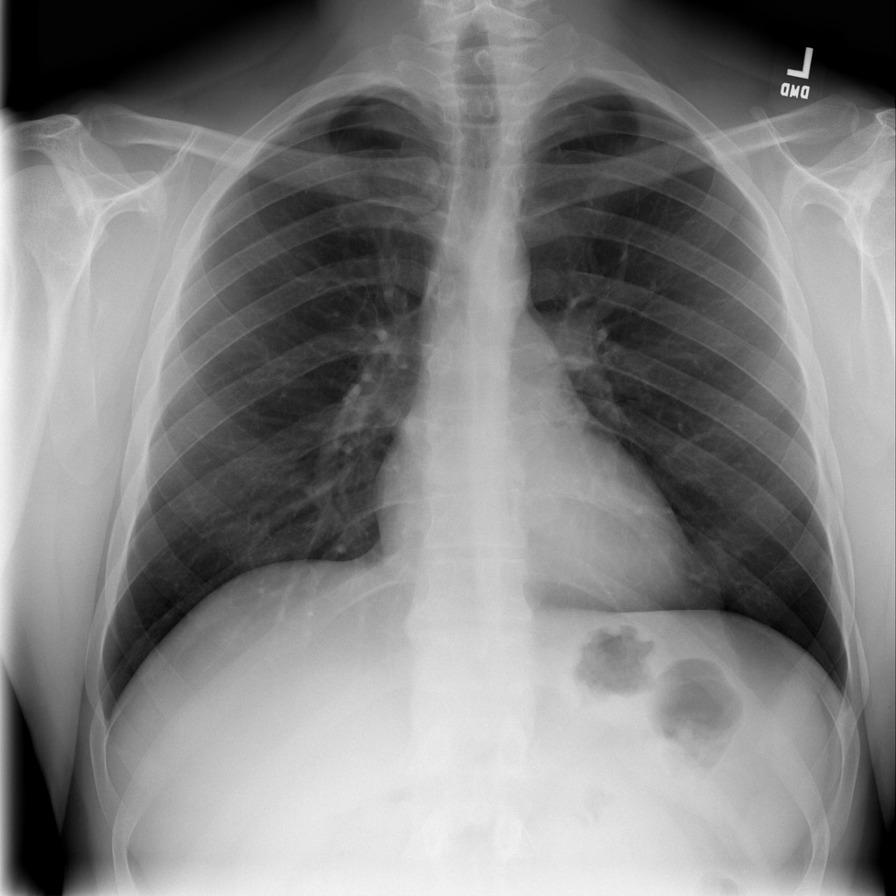

| | Expected | Model |
|---|---|---|
| Finding | no abnormality | none |
| Location | box (green) | - (IoU -) |
| Text | - | Chest X-ray showing normal heart size and clear lung fields. Impression: The patient was diagnosed with a left-sided pleural effusion and was [history not provided]. The patient was diagnosed with a left-sided pleural effusion and was [history not provided]. Suggested next steps (most to least suitable): 1. Immediate stabilisation: The patient [history not provided]. 2. Immediate stabilisation: The patient was started on a low-molecular-weight heparin (LMWH) infusion. 3. Investigate: A chest... |

## slake / xmlab371 (x_ray)

| | Expected | Model |
|---|---|---|
| Finding | mass | none |
| Location | box (green) | - (IoU 0.0) |
| Text | - | Chest X-ray showing a right lower lobe opacity. Impression: The patient was diagnosed with a right lower lobe pneumonia. Suggested next steps (most to least suitable): 1. Immediate stabilisation: The patient was started on a 10-day course of azithromycin and was discharged on oral antibiotics. 2. Investigate: A chest X-ray was obtained, which showed a right lower lobe opacity (Figure 1). 3. Investigate: A chest X-ray was obtained, which showed a right lower lobe opacity (Figure 2). 4.... |

## slake / xmlab65 (mri)

| | Expected | Model |
|---|---|---|
| Finding | brain edema, brain enhancing tumor, brain non-enhancing tumor | none |
| Location | box (green) | - (IoU 0.0) |
| Text | - | Brain MRI of the patient. (A) T2WI showed bilateral periventricular white matter hyperintensity. Impression: The patient [history not provided]. The patient was diagnosed with a diagnosis of "cerebellar infarction." Suggested next steps (most to least suitable): 1. Investigate: The patient's blood tests were normal, and the electrocardiogram was normal. 2. Investigate: The patient's blood tests were normal, and the electrocardiogram was normal. 3. Investigate: The patient's blood tests were... |

## slake / xmlab70 (mri)

| | Expected | Model |
|---|---|---|
| Finding | brain edema, brain enhancing tumor, brain non-enhancing tumor | tumor |
| Location | box (green) | middle third, centre; box covers about 4% of the image (IoU 0.15134714587857942) |
| Text | - | MRI of the brain. (A) T1-weighted image shows a large mass in the right frontal lobe with a heterogeneous signal. Impression: The patient was diagnosed with a right frontal lobe tumor and underwent a right frontotemporal craniotomy for tumor resection. The pathology report revealed a 4.5 x 3.5 x 3.0 cm tumor with a predominantly epithelioid component and a small amount of clear cell component. Suggested next steps (most to least suitable): 1. Investigate: A brain MRI was performed, which showed... |

## slake / xmlab333 (x_ray)

| | Expected | Model |
|---|---|---|
| Finding | effusion, mass | mass |
| Location | box (green) | middle third, image-left (on a standard frontal chest radiograph or axial CT this is usually the patient's right); box covers about 1% of the image (IoU 0.14179065575434668) |
| Text | - | Chest X-ray showing a right upper lobe mass and a left lower lobe mass. Impression: The patient was diagnosed with a right upper lobe mass and a left lower lobe mass on a chest X-ray (Figure 1). The patient was diagnosed with a right upper lobe mass and a left lower lobe mass on a chest X-ray (Figure 1). Suggested next steps (most to least suitable): 1. Investigate: A biopsy of the right upper lobe mass was performed. 2. Investigate: A biopsy of the left lower lobe mass was performed. 3.... |

## slake / xmlab60 (mri)

| | Expected | Model |
|---|---|---|
| Finding | brain edema, brain enhancing tumor, brain non-enhancing tumor | hemorrhage |
| Location | box (green) | middle third, centre; box covers about 0% of the image (IoU 0.03393755651685335) |
| Text | - | MRI of the brain. (A) T2-weighted image showing a hyperintense lesion in the right occipital lobe. Impression: The patient was diagnosed with a right occipital lobe lesion on MRI (Figure 1A). The patient was diagnosed with a right occipital lobe lesion on MRI (Figure 1A). Suggested next steps (most to least suitable): 1. Investigate: The patient was diagnosed with a right occipital lobe lesion on MRI (Figure 1A). 2. Investigate: The patient was diagnosed with a right occipital lobe lesion on... |

## slake / xmlab322 (x_ray)

| | Expected | Model |
|---|---|---|
| Finding | effusion | none |
| Location | box (green) | - (IoU 0.0) |
| Text | - | Chest X-ray showing right-sided pleural effusion. Impression: The patient was diagnosed with a left-sided pleural effusion and was started on a course of antibiotics. Suggested next steps (most to least suitable): 1. Immediate stabilisation: The patient was started on a course of antibiotics and was discharged on the same day. 2. Immediate stabilisation: The patient was started on a course of antibiotics and was discharged on the same day. 3. Immediate stabilisation: The patient was started on... |

## slake / xmlab66 (mri)

| | Expected | Model |
|---|---|---|
| Finding | brain edema | hyperintensity |
| Location | box (green) | middle third, centre; box covers about 0% of the image (IoU 0.0) |
| Text | - | MRI of the brain. (A) T2-weighted image showing hyperintense lesions in the right frontal lobe. Impression: The patient was diagnosed with a left frontal lobe tumor and underwent a right frontal lobectomy. The patient was diagnosed with a left frontal lobe tumor and underwent a right frontal lobectomy. Suggested next steps (most to least suitable): 1. Investigate: A brain MRI was performed, which showed a hyperintense lesion in the right frontal lobe (Figure 1A). 2. Investigate: A brain MRI was... |

## slake / xmlab360 (x_ray)

| | Expected | Model |
|---|---|---|
| Finding | pneumonia | none |
| Location | box (green) | - (IoU 0.0) |
| Text | - | Chest X-ray showing bilateral diffuse alveolar infiltrates. Impression: The patient with a [history not provided]. Physical examination revealed a temperature [value]C, a pulse rate [value], a blood pressure [value], and a respiratory rate [value]cycles/min. Suggested next steps (most to least suitable): 1. Immediate stabilisation: The patient was intubated and mechanically ventilated. 2. Immediate stabilisation: The patient was started on intravenous (IV) antibiotics and received a blood... |

## slake / xmlab370 (x_ray)

| | Expected | Model |
|---|---|---|
| Finding | pneumothorax | pleural effusion |
| Location | box (green) | middle third, image-left (on a standard frontal chest radiograph or axial CT this is usually the patient's right); box covers about 12% of the image (IoU 0.24303040448001947) |
| Text | - | Chest X-ray showing right-sided pleural effusion and loculated right-sided pleural effusion. Impression: The patient was diagnosed with a left-sided pleural effusion and was started on a course of antibiotics. A repeat chest X-ray revealed a right-sided pleural effusion and loculated right-sided pleural effusion (Figure 1). Suggested next steps (most to least suitable): 1. Immediate stabilisation: The patient was started on a course of antibiotics and was discharged on a course of oral... |

## slake / xmlab96 (ct)

| | Expected | Model |
|---|---|---|
| Finding | lung cancer | nodule |
| Location | box (green) | middle third, centre; box covers about 0% of the image (IoU 0.0) |
| Text | - | Chest CT scan showing multiple cavitary lesions in the right upper lobe. Impression: The patient was diagnosed with pulmonary tuberculosis and was treated with a standard four-drug regimen (isoniazid, rifampicin, pyrazinamide, and ethambutol) for 2 months. The patient was diagnosed with pulmonary tuberculosis and was treated with a standard four-drug regimen (isoniazid, rifampicin, pyrazinamide, and ethambutol) for 2 months. Suggested next steps (most to least suitable): 1. Immediate... |

## slake / xmlab334 (x_ray)

| | Expected | Model |
|---|---|---|
| Finding | effusion, pneumothorax | pleural effusion |
| Location | box (green) | middle third, image-right (on a standard frontal chest radiograph or axial CT this is usually the patient's left); box covers about 9% of the image (IoU 0.1328965960427978) |
| Text | - | Chest X-ray showing left-sided pleural effusion. Impression: The patient was diagnosed with a left-sided pleural effusion and was referred to hospital. The patient was diagnosed with a left-sided pleural effusion and was referred to hospital. Suggested next steps (most to least suitable): 1. Immediate stabilisation: The patient was referred to hospital for further evaluation and management. 2. Immediate stabilisation: The patient was referred to hospital for further evaluation and management.... |

## slake / xmlab332 (x_ray)

| | Expected | Model |
|---|---|---|
| Finding | nodule | none |
| Location | box (green) | - (IoU 0.0) |
| Text | - | Chest X-ray showing a normal heart size and clear lung fields. Impression: The patient was diagnosed with a left-sided pleural effusion and was [history not provided]. A chest X-ray revealed a left-sided pleural effusion and a normal heart size (Figure 1). Suggested next steps (most to least suitable): 1. Immediate stabilisation: The patient [history not provided]. 2. Immediate stabilisation: The patient was started on a low-molecular-weight heparin (LMWH) infusion and [history not provided].... |

## slake / xmlab377 (x_ray)

| | Expected | Model |
|---|---|---|
| Finding | nodule | nodule |
| Location | box (green) | middle third, image-right (on a standard frontal chest radiograph or axial CT this is usually the patient's left); box covers about 1% of the image (IoU 0.06850137983480717) |
| Text | - | Chest X-ray showing a left upper lobe mass. Impression: The patient was diagnosed with a left upper lobe lung mass and was referred to hospital for further evaluation and treatment. A chest X-ray revealed a left upper lobe mass (Fig. Suggested next steps (most to least suitable): 1. Investigate: A biopsy was performed, and the pathology report showed a poorly differentiated adenocarcinoma. 2. Investigate: A chest X-ray was obtained, which showed a left upper lobe mass (Fig. 3. Investigate: A... |

## slake / xmlab324 (x_ray)

| | Expected | Model |
|---|---|---|
| Finding | mass | pleural effusion |
| Location | box (green) | lower third, image-right (on a standard frontal chest radiograph or axial CT this is usually the patient's left); box covers about 2% of the image (IoU 0.0) |
| Text | - | Chest X-ray showing a left pleural effusion and a right pneumothorax. Impression: The patient was diagnosed with a left pleural effusion and a right pneumothorax (Figure 1). Suggested next steps (most to least suitable): 1. Immediate stabilisation: The patient was intubated and mechanically ventilated. 2. Immediate stabilisation: The patient was transferred to the intensive care unit and was intubated and mechanically ventilated. 3. Immediate stabilisation: The patient was transferred to the... |

## slake / xmlab641 (ct)

| | Expected | Model |
|---|---|---|
| Finding | colon, small bowel | none |
| Location | box (green) | - (IoU -) |
| Text | - | CT scan of the abdomen and pelvis showing a 1.5 cm right lower quadrant mesenteric lymph node. Impression: The patient was diagnosed with a right lower quadrant mesenteric lymph node measuring 1.5 cm (Figure 1). Suggested next steps (most to least suitable): 1. Investigate: A CT scan of the abdomen and pelvis was performed, which showed a 1.5 cm right lower quadrant mesenteric lymph node (Figure 1). 2. Definitive treatment: the patient with a [history not provided]. 3. Definitive treatment: The... |

## slake / xmlab331 (x_ray)

| | Expected | Model |
|---|---|---|
| Finding | atelectasis | none |
| Location | box (green) | - (IoU 0.0) |
| Text | - | Chest X-ray showing cardiomegaly and bilateral pulmonary edema. Impression: The patient was diagnosed with a left-sided pleural effusion and [history not provided]. A chest X-ray revealed cardiomegaly and bilateral pulmonary edema (Figure 1). Suggested next steps (most to least suitable): 1. Immediate stabilisation: The patient was intubated and mechanically ventilated. 2. Immediate stabilisation: The patient was treated with intravenous diuretics, inotropes, and antibiotics. 3. Immediate... |

## slake / xmlab362 (x_ray)

| | Expected | Model |
|---|---|---|
| Finding | pneumonia | infiltrate |
| Location | box (green) | middle third, image-right (on a standard frontal chest radiograph or axial CT this is usually the patient's left); box covers about 5% of the image (IoU 0.5444989712139244) |
| Text | - | Chest X-ray showing left lower lobe consolidation. Impression: The patient with a [history not provided]. A chest X-ray revealed left lower lobe consolidation (Fig. Suggested next steps (most to least suitable): 1. Immediate stabilisation: The patient was intubated and mechanically ventilated. 2. Immediate stabilisation: The patient was treated with intravenous antibiotics and fluid resuscitation. 3. Immediate stabilisation: The patient's condition improved, and the ventilator was weaned. 4.... |

## slake / xmlab374 (x_ray)

| | Expected | Model |
|---|---|---|
| Finding | pneumonia | none |
| Location | box (green) | - (IoU 0.0) |
| Text | - | Chest X-ray showing right upper lobe consolidation. Impression: The patient was diagnosed with a right upper lobe pneumonia. Suggested next steps (most to least suitable): 1. Immediate stabilisation: The patient was started on intravenous antibiotics and was discharged home on oral antibiotics. 2. Investigate: A chest X-ray was obtained and showed right upper lobe consolidation (Figure 1). 3. Investigate: A chest X-ray was obtained and showed a right upper lobe consolidation (Figure 2). 4.... |

## slake / xmlab335 (x_ray)

| | Expected | Model |
|---|---|---|
| Finding | cardiomegaly | atelectasis |
| Location | box (green) | middle third, image-right (on a standard frontal chest radiograph or axial CT this is usually the patient's left); box covers about 1% of the image (IoU 0.055369871135783885) |
| Text | - | Chest X-ray showing cardiomegaly and left pleural effusion. Impression: The patient was diagnosed with a left pleural effusion and a left lower lobe pneumonia. The patient was diagnosed with a left pleural effusion and a left lower lobe pneumonia. Suggested next steps (most to least suitable): 1. Immediate stabilisation: The patient [history not provided]. 2. Immediate stabilisation: The patient was intubated and mechanically ventilated. 3. Immediate stabilisation: The patient was intubated and... |

## slake / xmlab73 (mri)

| | Expected | Model |
|---|---|---|
| Finding | brain edema, brain enhancing tumor, brain non-enhancing tumor | lesion |
| Location | box (green) | middle third, centre; box covers about 2% of the image (IoU 0.46891806840826084) |
| Text | - | MRI of the brain. (A) T1-weighted image with contrast shows a large, lobulated, and heterogeneous mass in the left frontal lobe. Impression: The patient was diagnosed with a left frontal lobe lesion on MRI (Figure 1A). The patient was diagnosed with a left frontal lobe lesion on MRI (Figure 1A). Suggested next steps (most to least suitable): 1. Investigate: A biopsy was performed, and the pathology report showed a high-grade glioma. 2. Definitive treatment: The patient was started on a... |

## slake / xmlab63 (mri)

| | Expected | Model |
|---|---|---|
| Finding | brain edema, brain enhancing tumor, brain non-enhancing tumor | tumor |
| Location | box (green) | middle third, centre; box covers about 2% of the image (IoU 0.1777577769025723) |
| Text | - | MRI of the brain. (A) T1-weighted image showing a large mass in the left frontal lobe. Impression: The patient was diagnosed with a left frontal lobe tumor and underwent a left frontotemporal craniotomy for resection. Histopathological examination revealed a malignant neoplasm composed of cells with large nuclei, prominent nucleoli, and abundant cytoplasm, consistent with a malignant neoplasm (Figure 2). Suggested next steps (most to least suitable): 1. Investigate: A brain MRI performed at the... |

## slake / xmlab323 (x_ray)

| | Expected | Model |
|---|---|---|
| Finding | pneumonia | pleural effusion |
| Location | box (green) | middle third, image-right (on a standard frontal chest radiograph or axial CT this is usually the patient's left); box covers about 4% of the image (IoU 0.14928298939614407) |
| Text | - | Chest X-ray showing left pleural effusion. Impression: The patient was diagnosed with a left pleural effusion and [history not provided]. The patient was diagnosed with a left pleural effusion and [history not provided]. Suggested next steps (most to least suitable): 1. Immediate stabilisation: The patient [history not provided]. 2. Immediate stabilisation: The patient [history not provided]. 3. Investigate: A chest X-ray was performed, and a left pleural effusion was observed (Figure 1). 4.... |

## slake / xmlab364 (x_ray)

| | Expected | Model |
|---|---|---|
| Finding | pneumonia | atelectasis |
| Location | box (green) | middle third, image-right (on a standard frontal chest radiograph or axial CT this is usually the patient's left); box covers about 2% of the image (IoU 0.18382392070187645) |
| Text | - | Chest X-ray showing left upper lobe collapse. Impression: The patient was diagnosed with a left upper lobe collapse and was referred to hospital for further evaluation and treatment. A chest X-ray revealed a left upper lobe collapse (Figure 1). Suggested next steps (most to least suitable): 1. Immediate stabilisation: The patient was treated with a 10-day course of oral antibiotics and was discharged. 2. Investigate: A chest CT scan was performed to determine the cause of the left upper lobe... |

## slake / xmlab76 (mri)

| | Expected | Model |
|---|---|---|
| Finding | brain edema, brain non-enhancing tumor | abscess |
| Location | box (green) | middle third, centre; box covers about 0% of the image (IoU 0.0) |
| Text | - | MRI of the brain. (A) T2-weighted image shows a hyperintense lesion in the left frontal lobe. Impression: The patient was diagnosed with a left frontal lobe lesion on brain MRI (Figure 1A). The patient was diagnosed with a left frontal lobe lesion on brain MRI (Figure 1A). Suggested next steps (most to least suitable): 1. Investigate: The patient was diagnosed with a left frontal lobe lesion on brain MRI (Figure 1A). 2. Investigate: The patient was diagnosed with a left frontal lobe lesion on... |

## slake / xmlab640 (ct)

| | Expected | Model |
|---|---|---|
| Finding | colon, small bowel, spinal cord | none |
| Location | box (green) | - (IoU -) |
| Text | - | CT scan of the abdomen and pelvis showing a 1.5 cm left adrenal mass. Impression: The patient was diagnosed with a left adrenal mass on CT scan (Fig. The patient was diagnosed with a left adrenal mass on CT scan (Fig. Suggested next steps (most to least suitable): 1. Investigate: A CT scan of the abdomen and pelvis was performed and showed a 1.5 cm left adrenal mass (Fig. 2. Investigate: A CT scan of the abdomen and pelvis was performed and showed a 1.5 cm left adrenal mass (Fig. 3.... |

