# Open-i chest X-ray reports - for clinician review

Lexical / rule-based scores are proxies only.

## Open-i 778 (abnormal: calcified granuloma)

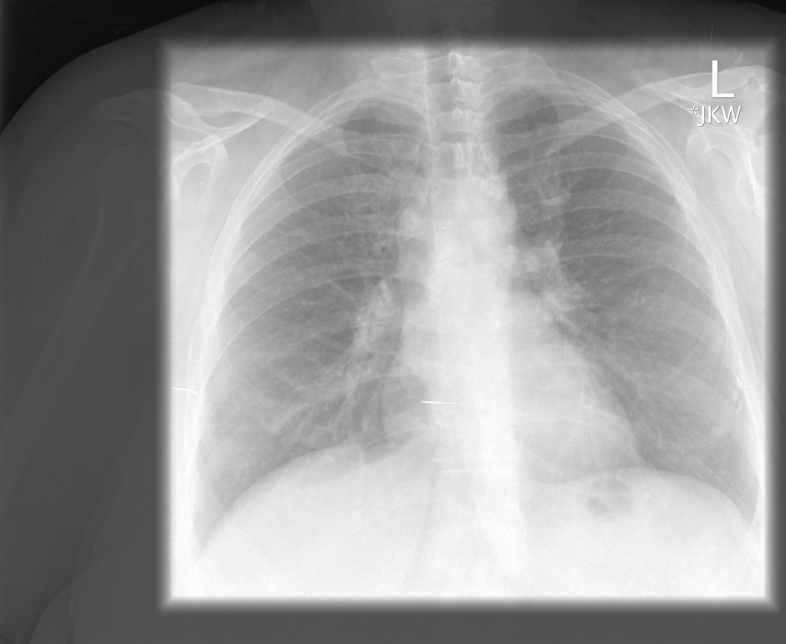

**Indication given to model:** female with chest pain.

| | Radiologist report | Model |
|---|---|---|
| Findings | Cardiomediastinal silhouettes are within normal limits. Lungs are clear without focal consolidation, pneumothorax, or pleural effusion. Stable calcified granulomas. Bony thorax is unremarkable. | Chest X-ray showing no acute process. |
| Impression | No acute cardiopulmonary abnormalities. | The patient was diagnosed with a left breast carcinoma and underwent a left mastectomy with sentinel node biopsy. The patient was diagnosed with a left breast carcinoma and underwent a left mastectomy with sentinel node biopsy. |
| Next steps | - | 1. Investigate: A chest X-ray was obtained and showed no acute process (Figure 1). 2. Investigate: A chest X-ray was obtained and showed no acute process (Figure 2). 3. Investigate: A chest X-ray was obtained and showed no acute process (Figure 3). 4. Investigate: A chest X-ray was obtained and showed no acute process (Figure 4). |

## Open-i 653 (abnormal: -)

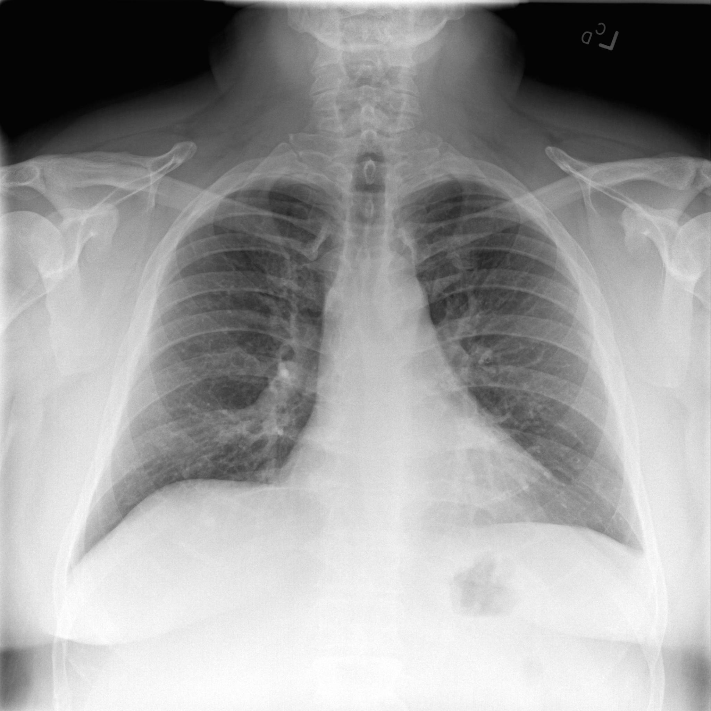

**Indication given to model:** History of testicular cancer, evaluate for metastatic disease

| | Radiologist report | Model |
|---|---|---|
| Findings | Heart size and vascularity normal. Lungs clear. No effusions or pneumothorax. Limited degenerative change of the spine | Chest X-ray showing no evidence of pulmonary metastases. |
| Impression | No radiographic evidence for thoracic metastases. | The patient was diagnosed with testicular cancer and underwent orchiectomy. The patient was diagnosed with stage IV metastatic disease and was started on pembrolizumab. |
| Next steps | - | 1. Investigate: A chest X-ray was obtained and showed no evidence of pulmonary metastases (Figure 1). 2. Definitive treatment: The patient was started on pembrolizumab and was doing well until he was [history not provided]. 3. Definitive treatment: The patient was started on pembrolizumab and was doing well until he was [history not provided]. |

## Open-i 646 (abnormal: -)

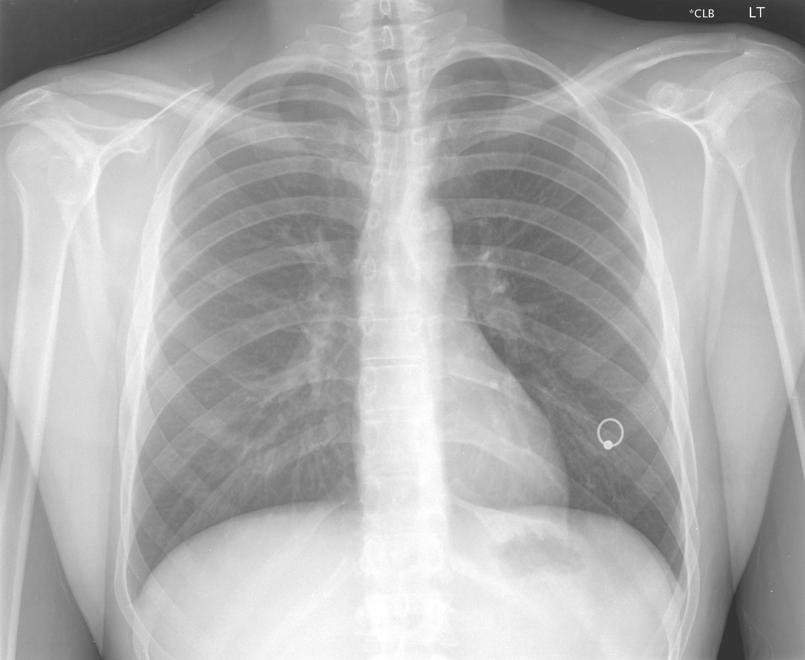

**Indication given to model:** vehicle accident.

| | Radiologist report | Model |
|---|---|---|
| Findings | Clear lungs. Normal heart mediastinum. No pneumothorax. No pleural effusion. No acute bony abnormality. Nipple ring on left. | Chest X-ray showing a small left pneumothorax. |
| Impression | Normal chest exam. | The patient was diagnosed with a left pneumothorax and was treated with a chest tube. |
| Next steps | - | 1. Immediate stabilisation: The patient was treated with oxygen and a chest tube was inserted. 2. Immediate stabilisation: The patient was treated with oxygen and a chest tube was inserted. 3. Immediate stabilisation: The patient was treated with oxygen and a chest tube was inserted. 4. Immediate stabilisation: The patient was treated with oxygen and a chest tube was inserted. |

## Open-i 554 (normal)

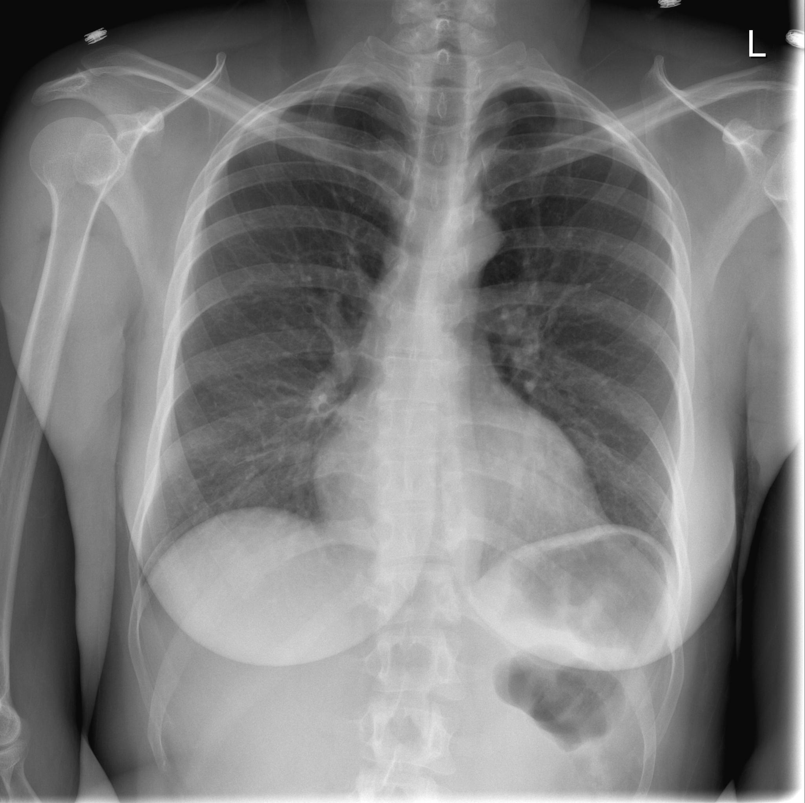

**Indication given to model:** female. Dyspnea.

| | Radiologist report | Model |
|---|---|---|
| Findings | The cardiomediastinal silhouette is normal in size and contour. No focal consolidation, pneumothorax or large pleural effusion. Negative for acute bone abnormality. | Chest X-ray showing a normal heart size and no pulmonary congestion. |
| Impression | Negative. | The patient [history not provided]. The patient was diagnosed with a pulmonary embolism and was started on anticoagulation therapy. |
| Next steps | - | 1. Immediate stabilisation: The patient was intubated and mechanically ventilated. 2. Immediate stabilisation: The patient was started on a high-dose steroid therapy and was weaned off the ventilator. 3. Investigate: A chest X-ray was normal (Figure 1). 4. Investigate: A CT scan of the chest was performed, which showed a large right lower lobe consolidation with a small amount of pleural effusion (Figure 2). |

## Open-i 623 (abnormal: -)

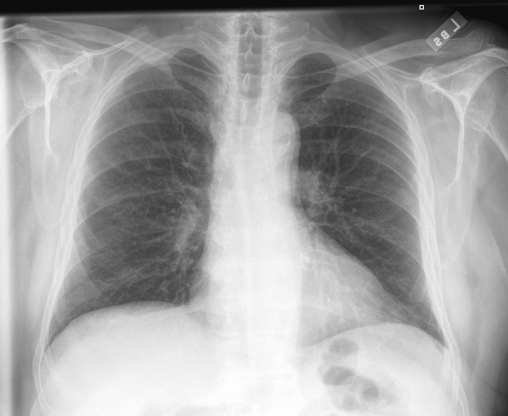

**Indication given to model:** CHEST PAIN CXR SFWP

| | Radiologist report | Model |
|---|---|---|
| Findings | The heart is normal in size. The mediastinum is stable. Atherosclerotic calcifications of the aorta. There is again a pleural based density in the right lung base, related to subpleural fat. The appearance is stable from multiple previous studies. The lungs are clear. There is no pleural effusion. | Chest X-ray showing no acute process. |
| Impression | No acute disease. | The patient with a [history not provided]. The patient was diagnosed with a left anterior descending (LAD) stenosis of 90% and was started on aspirin and clopidogrel. |
| Next steps | - | 1. Investigate: A chest X-ray was obtained and was normal (Figure 1). 2. Investigate: A coronary angiogram was obtained and showed a 90% stenosis of the LAD. 3. Definitive treatment: The patient was started on aspirin and clopidogrel. 4. Definitive treatment: The patient was started on aspirin and clopidogrel. |

## Open-i 225 (normal)

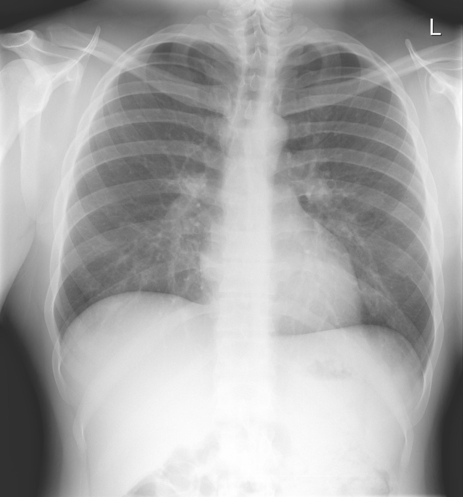

**Indication given to model:** male with, shortness breath, and asthma.

| | Radiologist report | Model |
|---|---|---|
| Findings | Cardiomediastinal silhouette is within normal limits. No focal consolidation. No pneumothorax or pleural effusion. No acute bony abnormalities. | Chest X-ray showing no evidence of pneumonia. |
| Impression | No acute cardiopulmonary abnormalities.. | The patient was diagnosed with asthma and was prescribed a daily inhaled corticosteroid and a short-acting beta-agonist. |
| Next steps | - | 1. Immediate stabilisation: He was given oxygen and a nebulized bronchodilator. 2. Immediate stabilisation: The patient [history not provided]. 3. Immediate stabilisation: The patient was intubated and placed on mechanical ventilation. 4. Immediate stabilisation: The patient was weaned off the ventilator and was discharged to the medical floor. |

## Open-i 174 (abnormal: -)

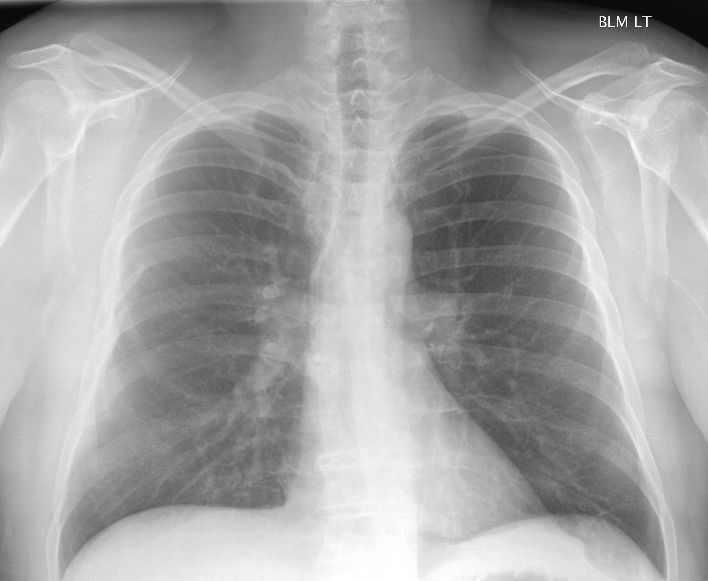

**Indication given to model:** (none)

| | Radiologist report | Model |
|---|---|---|
| Findings | There is a left-sided PICC with tip at the caval atrial junction. The cardiomediastinal contours are within normal limits. Pulmonary vasculature is unremarkable. There is no focal airspace opacity. No pleural effusion or pneumothorax is seen. Stable short segment catheter tubing overlying the left, to reside within anterior chest soft tissues on recent chest CT. Stable remote posttraumatic changes of multiple right ribs. | Chest X-ray showing a left-sided picc line. |
| Impression | 1. Left PICC tip at cavoatrial junction. 2. No acute cardiopulmonary abnormality. | The patient was diagnosed with a left-sided picc line in the emergency department. |
| Next steps | - | 1. Immediate stabilisation: The patient was given analgesia and fluids and was discharged home. 2. Investigate: A chest X-ray was taken and showed a left-sided picc line (Figure 1). 3. Definitive treatment: The patient was started on a course of antibiotics and was discharged home. |

## Open-i 24 (normal)

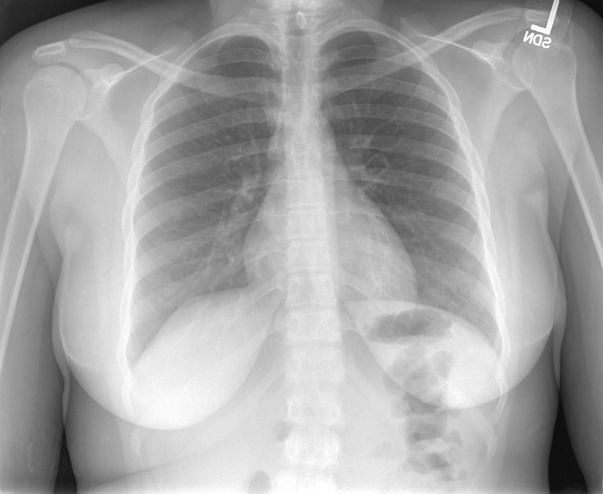

**Indication given to model:** (none)

| | Radiologist report | Model |
|---|---|---|
| Findings | Cardiomediastinal silhouette is within normal limits of size and appearance. The pulmonary vascularity is unremarkable. Lungs are expanded and clear of airspace disease. Negative for pneumothorax or pleural effusion. Limited bone evaluation reveals no acute abnormality. There is incompletely evaluated lumbar levoscoliosis. | Chest X-ray showing normal findings. |
| Impression | No acute cardiopulmonary abnormality. | The patient was diagnosed with a left breast mass and was referred to hospital for further evaluation and treatment. The patient was diagnosed with a left breast mass and was referred to hospital for further evaluation and treatment. |
| Next steps | - | 1. Investigate: A biopsy was performed and the patient was diagnosed with a left breast mass. 2. Investigate: A biopsy was performed and the patient was diagnosed with a left breast mass. 3. Investigate: A biopsy was performed and the patient was diagnosed with a left breast mass. 4. Investigate: A biopsy was performed and the patient was diagnosed with a left breast mass. |

## Open-i 387 (abnormal: opacity)

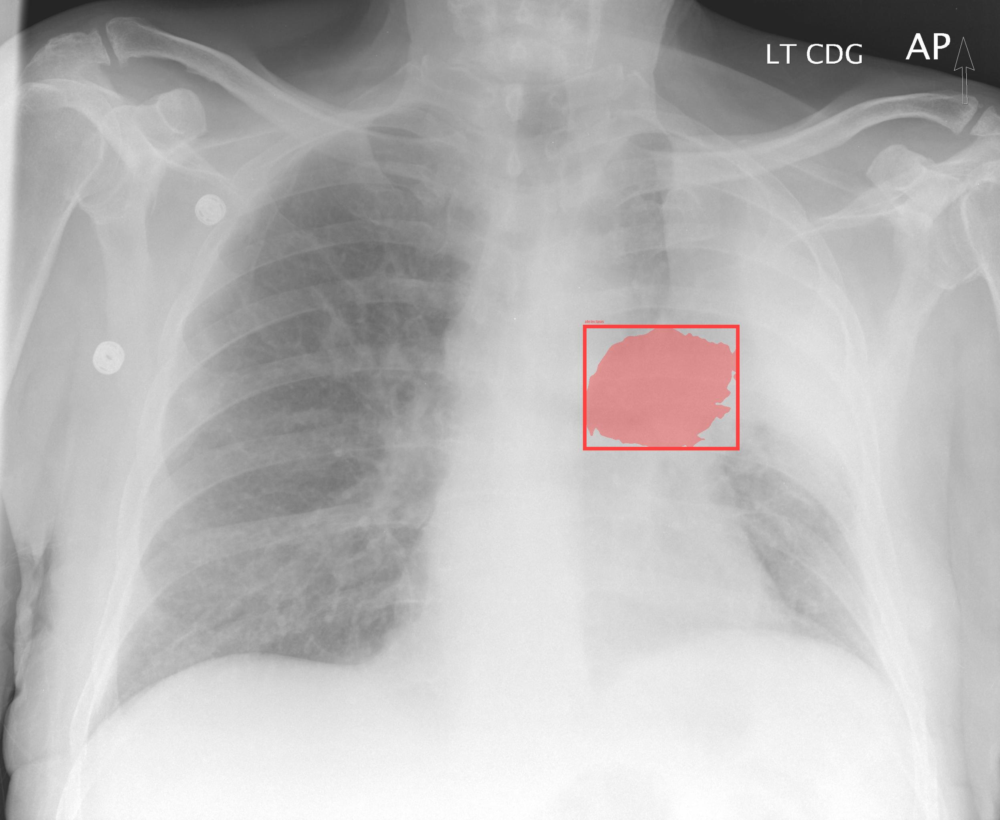

**Indication given to model:** male with shortness of breath.

| | Radiologist report | Model |
|---|---|---|
| Findings | Heart size is normal. There is left hilar enlargement with partial opacification of the left upper lobe suggestive of hilar mass with obstructive atelectasis. Questionable small right midlung nodule. Negative for pneumothorax or pleural effusion. Bony thorax is unremarkable. | Chest X-ray showing left upper lobe consolidation. |
| Impression | Suspected left hilar mass with obstructive atelectasis. thorax for further characterization. | The patient was diagnosed with a left upper lobe pneumonia. |
| Next steps | - | 1. Immediate stabilisation: He was started on a 10-day course of azithromycin and was discharged on supplemental oxygen. 2. Investigate: A chest X-ray was obtained, which showed left upper lobe consolidation (Figure 1). 3. Investigate: A chest X-ray was obtained, which showed a left upper lobe consolidation (Figure 2). 4. Investigate: A chest X-ray was obtained, which showed a left upper lobe consolidation (Figure 3). |

## Open-i 44 (normal)

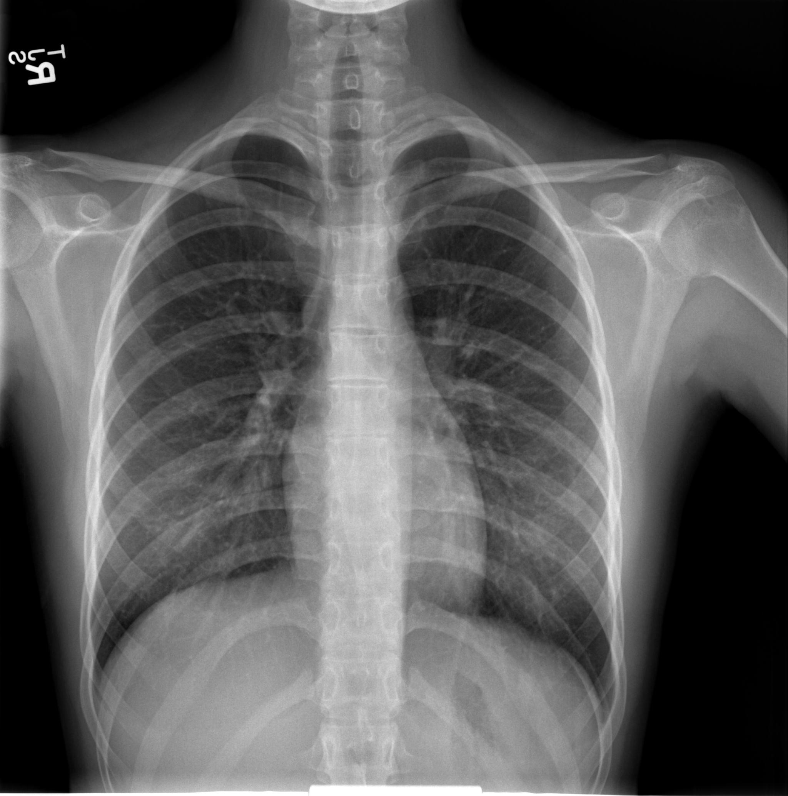

**Indication given to model:** with for 5 days. Previously seen for vomiting and ear pain.

| | Radiologist report | Model |
|---|---|---|
| Findings | The heart, pulmonary and mediastinum are within normal limits. There is no pleural effusion or pneumothorax. There is no focal air space opacity to suggest a pneumonia. | Chest X-ray showing no acute process. |
| Impression | No acute cardiopulmonary disease. | The patient [history not provided]. The patient was diagnosed with gastroenteritis and was discharged home. |
| Next steps | - | 1. Immediate stabilisation: The patient was intubated and placed on mechanical ventilation. 2. Immediate stabilisation: The patient was started on intravenous fluids and antibiotics. 3. Immediate stabilisation: The patient was started on intravenous fluids and antibiotics. 4. Immediate stabilisation: The patient was started on intravenous fluids and antibiotics. |

## Open-i 588 (normal)

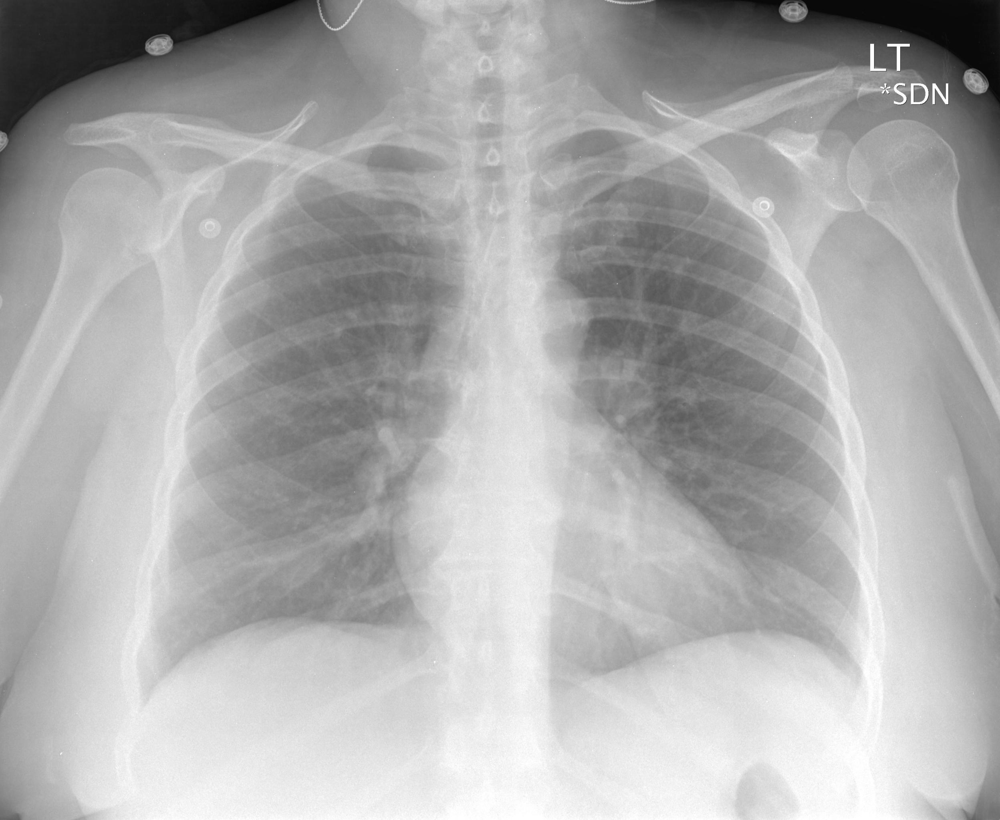

**Indication given to model:** Chest pain.

| | Radiologist report | Model |
|---|---|---|
| Findings | The heart is normal in size and contour. There is no mediastinal widening. The lungs are clear bilaterally. No large pleural effusion or pneumothorax. The are intact. | Chest X-ray. |
| Impression | No acute cardiopulmonary abnormalities. | The patient [history not provided]. The patient was diagnosed with a left anterior descending coronary artery stenosis of 90% and was treated with aspirin, clopidogrel, and atorvastatin. |
| Next steps | - | 1. Investigate: A chest X-ray was performed (Figure 1). 2. Investigate: A chest X-ray was performed (Figure 2). 3. Investigate: A chest X-ray was performed (Figure 3). 4. Investigate: A chest X-ray was performed (Figure 4). |

## Open-i 609 (normal)

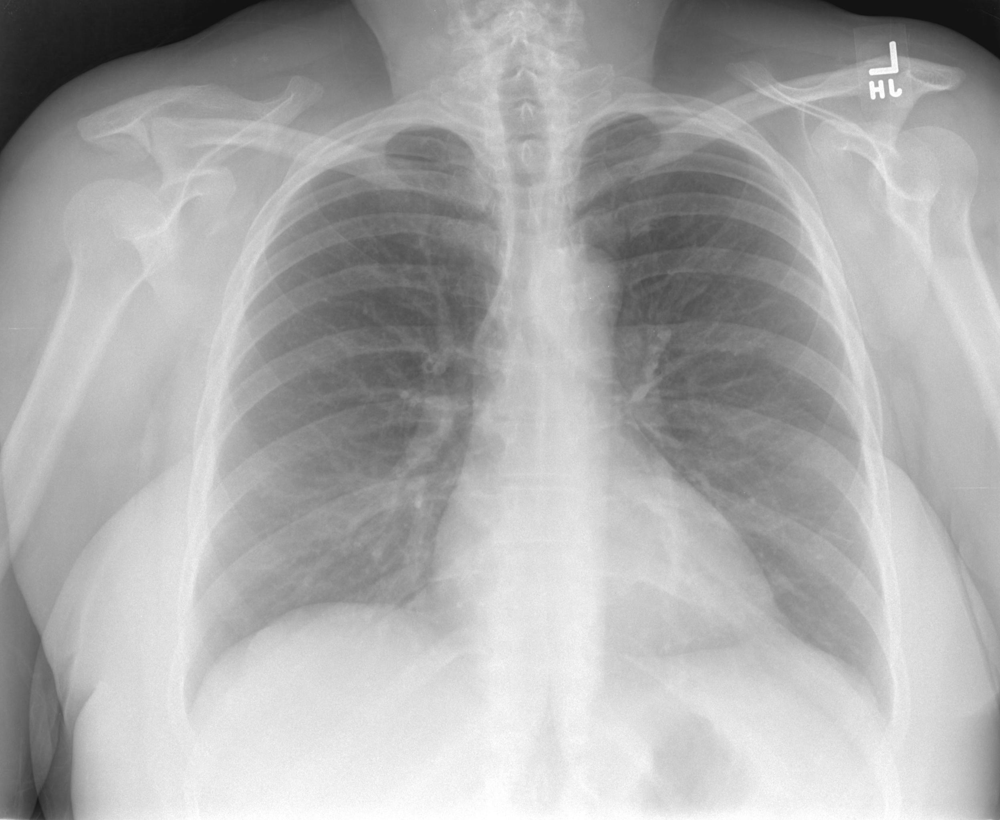

**Indication given to model:** COPD

| | Radiologist report | Model |
|---|---|---|
| Findings | Stable cardiomediastinal silhouette. Pulmonary vascularity is within normal limits. Lungs are expanded and clear of airspace disease. Negative for pneumothorax or pleural effusion. are grossly intact. | Chest X-ray showing no evidence of pulmonary infection. |
| Impression | 1. No acute cardiopulmonary abnormality. | The patient was diagnosed with a left-sided pleural effusion and was referred to hospital for further evaluation. A chest X-ray revealed a left-sided pleural effusion and a right-sided pleural effusion (Fig. |
| Next steps | - | 1. Immediate stabilisation: The pleural fluid was exudative and contained 100,000 cells/mm3, 90% of which were neutrophils. 2. Immediate stabilisation: The pleural fluid was sent for cytological examination and was found to contain malignant cells. 3. Investigate: A CT scan of the chest was performed and showed a left-sided pleural effusion and a right-sided pleural effusion (Fig. 4. Investigate: A CT scan of the chest was performed and showed a left-sided pleural effusion and a right-sided pleural effusion (Fig. |

## Open-i 469 (abnormal: -)

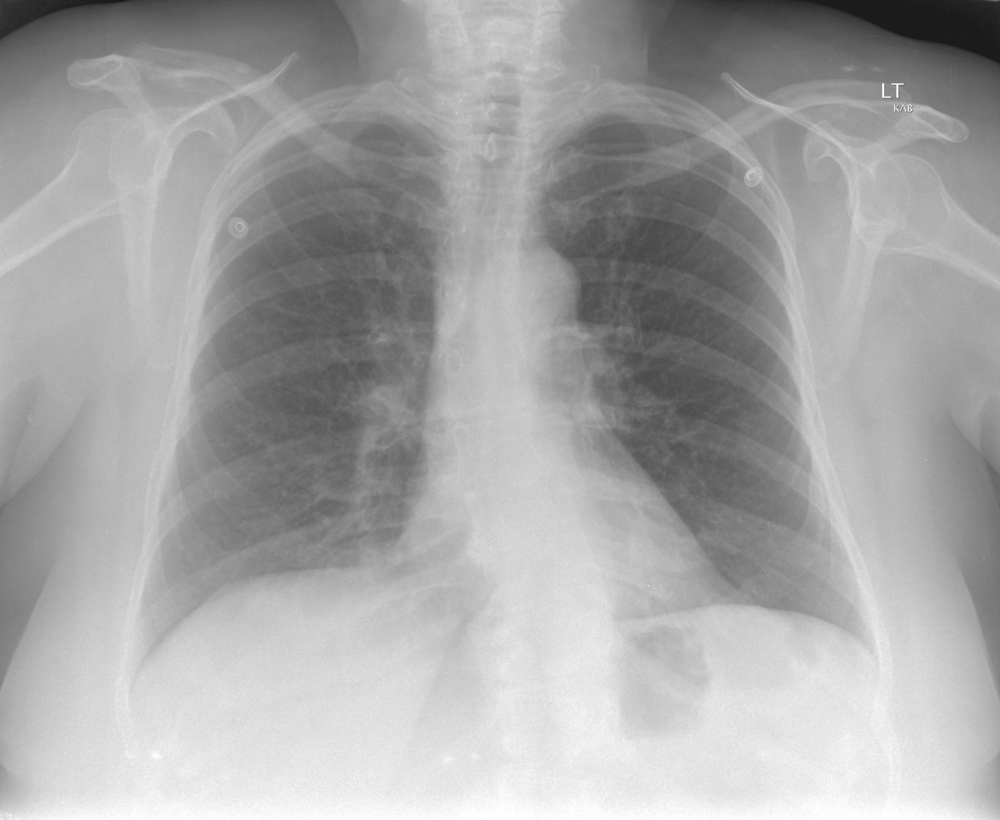

**Indication given to model:** with dyspnea.

| | Radiologist report | Model |
|---|---|---|
| Findings | The heart, pulmonary and mediastinum are within normal limits. There is no pleural effusion or pneumothorax. There is no focal airspace opacity to suggest a pneumonia. There are scoliotic changes of the thoracolumbar spine. There degenerative changes of the spine. | Chest X-ray showing a normal heart size and no pulmonary congestion. |
| Impression | No acute cardiopulmonary disease. | The patient with a [history not provided]. Physical examination revealed a blood pressure [value], a pulse rate [value], and a temperature [value]C. |
| Next steps | - | 1. Immediate stabilisation: The patient was treated with oxygen therapy and intravenous diuretics. 2. Investigate: A chest X-ray was performed, which showed a normal heart size and no pulmonary congestion (Figure 1). 3. Investigate: A transthoracic echocardiogram was performed, which showed a normal left ventricular ejection fraction (LVEF) of 60% and a normal left ventricular size. 4. Investigate: A computed tomography (CT) scan of the chest was performed, which showed a normal heart size and no pulmonary congestion (Figure 2). |

## Open-i 55 (abnormal: -)

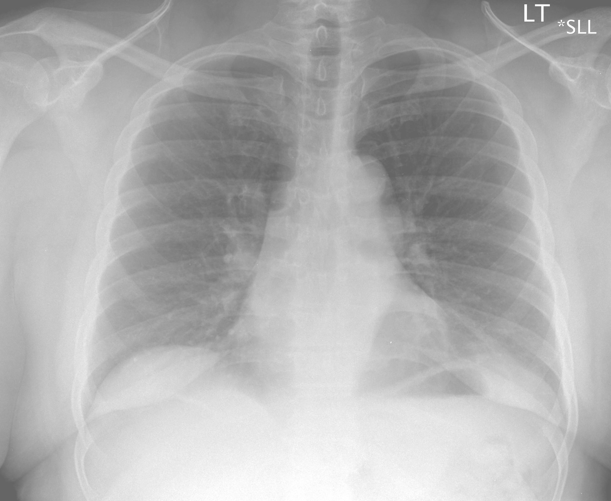

**Indication given to model:** chest pain

| | Radiologist report | Model |
|---|---|---|
| Findings | Lung lines remain low. However, no focal infiltrates are identified. Heart and pulmonary are normal. | Chest X-ray showing a left lower lobe opacity. |
| Impression | change. Hypoinflation with no visible active cardiopulmonary disease. | The patient with a [history not provided]. The patient was diagnosed with acute coronary syndrome and was started on aspirin, clopidogrel, and enoxaparin. |
| Next steps | - | 1. Immediate stabilisation: The patient was started on oxygen therapy and [history not provided]. 2. Immediate stabilisation: The patient was started on intravenous antibiotics and [history not provided]. 3. Investigate: A chest X-ray was obtained, which showed a left lower lobe opacity (Figure 1). 4. Investigate: A computed tomography (CT) scan of the chest was obtained, which showed a left lower lobe consolidation with air bronchograms (Figure 2). |

## Open-i 756 (normal)

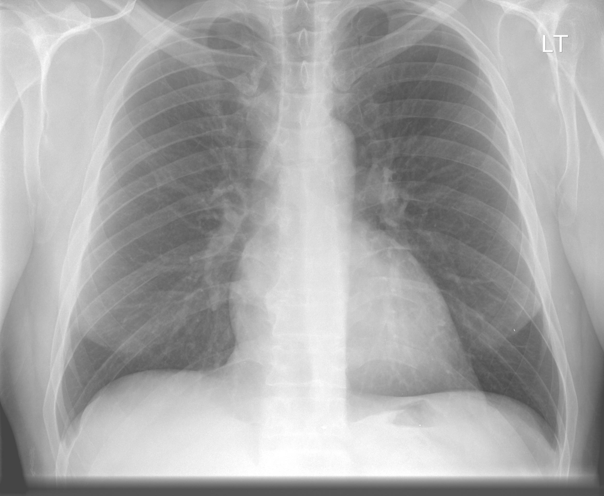

**Indication given to model:** male with chest pain.

| | Radiologist report | Model |
|---|---|---|
| Findings | Normal cardiomediastinal silhouette. No airspace consolidation, pneumothorax, pleural effusion, or pulmonary edema. No acute bony abnormality. | Chest X-ray showing normal heart size and clear lungs. |
| Impression | No acute cardiopulmonary disease. | The patient was diagnosed with a left breast carcinoma and underwent a left mastectomy with axillary lymph node dissection. The patient was diagnosed with a left breast carcinoma and underwent a left mastectomy with axillary lymph node dissection. |
| Next steps | - | 1. Investigate: A chest X-ray was performed and was normal (Figure 1). 2. Investigate: A chest X-ray was performed and was normal (Figure 2). 3. Investigate: A chest X-ray was performed and was normal (Figure 3). 4. Investigate: A chest X-ray was performed and was normal (Figure 4). |

## Open-i 131 (abnormal: calcified granuloma)

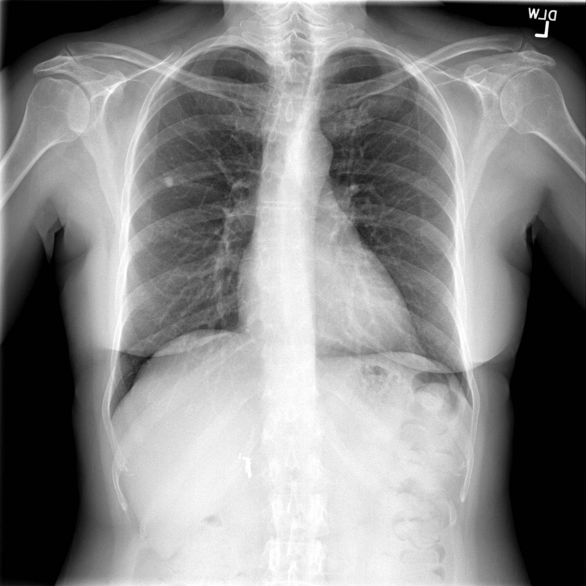

**Indication given to model:** Left-sided chest pain for 2 days.

| | Radiologist report | Model |
|---|---|---|
| Findings | There is a calcified granuloma in the right midlung zone. Lungs are otherwise clear. There is no pleural effusion or pneumothorax. The heart and mediastinum are normal. The skeletal structures are normal. Surgical clips are present in the right upper quadrant. | Chest X-ray showing a small nodule in the right upper lobe. |
| Impression | No acute pulmonary disease. | The patient was diagnosed with a small nodule in the right upper lobe of the lung on a chest X-ray (Figure 1). The patient was diagnosed with a small nodule in the right upper lobe of the lung on a chest X-ray (Figure 1). |
| Next steps | - | 1. Investigate: A chest CT scan was performed, which showed a 1.2 cm nodule in the right upper lobe of the lung (Figure 2). 2. Investigate: A biopsy was performed on the nodule, and the pathology report showed a small cell carcinoma of the lung. 3. Definitive treatment: The patient was treated with a combination of chemotherapy and radiation therapy. 4. Definitive treatment: The patient was treated with a combination of chemotherapy and radiation therapy. |

## Open-i 774 (abnormal: emphysema)

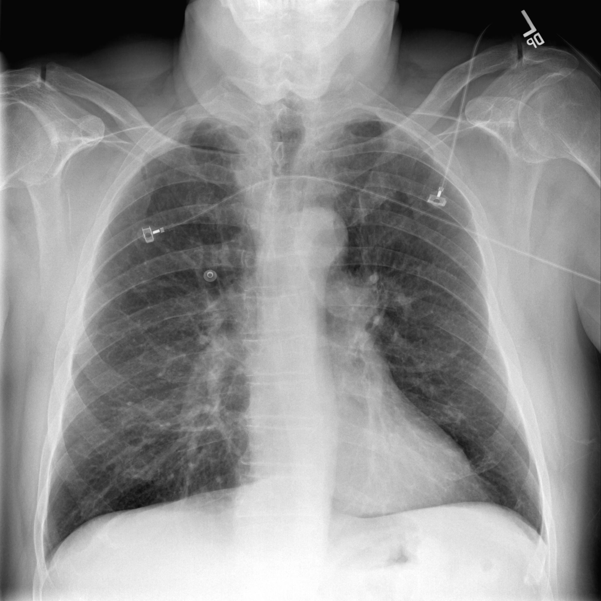

**Indication given to model:** Difficulty breathing, history of emphysema

| | Radiologist report | Model |
|---|---|---|
| Findings | Heart size and mediastinal contour are normal. Pulmonary vascularity is normal. Lungs are mildly hyperexpanded but clear. No pleural effusions or pneumothoraces. Degenerative changes in the thoracic spine. | Chest X-ray showing no acute process. |
| Impression | Emphysema without acute cardiopulmonary process. | The patient was diagnosed with a left-sided pleural effusion and [history not provided]. The patient was diagnosed with a left-sided pleural effusion and [history not provided]. |
| Next steps | - | 1. Immediate stabilisation: The patient [history not provided]. 2. Immediate stabilisation: The patient [history not provided]. 3. Immediate stabilisation: The patient [history not provided]. 4. Immediate stabilisation: The patient [history not provided]. |

## Open-i 295 (abnormal: fractures, bone)

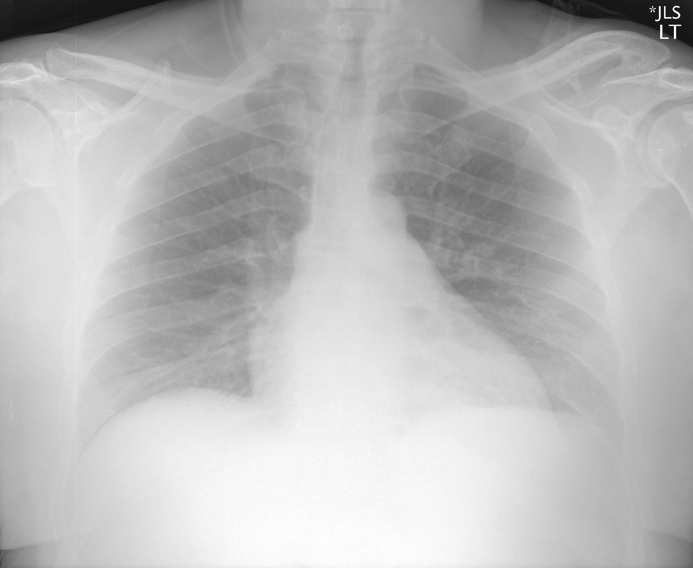

**Indication given to model:** EtOH abuse.

| | Radiologist report | Model |
|---|---|---|
| Findings | Limited lateral projection. The lungs are clear bilaterally. Specifically, no evidence of focal consolidation, pneumothorax, or pleural effusion. Cardiomediastinal silhouette is unremarkable. Visualized osseous structures of the thorax are without acute abnormality. Healed distal left clavicular fracture noted. | Chest X-ray showing no acute process. |
| Impression | No acute cardiopulmonary abnormality. | The patient with a [history not provided]. A chest X-ray revealed no acute process (Figure 1). |
| Next steps | - | 1. Immediate stabilisation: The patient was started on broad-spectrum antibiotics and [history not provided]. 2. Investigate: A CT scan of the abdomen and pelvis was obtained, which showed a 1.5 cm x 1.5 cm x 1.5 cm pancreatic pseudocyst with a small amount of fluid in the pelvis. 3. Investigate: A CT scan of the chest was obtained, which showed no acute process. 4. Investigate: A CT scan of the abdomen and pelvis was obtained, which showed a 1.5 cm x 1.5 cm x 1.5 cm pancreatic pseudocyst with a small amount of fluid in the pelvis. |

## Open-i 432 (normal)

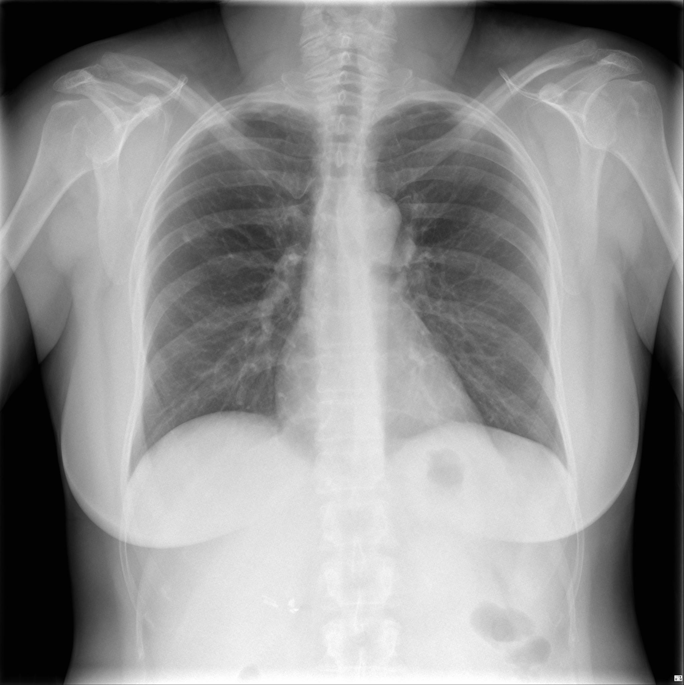

**Indication given to model:** female,, nonsmoker.

| | Radiologist report | Model |
|---|---|---|
| Findings | The cardiomediastinal silhouette is within normal limits for size and contour. The lungs are normally inflated without evidence of focal airspace disease, pleural effusion, or pneumothorax. Cholecystectomy clips overlie the right upper quadrant. No acute bone abnormality. | Chest X-ray showing a small nodule in the right upper lobe. |
| Impression | No acute cardiopulmonary process. | The patient was diagnosed with a right upper lobe nodule on a chest X-ray (Figure 1). The patient was diagnosed with a right upper lobe nodule on a chest X-ray (Figure 1). |
| Next steps | - | 1. Investigate: A chest CT scan was performed, which showed a 1.2 cm nodule in the right upper lobe (Figure 2). 2. Investigate: A biopsy was performed, and the pathology report showed a small cell carcinoma. 3. Definitive treatment: The patient was treated with radiation therapy. |

## Open-i 670 (abnormal: cardiomegaly)

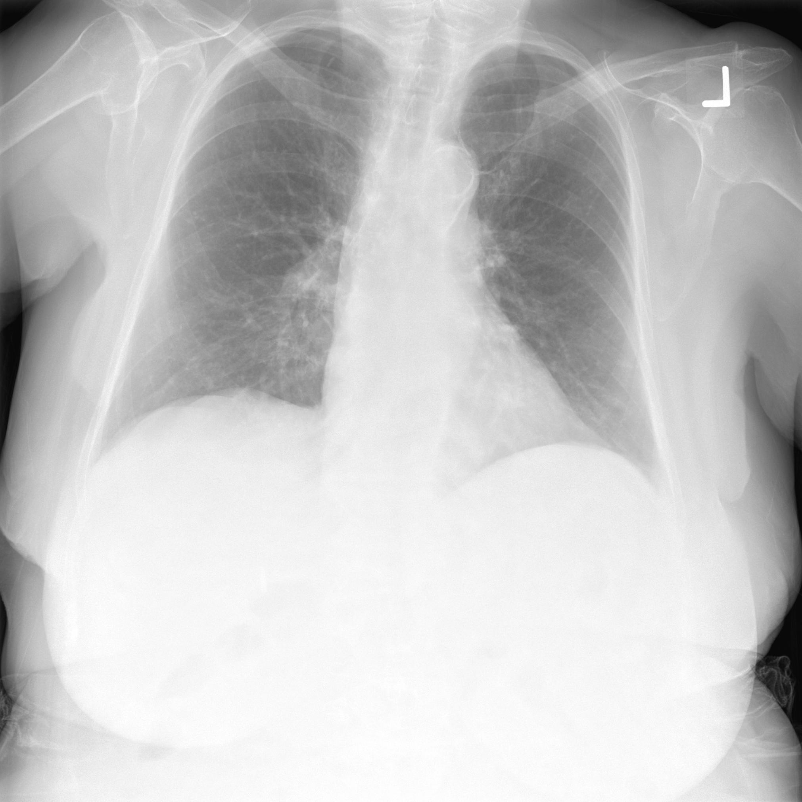

**Indication given to model:** (none)

| | Radiologist report | Model |
|---|---|---|
| Findings | The heart is top normal in size. The mediastinum is Stable. The aorta is atherosclerotic. There are mild chronic changes without focal consolidation. No pleural effusion is seen. | Chest X-ray showing no evidence of pulmonary disease. |
| Impression | Mild cardiomegaly and atherosclerosis. No acute infiltrate. | The patient was diagnosed with a left breast carcinoma and underwent a modified radical mastectomy. The patient was diagnosed with a left breast carcinoma and underwent a modified radical mastectomy. |
| Next steps | - | 1. Investigate: A chest X-ray was performed and showed no evidence of pulmonary disease (Figure 1). 2. Investigate: A chest X-ray was performed and showed no evidence of pulmonary disease (Figure 2). 3. Investigate: A chest X-ray was performed and showed no evidence of pulmonary disease (Figure 3). 4. Investigate: A chest X-ray was performed and showed no evidence of pulmonary disease (Figure 4). |

## Open-i 204 (normal)

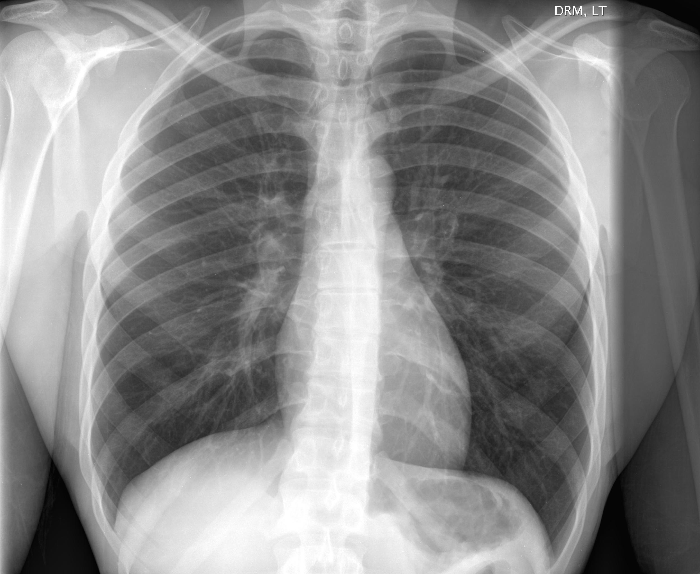

**Indication given to model:** (none)

| | Radiologist report | Model |
|---|---|---|
| Findings | Heart size normal. Lungs are clear. are normal. No pneumonia, effusions, edema, pneumothorax, adenopathy, nodules or masses. | Chest X-ray showing normal lung fields. |
| Impression | Normal chest | The patient was diagnosed with a left-sided pleural effusion and was [history not provided]. A chest X-ray revealed a left-sided pleural effusion (Fig. |
| Next steps | - | 1. Immediate stabilisation: The pleural fluid was exudative and contained 100,000 cells/mm3 with 80% lymphocytes and 20% neutrophils. 2. Immediate stabilisation: The pleural fluid was sent for cytology and was negative for malignant cells. 3. Investigate: A CT scan of the chest was performed and showed a left-sided pleural effusion with a small amount of pleural thickening. 4. Investigate: A CT scan of the chest was performed and showed a left-sided pleural effusion with a small amount of pleural thickening. |

## Open-i 520 (abnormal: fractures, bone, hernia, hiatal)

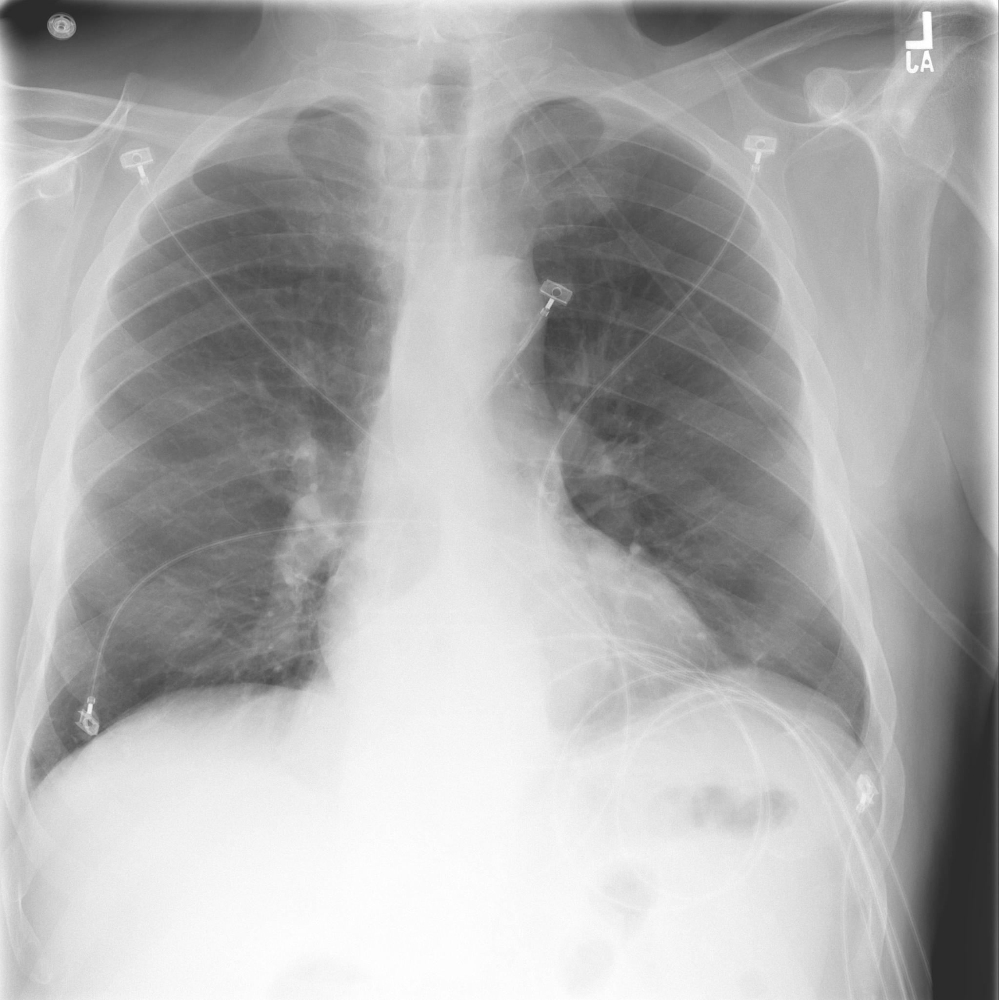

**Indication given to model:** The patient is a male with atrial flutter, hypertensive urgency..

| | Radiologist report | Model |
|---|---|---|
| Findings | No pneumothorax, pleural effusion or airspace consolidation. Cardiomediastinal size is within normal limits. Pulmonary vasculature is normal. Old rib fractures, healed. Stable increased density overlying the lower mediastinum, unchanged, is due to hiatal hernia seen on examination. | Chest X-ray showing a large left pleural effusion. |
| Impression | No acute cardiopulmonary abnormality.. | The patient was admitted to the hospital with a diagnosis of acute heart failure. The patient was diagnosed with a left pleural effusion and was treated with a thoracentesis. |
| Next steps | - | 1. Immediate stabilisation: The patient was intubated and mechanically ventilated. 2. Immediate stabilisation: The patient was treated with a thoracentesis and a chest tube was inserted. 3. Immediate stabilisation: The patient was treated with a thoracentesis and a chest tube was inserted. 4. Immediate stabilisation: The patient was treated with a thoracentesis and a chest tube was inserted. |

## Open-i 783 (abnormal: calcified granuloma)

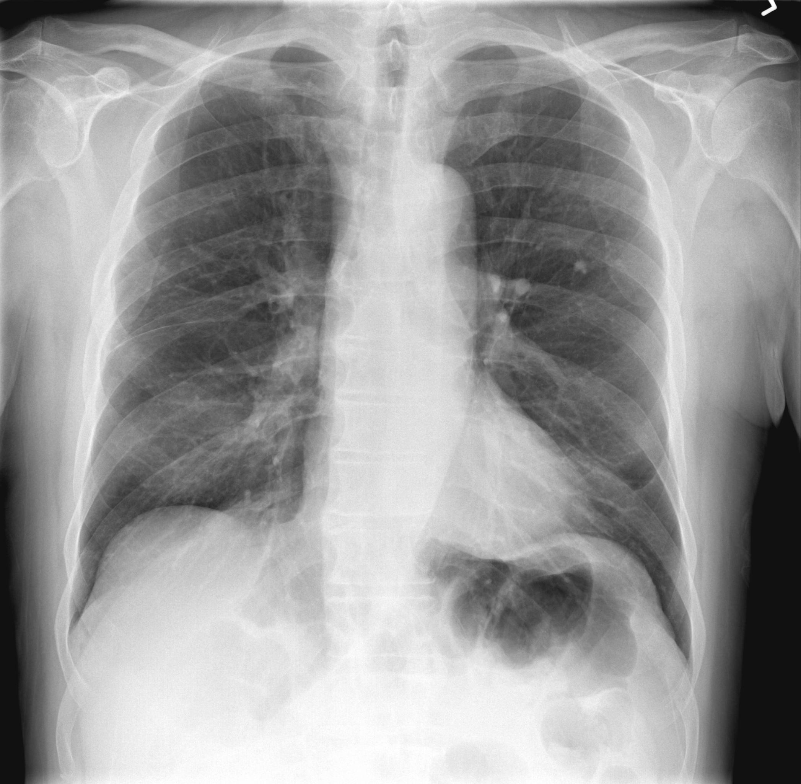

**Indication given to model:** COPD with chronic bronchitis.

| | Radiologist report | Model |
|---|---|---|
| Findings | There is a calcified granuloma in the left upper lung zone. The lungs are otherwise clear. There is hyperinflation. The heart and mediastinum are normal. The skeletal structures and soft tissues are normal for age. | Chest X-ray showing a left upper lobe nodule. |
| Impression | No acute pulmonary disease. | The patient with a history of COPD with chronic bronchitis and a 20 pack-year smoking history [history not provided]. A chest X-ray revealed a left upper lobe nodule (Fig. |
| Next steps | - | 1. Investigate: A chest CT scan was performed, which showed a 1.5 cm nodule in the left upper lobe (Fig. 2. Investigate: A biopsy of the left upper lobe nodule was performed using a bronchoscopic needle aspiration. 3. Investigate: A biopsy of the left upper lobe nodule was performed using a bronchoscopic needle aspiration. 4. Investigate: A biopsy of the left upper lobe nodule was performed using a bronchoscopic needle aspiration. |

## Open-i 539 (normal)

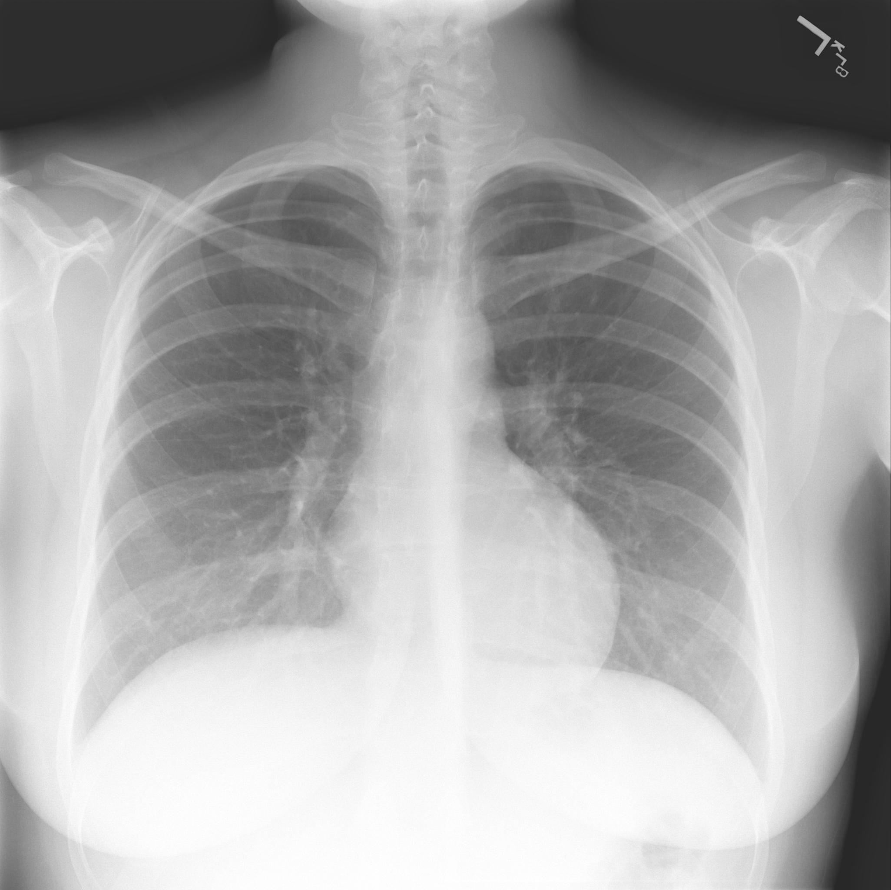

**Indication given to model:** MVC. Back pain.

| | Radiologist report | Model |
|---|---|---|
| Findings | 2 images. Heart size and pulmonary vascular engorgement appear within limits of normal. Mediastinal contour is unremarkable. No focal consolidation, pleural effusion, or pneumothorax identified. No convincing acute bony findings. | Chest X-ray. |
| Impression | No acute cardiopulmonary abnormality identified. | The patient was diagnosed with a left-sided rib fracture. |
| Next steps | - | 1. Immediate stabilisation: The patient was treated with analgesics and discharged home. 2. Investigate: A chest X-ray was performed (Figure 1). 3. Investigate: A chest X-ray was performed (Figure 2). 4. Investigate: A chest X-ray was performed (Figure 3). |

## Open-i 383 (abnormal: -)

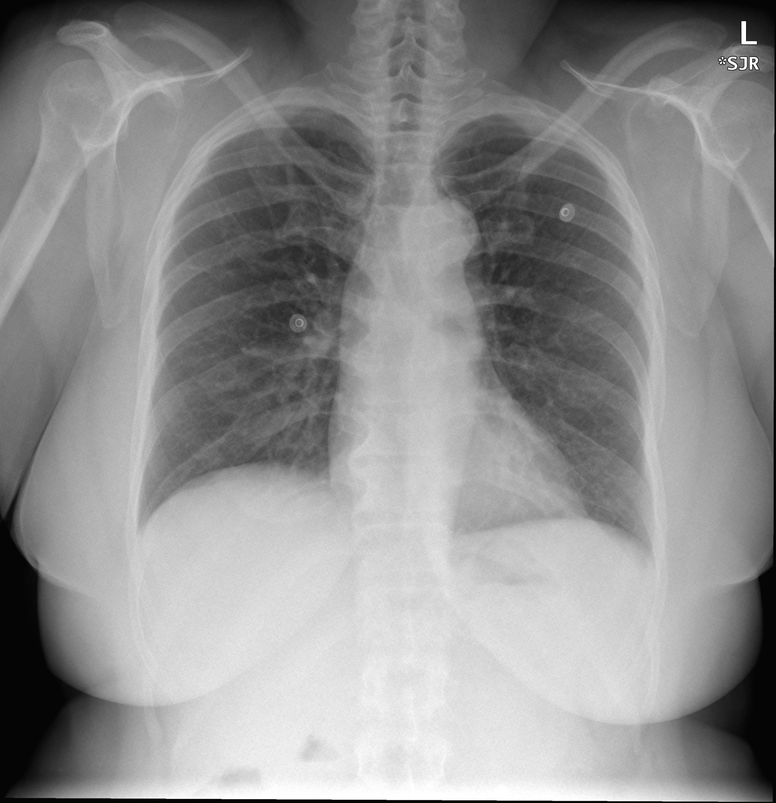

**Indication given to model:** female with chest pain.

| | Radiologist report | Model |
|---|---|---|
| Findings | Normal heart size. No focal air space consolidation, pneumothorax, pleural effusion, or pulmonary edema. Anterior osteophytes of the thoracic spine. | Chest x-ray showing no acute process. |
| Impression | No acute cardiopulmonary disease. | The patient was diagnosed with a left breast carcinoma and underwent a modified radical mastectomy. The patient was diagnosed with a left breast carcinoma and underwent a modified radical mastectomy. |
| Next steps | - | 1. Investigate: A chest x-ray was performed and showed no acute process (Figure 1). 2. Investigate: A chest x-ray was performed and showed no acute process (Figure 2). 3. Investigate: A chest x-ray was performed and showed no acute process (Figure 3). 4. Investigate: A chest x-ray was performed and showed no acute process (Figure 4). |

## Open-i 581 (normal)

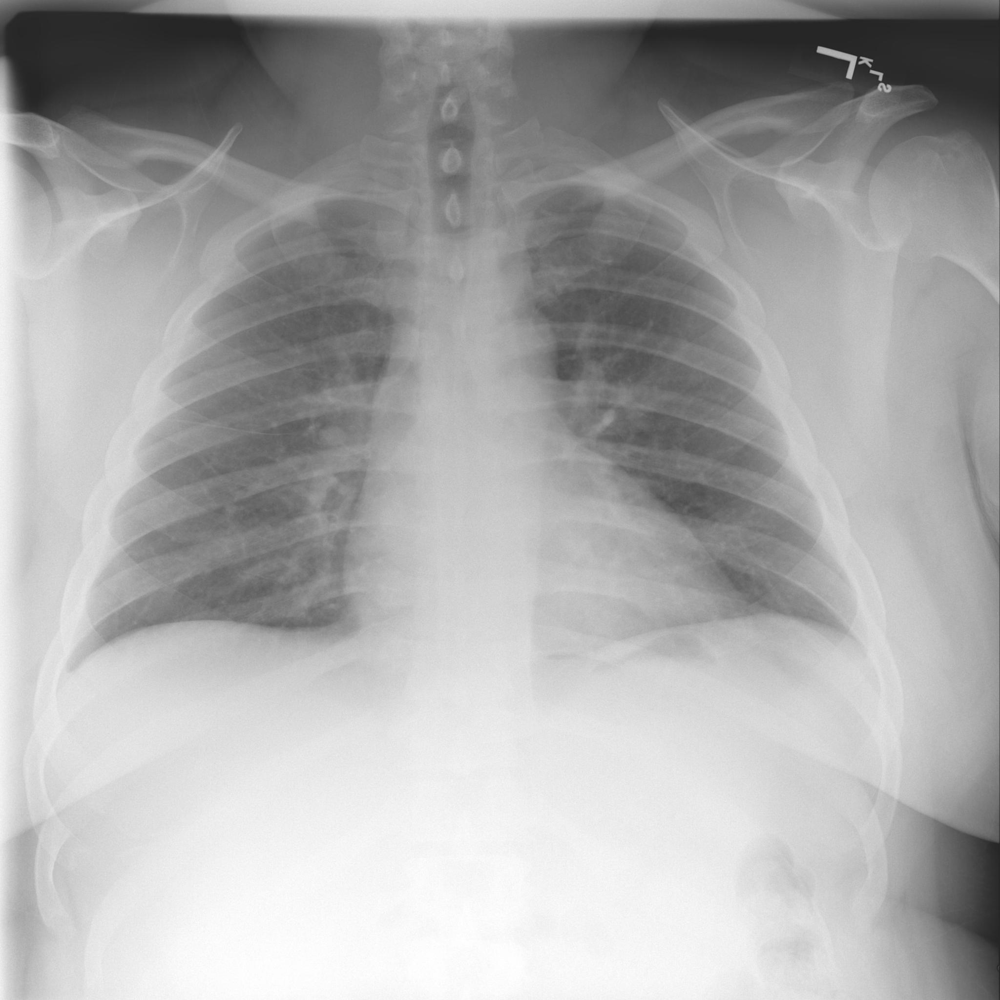

**Indication given to model:** Dyspnea. Asthma.

| | Radiologist report | Model |
|---|---|---|
| Findings | Frontal and lateral views of the chest show an unchanged cardiomediastinal silhouette. No focal airspace consolidation or pleural effusion. | Chest X-ray showing no abnormalities. |
| Impression | No acute or active cardiac, pulmonary or pleural disease. | The patient was diagnosed with asthma and was taking inhaled corticosteroids and long-acting beta-agonists. The patient was diagnosed with asthma and was taking inhaled corticosteroids and long-acting beta-agonists. |
| Next steps | - | 1. Immediate stabilisation: The patient was intubated and mechanically ventilated. 2. Immediate stabilisation: The patient was intubated and mechanically ventilated. 3. Immediate stabilisation: The patient was intubated and mechanically ventilated. 4. Immediate stabilisation: The patient was intubated and mechanically ventilated. |

## Open-i 268 (abnormal: opacity, pneumonia)

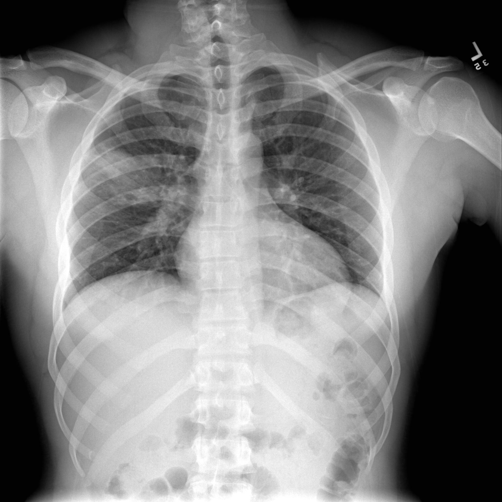

**Indication given to model:** (none)

| | Radiologist report | Model |
|---|---|---|
| Findings | There is a right upper lobe opacity. Cardiomediastinal silhouette is normal. Pulmonary vasculature and are normal. Osseous structures and soft tissues are normal. | Chest X-ray showing bilateral patchy infiltrates. |
| Impression | Right upper lobe pneumonia. | The patient was diagnosed with a left-sided pleural effusion and was started on a course of antibiotics. A repeat chest X-ray revealed bilateral patchy infiltrates (Figure 1). |
| Next steps | - | 1. Immediate stabilisation: The patient was started on oxygen therapy and [history not provided]. 2. Immediate stabilisation: The patient was started on intravenous antibiotics and [history not provided]. 3. Immediate stabilisation: The patient was started on intravenous antibiotics and [history not provided]. 4. Immediate stabilisation: The patient was started on intravenous antibiotics and [history not provided]. |

## Open-i 752 (abnormal: calcified granuloma)

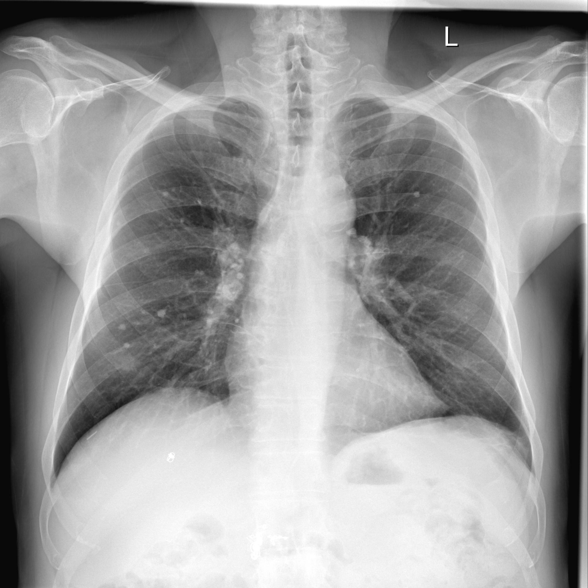

**Indication given to model:** V42.7 LIVER REPLACED BY TRANSP

| | Radiologist report | Model |
|---|---|---|
| Findings | The lungs appear clear. Scattered calcified granulomas are stable as are calcified mediastinal lymph. The heart and pulmonary are normal. Mediastinal contours are normal. Pleural spaces are clear. | Chest X-ray showing multiple calcified granulomas. |
| Impression | No acute cardiopulmonary disease | The patient was diagnosed with a 1.5 cm x 1.5 cm x 1.5 cm right adrenal mass. The patient was diagnosed with a 1.5 cm x 1.5 cm x 1.5 cm left adrenal mass. |
| Next steps | - | 1. Investigate: A chest X-ray was performed and showed multiple calcified granulomas (Figure 1). 2. Investigate: A CT scan of the abdomen and pelvis was performed and showed a 1.5 cm x 1.5 cm x 1.5 cm right adrenal mass and a 1.5 cm x 1.5 cm x 1.5 cm left adrenal mass. 3. Investigate: A CT scan of the abdomen and pelvis was performed and showed a 1.5 cm x 1.5 cm x 1.5 cm right adrenal mass and a 1.5 cm x 1.5 cm x 1.5 cm left adrenal mass. 4. Investigate: A CT scan of the abdomen and pelvis was performed and showed a 1.5 cm x 1.5 cm x 1.5 cm right adrenal mass and a 1. |

## Open-i 300 (abnormal: calcified granuloma, pulmonary disease, chronic obstructive)

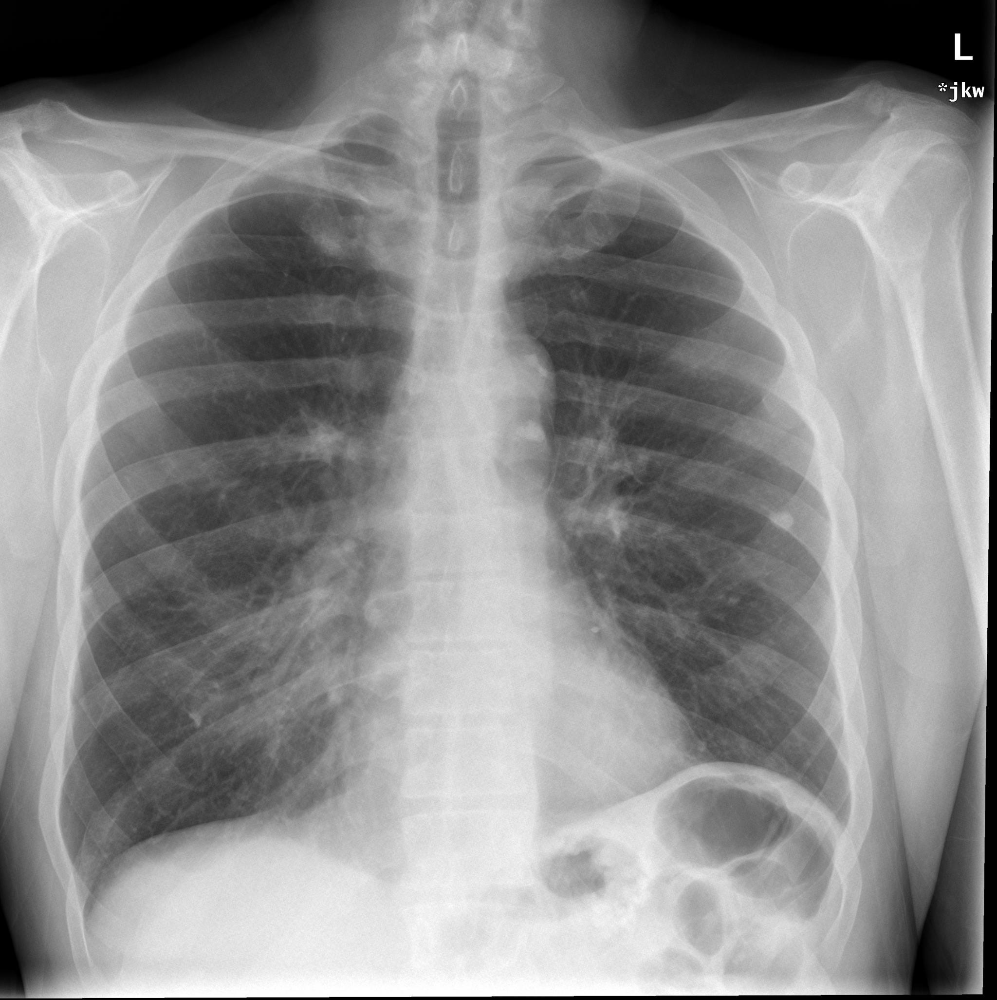

**Indication given to model:** male with.

| | Radiologist report | Model |
|---|---|---|
| Findings | Heart size within normal limits. Mild hyperinflation of the lungs. Mild pectus excavatum deformity. Stable left mid lung calcified granuloma. No focal airspace disease. No pneumothorax or effusions. | Chest X-ray showing a left lower lobe nodule. |
| Impression | Changes of chronic lung disease with no acute cardiopulmonary finding. | The patient was diagnosed with a left lower lobe nodule on a chest X-ray (Figure 1). A chest CT scan revealed a 1.2 cm left lower lobe nodule (Figure 2). |
| Next steps | - | 1. Investigate: A biopsy of the lung nodule was performed. 2. Investigate: A biopsy of the liver was performed. 3. Investigate: A biopsy of the liver was performed. 4. Investigate: A biopsy of the liver was performed. |

## Open-i 237 (abnormal: calcified granuloma)

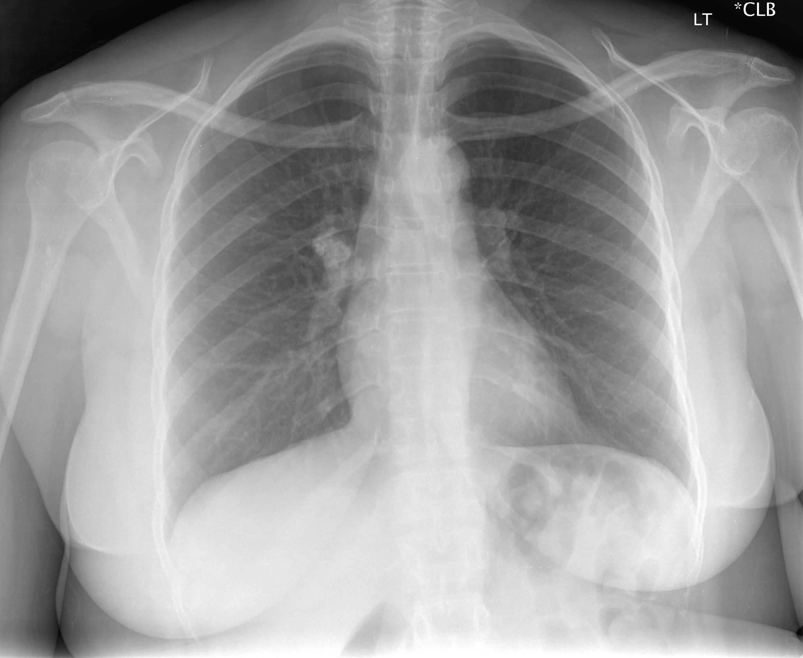

**Indication given to model:** female with.

| | Radiologist report | Model |
|---|---|---|
| Findings | The heart size and cardiomediastinal silhouette are normal. The lungs are clear without focal airspace opacity, pleural effusion, or pneumothorax. There are numerous calcified granuloma in the right perihilar region. There are multilevel degenerative changes in the thoracic spine. | Chest X-ray showing a right hilar mass. |
| Impression | No acute cardiopulmonary finding. | The patient was diagnosed with a right hilar mass on a chest X-ray (Figure 1). The patient was diagnosed with a right hilar mass on a chest X-ray (Figure 1). |
| Next steps | - | 1. Investigate: A chest CT scan was performed and showed a right hilar mass (Figure 2). 2. Investigate: A biopsy was performed and the patient was diagnosed with a right hilar mass. 3. Investigate: A biopsy was performed and the patient was diagnosed with a right hilar mass. 4. Investigate: A biopsy was performed and the patient was diagnosed with a right hilar mass. |

## Open-i 278 (abnormal: nodule, opacity)

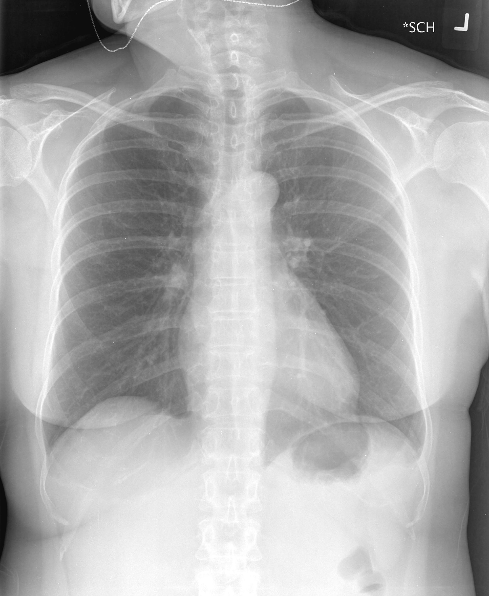

**Indication given to model:** female with

| | Radiologist report | Model |
|---|---|---|
| Findings | No pneumothorax, pleural effusion, or focal airspace disease. Heart size normal. Stable cardiomediastinal silhouette. Nodular opacities consistent with chronic granulomatous disease. Bony structures intact. | Chest X-ray showing no abnormality. |
| Impression | Negative for acute cardiopulmonary disease. | The patient was diagnosed with a left breast cancer and underwent a modified radical mastectomy. The patient was diagnosed with a left breast cancer and underwent a modified radical mastectomy. |
| Next steps | - | 1. Investigate: A chest X-ray was performed and showed no abnormality (Fig. 2. Investigate: A chest X-ray was performed and showed no abnormality (Fig. 3. Investigate: A chest X-ray was performed and showed no abnormality (Fig. 4. Investigate: A chest X-ray was performed and showed no abnormality (Fig. |

## Open-i 504 (abnormal: calcified granuloma, opacity, pulmonary atelectasis)

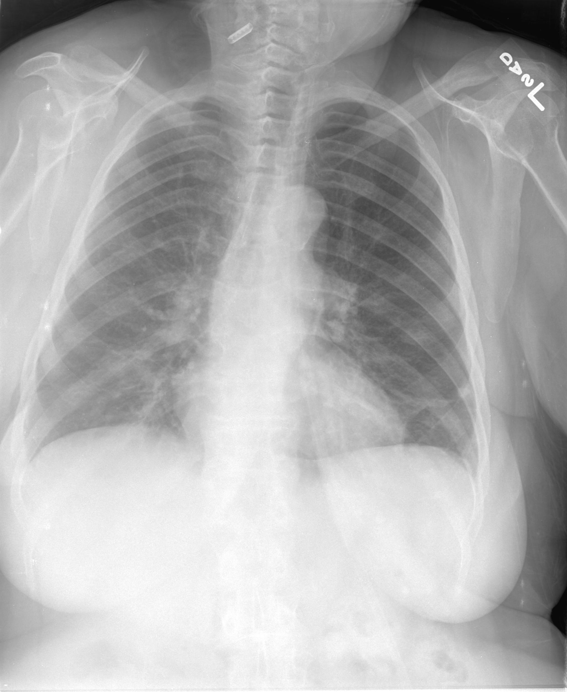

**Indication given to model:** with dyspnea.

| | Radiologist report | Model |
|---|---|---|
| Findings | Stable cardiomediastinal silhouette. Stable opacity in the left base, scarring or atelectasis. Rounded calcified density in the left lung base, calcified granuloma. No consolidation. No pleural effusion or pneumothorax. Stable degenerative changes of the spine. | Chest X-ray showing bilateral lower lung infiltrates. |
| Impression | No acute cardiopulmonary abnormality. | The patient was diagnosed with a left breast carcinoma and underwent a modified radical mastectomy. The patient was diagnosed with a left breast carcinoma and underwent a modified radical mastectomy. |
| Next steps | - | 1. Immediate stabilisation: The patient was treated with oxygen inhalation and antibiotics. 2. Immediate stabilisation: The patient was treated with oxygen inhalation and antibiotics. 3. Immediate stabilisation: The patient was treated with oxygen inhalation and antibiotics. 4. Immediate stabilisation: The patient was treated with oxygen inhalation and antibiotics. |

## Open-i 267 (abnormal: pleural effusion)

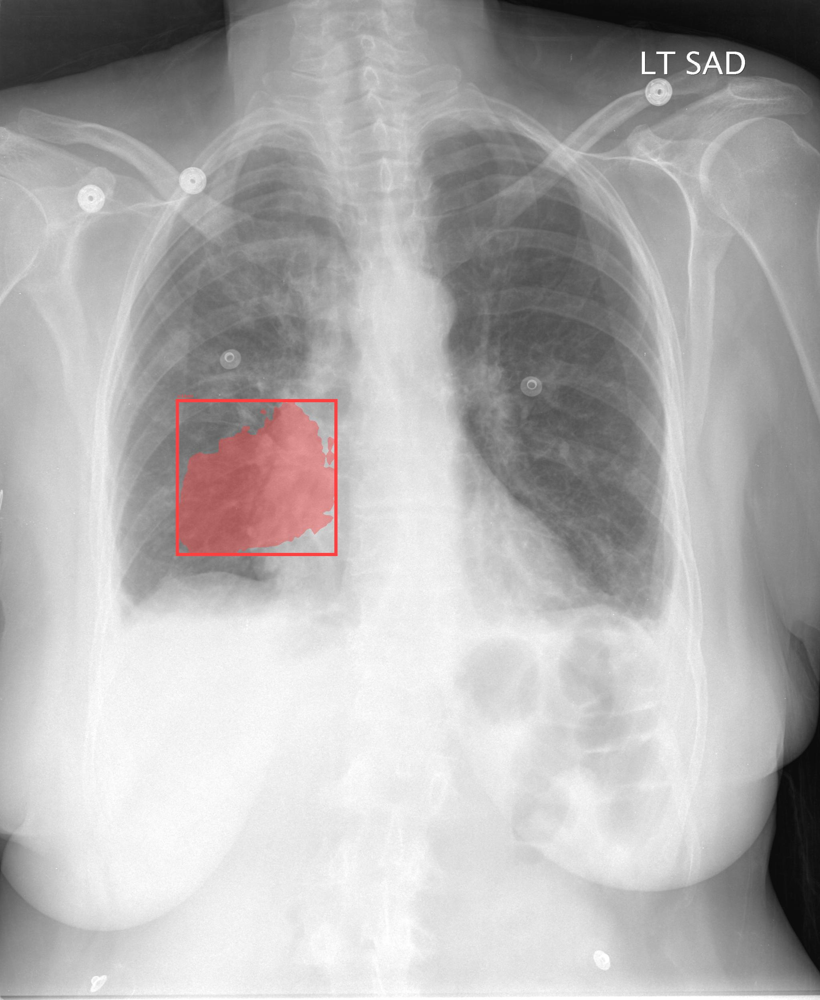

**Indication given to model:** pt with.please for infiltrates

| | Radiologist report | Model |
|---|---|---|
| Findings | Endotracheal tube and NG tube have been removed. Mild patchy bilateral airspace disease. There are small bilateral pleural effusions. No pneumothorax. Heart and mediastinum are stable with normal size heart. Degenerative changes in the spine. | Chest x-ray showing bilateral pleural effusions. |
| Impression | Small bilateral pleural effusions with a few scattered areas of patchy bilateral airspace disease. | The patient was diagnosed with a left breast carcinoma and underwent a modified radical mastectomy. The patient was diagnosed with a left breast carcinoma and underwent a modified radical mastectomy. |
| Next steps | - | 1. Immediate stabilisation: The patient [history not provided]. 2. Immediate stabilisation: The patient was intubated and mechanically ventilated. 3. Immediate stabilisation: The patient was intubated and mechanically ventilated. 4. Immediate stabilisation: The patient was intubated and mechanically ventilated. |

## Open-i 721 (normal)

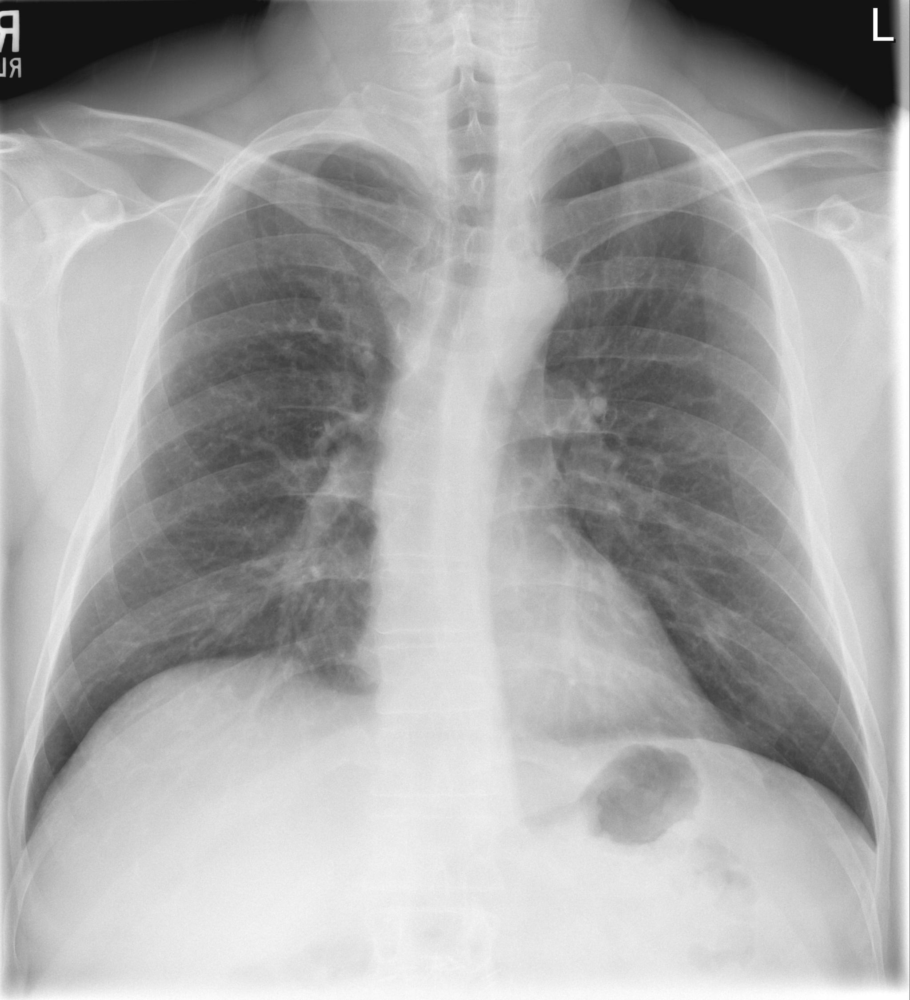

**Indication given to model:** Testicular cancer are all

| | Radiologist report | Model |
|---|---|---|
| Findings | Lungs are clear. No pleural effusions or pneumothoraces. Heart and mediastinum of normal size and contour. | Chest X-ray showed no abnormality. |
| Impression | Clear lungs with no suspicious pulmonary nodules or masses. | The patient was diagnosed with testicular cancer and was treated with chemotherapy. The patient was diagnosed with a left renal tumor and was treated with surgery. |
| Next steps | - | 1. Investigate: A chest X-ray was performed and showed no abnormality (Figure 1). 2. Investigate: A chest CT scan was performed and showed a 1.5 cm mass in the left upper lobe of the lung (Figure 2). 3. Investigate: A biopsy was performed and the tumor was diagnosed as a left renal tumor. 4. Definitive treatment: The patient was treated with chemotherapy and the tumor was reduced. |

## Open-i 128 (abnormal: -)

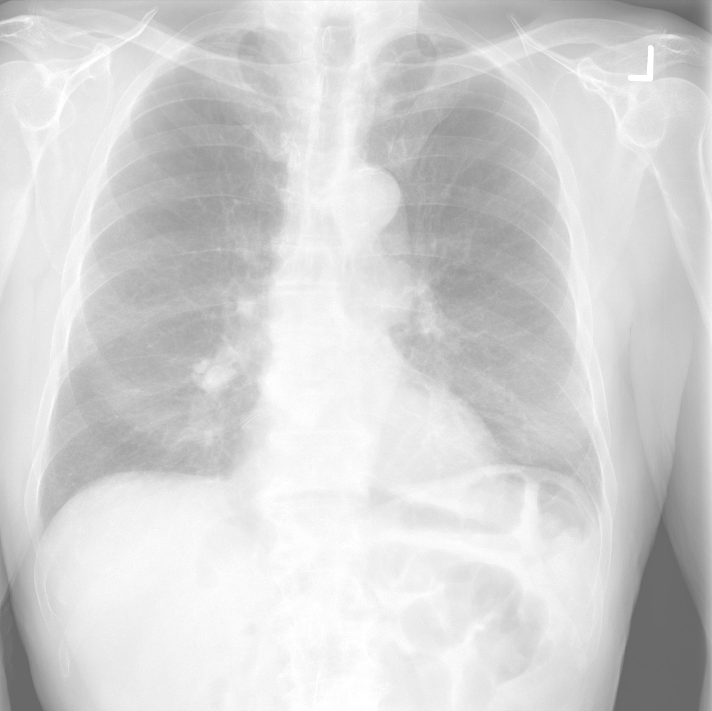

**Indication given to model:** Recent loss.

| | Radiologist report | Model |
|---|---|---|
| Findings | Sequelae of old granulomatous disease. Lungs are overall hyperexpanded with flattening of the diaphragms. No focal consolidation. Prominent interstitial markings are again noted which are predominantly lower lobe and peripheral suggesting pulmonary fibrosis. This appearance is overall not significantly. No pleural effusions or pneumothoraces. heart and mediastinum are stable with atherosclerotic vascular disease. Degenerative changes in the thoracic spine. | Chest X-ray showing a right lower lobe opacity. |
| Impression | 1. Overall stable appearance of the chest suggesting pulmonary fibrosis. | The patient with a [history not provided]. A chest X-ray revealed a right lower lobe opacity (Fig. |
| Next steps | - | 1. Investigate: A chest CT scan was performed, which showed a right lower lobe mass with a cavitation and a right hilar lymph node enlargement (Fig. 2. Investigate: A biopsy of the lung mass was performed. 3. Investigate: A biopsy of the hilar lymph node was performed. 4. Investigate: A biopsy of the liver mass was performed. |

## Open-i 573 (abnormal: opacity, pulmonary emphysema)

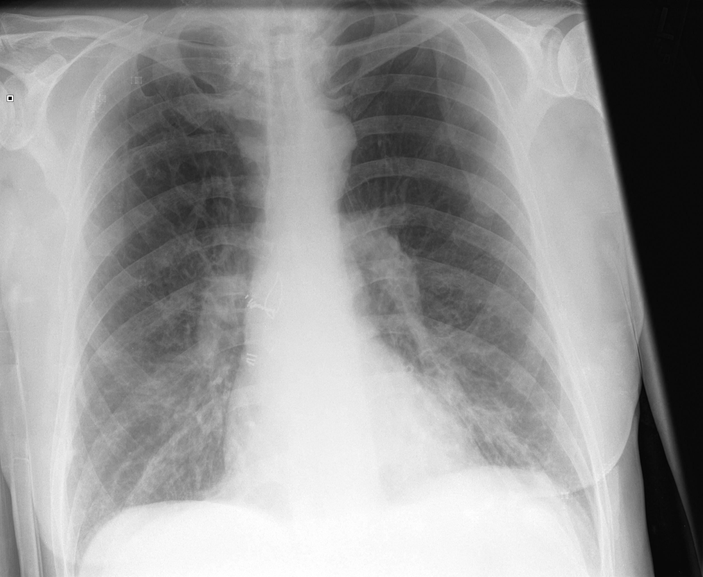

**Indication given to model:** Dyspnea.

| | Radiologist report | Model |
|---|---|---|
| Findings | The examination consists of frontal and lateral radiographs of the chest. Sternotomy and surgical clips are again seen. The cardiomediastinal contours are unchanged. There is a background of marked centrilobular emphysema. Streaky opacities in the lung bases may represent atelectasis or scarring. There is no consolidation, pleural effusion or pneumothorax. | Chest X-ray showing bilateral interstitial infiltrates. |
| Impression | No evidence of acute cardiopulmonary disease or significant interval change. | The patient with a [history not provided]. A chest X-ray revealed bilateral interstitial infiltrates (Figure 1). |
| Next steps | - | 1. Immediate stabilisation: The patient was treated with oxygen therapy and antibiotics. 2. Immediate stabilisation: The patient's condition improved, and the oxygen therapy was discontinued. 3. Investigate: A chest CT scan was performed, which showed bilateral interstitial infiltrates and ground-glass opacities (Figure 2). 4. Investigate: A biopsy of the lung was performed. |

## Open-i 767 (normal)

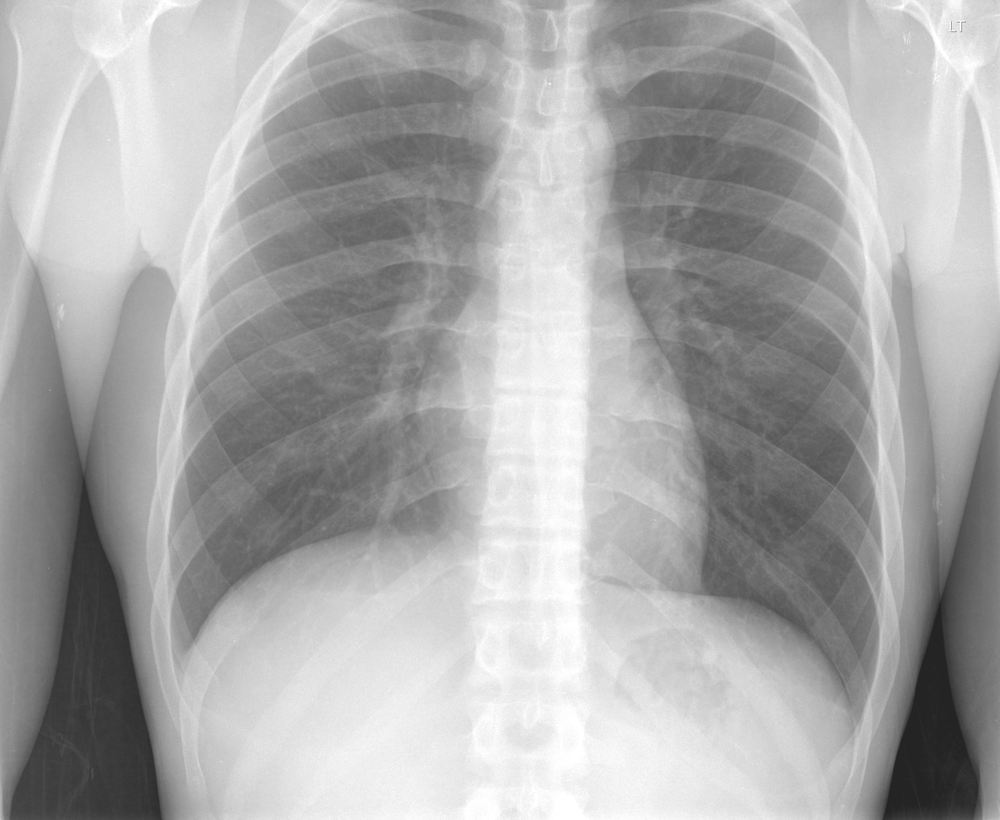

**Indication given to model:** (none)

| | Radiologist report | Model |
|---|---|---|
| Findings | Heart and mediastinum within normal limits. Negative for focal pulmonary consolidation, pleural effusion, pneumothorax. No acute bony abnormality. No lymphadenopathy. | Chest X-ray showing normal lung fields. |
| Impression | Unremarkable examination. | The patient was diagnosed with a left-sided pleural effusion and was referred to hospital for further evaluation. A chest X-ray revealed a left-sided pleural effusion (Fig. |
| Next steps | - | 1. Immediate stabilisation: The pleural fluid was exudative, and the pleural fluid/serum protein ratio was 2.2. 2. Investigate: A CT scan of the chest was performed, which showed a left-sided pleural effusion and a 1.5 cm x 1.5 cm x 1.5 cm mass in the left upper lobe (Fig. 3. Investigate: A CT scan of the chest was performed, which showed a left-sided pleural effusion and a 1.5 cm x 1.5 cm x 1.5 cm mass in the left upper lobe (Fig. 4. Investigate: A CT scan of the chest was performed, which showed a left-sided pleural effusion and a 1.5 cm x 1.5 cm x 1.5 cm mass in the left upper lobe (Fig. |

## Open-i 20 (normal)

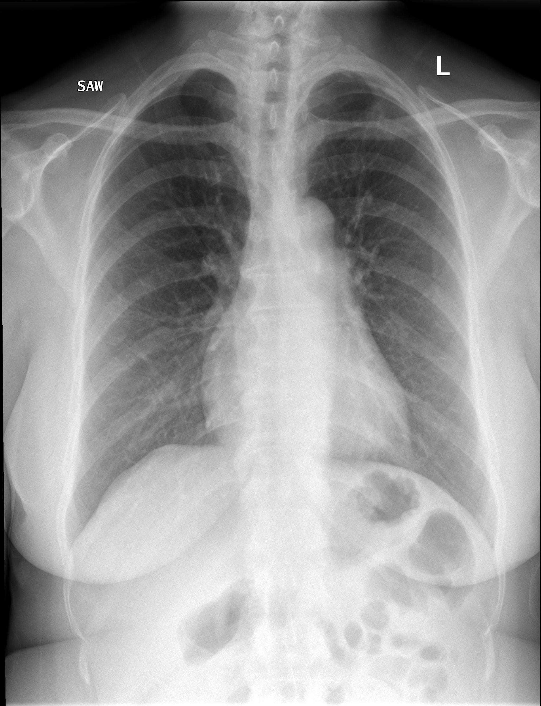

**Indication given to model:** female with.

| | Radiologist report | Model |
|---|---|---|
| Findings | The cardiac and mediastinal silhouettes are unremarkable. The lungs are well expanded and clear. There are no focal air space opacities. There is no pneumothorax or effusion. There are mild degenerative changes of the thoracic spine. | Chest X-ray showing no abnormalities. |
| Impression | No evidence of acute cardiopulmonary process. Stable appearance of the chest. | The patient was diagnosed with a left breast cancer and underwent a modified radical mastectomy. The patient was diagnosed with a left breast cancer and underwent a modified radical mastectomy. |
| Next steps | - | 1. Investigate: A chest X-ray was performed and showed no abnormalities (Figure 1). 2. Investigate: A chest X-ray was performed and showed no abnormalities (Figure 2). 3. Investigate: A chest X-ray was performed and showed no abnormalities (Figure 3). 4. Investigate: A chest X-ray was performed and showed no abnormalities (Figure 4). |

## Open-i 601 (abnormal: opacity)

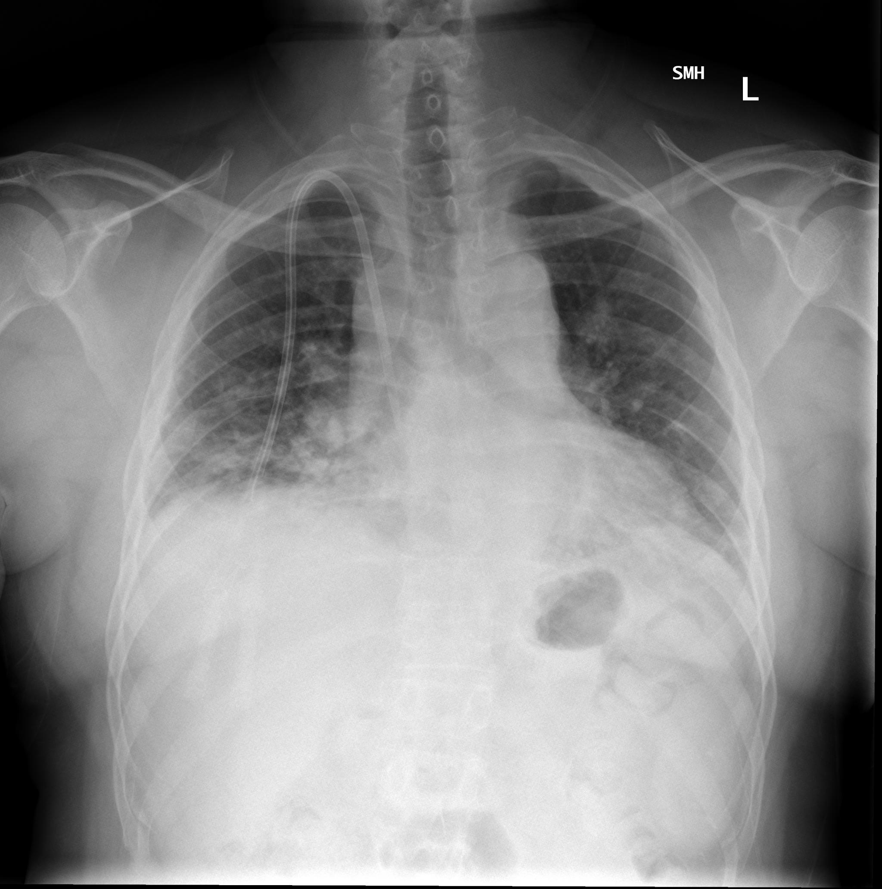

**Indication given to model:** male, shortness of breath. Reported history of sarcoid.

| | Radiologist report | Model |
|---|---|---|
| Findings | Right dual-lumen internal jugular central venous catheter seen with tip overlying the cavoatrial junction. Heart size at the upper limits of normal. Low lung volumes with bronchovascular crowding. Patchy bibasilar air airspace opacities right greater than left. No visualized pneumothorax. Prominence of the mediastinum consistent with history of sarcoid. | Chest X-ray showing bilateral lower lobe infiltrates. |
| Impression | 1. Bilateral lower lung airspace disease right greater than left, most representing acute infectious process. 2. Widening of the mediastinum, secondary to lymphadenopathy related to sarcoid, or possibly reactive adenopathy. | The patient [history not provided]. The patient was diagnosed with pulmonary sarcoidosis and was started on prednisone 20 mg daily. |
| Next steps | - | 1. Immediate stabilisation: The patient was started on supplemental oxygen and intravenous antibiotics. 2. Immediate stabilisation: The patient was started on supplemental oxygen and intravenous antibiotics. 3. Immediate stabilisation: The patient was started on supplemental oxygen and intravenous antibiotics. 4. Immediate stabilisation: The patient was started on supplemental oxygen and intravenous antibiotics. |

## Open-i 491 (abnormal: opacity, pulmonary atelectasis)

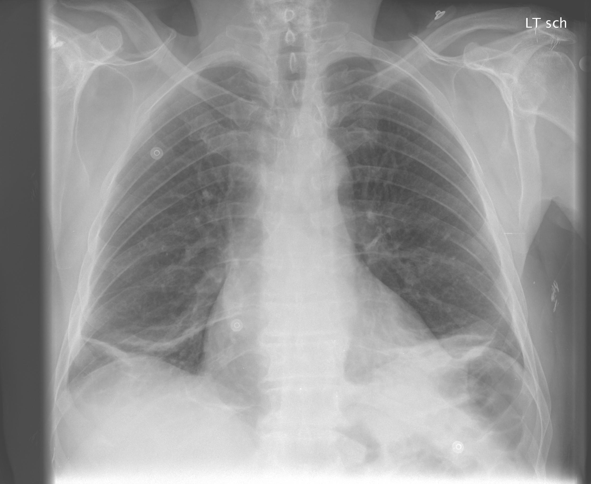

**Indication given to model:** with recent myocardial infarction, increasing oxygen requirements..

| | Radiologist report | Model |
|---|---|---|
| Findings | Cardiomediastinal silhouette is stable and within normal limits. There is improved lung volumes bilaterally with persistent bibasilar atelectatic opacities, without focal consolidation, pneumothorax, or effusion. No acute bony abnormality identified. | Chest X-ray showing bilateral lower lobe atelectasis. |
| Impression | Improving lung volumes with bibasilar atelectasis. | The patient with a history of hypertension, hyperlipidemia, and recent myocardial infarction presented to the emergency department with increasing oxygen requirements and a 2-day [history not provided]. A chest X-ray revealed bilateral lower lobe atelectasis (Figure 1). |
| Next steps | - | 1. Immediate stabilisation: The patient was started on intravenous antibiotics and supplemental oxygen. 2. Immediate stabilisation: The patient was started on intravenous antibiotics and supplemental oxygen. 3. Immediate stabilisation: The patient was started on intravenous antibiotics and supplemental oxygen. 4. Immediate stabilisation: The patient was started on intravenous antibiotics and supplemental oxygen. |

## Open-i 338 (normal)

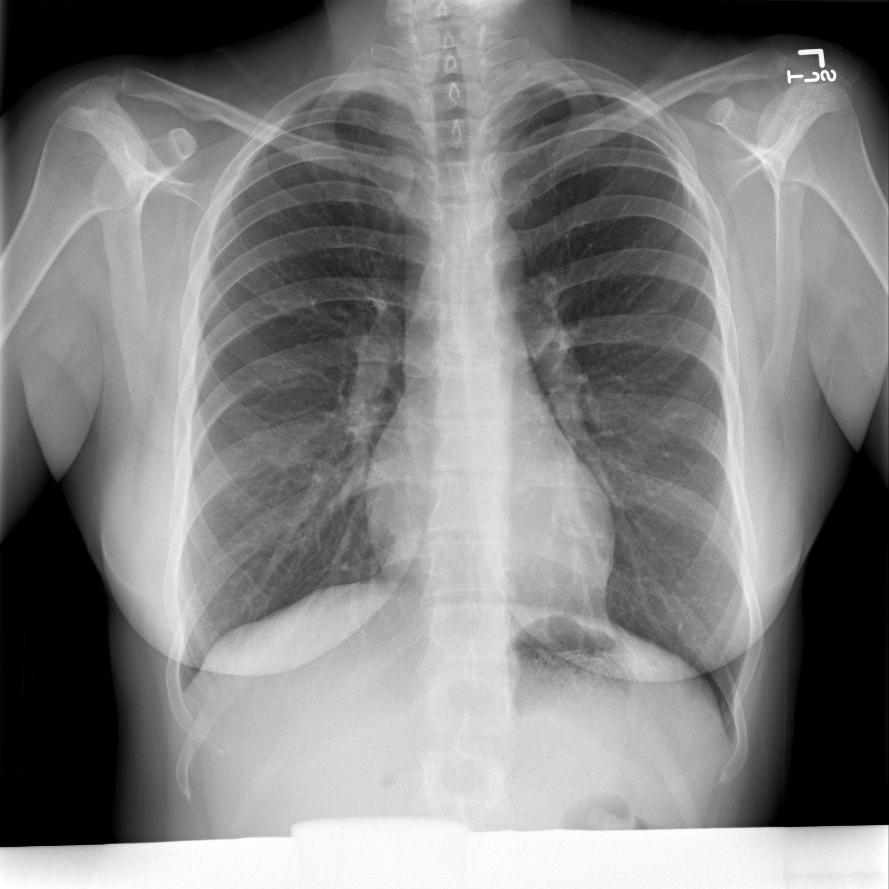

**Indication given to model:** with hemoptysis.

| | Radiologist report | Model |
|---|---|---|
| Findings | The heart, pulmonary and mediastinum are within normal limits. There is no pleural effusion or pneumothorax. There is no focal air space opacity to suggest a pneumonia. The patient was shielded. | Chest X-ray showing normal lung fields. |
| Impression | No acute cardiopulmonary disease. | The patient [history not provided]. The patient had been diagnosed with pulmonary tuberculosis and had been treated with anti-tuberculosis drugs for 2 months. |
| Next steps | - | 1. Immediate stabilisation: The patient was treated with oxygen inhalation and antibiotics. 2. Investigate: A chest X-ray was performed and showed normal lung fields (Figure 1). 3. Investigate: A chest CT scan was performed and showed a 1.5 cm x 1.5 cm x 1.5 cm mass in the right upper lobe of the lung (Figure 2). 4. Investigate: A biopsy was performed and the patient was diagnosed with a lung tumor. |

## Open-i 139 (abnormal: cardiomegaly, opacity, pulmonary disease, chronic obstructive)

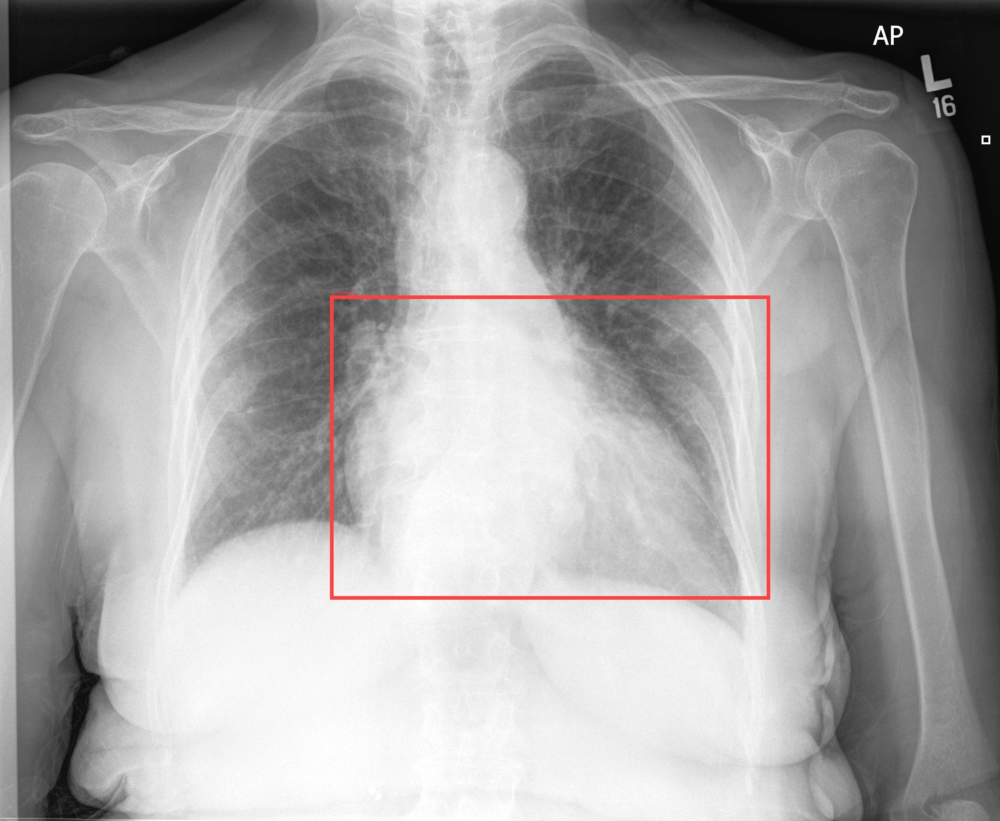

**Indication given to model:** female with shortness of breath.

| | Radiologist report | Model |
|---|---|---|
| Findings | The cardiac silhouette is mildly enlarged. A lobulated opacity is identified superior to the heart, in the anterior mediastinum on the lateral view, possibly consistent with a tortuous/ectatic thoracic aorta versus an anterior mediastinal mass. The thoracic aorta is tortuous and calcified. No focal areas of pulmonary consolidation. The lungs are hyperexpanded with flattening of the bilateral hemidiaphragms. No pneumothorax or pleural effusion. Severe degenerative changes of the thoracic spine. | Chest X-ray showing cardiomegaly. |
| Impression | 1. Lobulated anterior mediastinal opacity on the lateral view, possibly consistent with a tortuous/ectatic thoracic aorta versus an anterior mediastinal mass. Contrast-enhanced examination would to further evaluate if clinically indicated. 2. Mild cardiomegaly with findings of chronic obstructive pulmonary disease. | The patient was diagnosed with a left atrial myxoma. |
| Next steps | - | 1. Investigate: A transthoracic echocardiogram was performed, which showed a large mobile mass in the left atrium. 2. Investigate: A CT scan was performed, which showed a large left atrial mass measuring 10.5 x 8.5 x 10.5 cm. 3. Definitive treatment: The patient was started on warfarin and had a successful surgery. |

## Open-i 483 (abnormal: cardiomegaly)

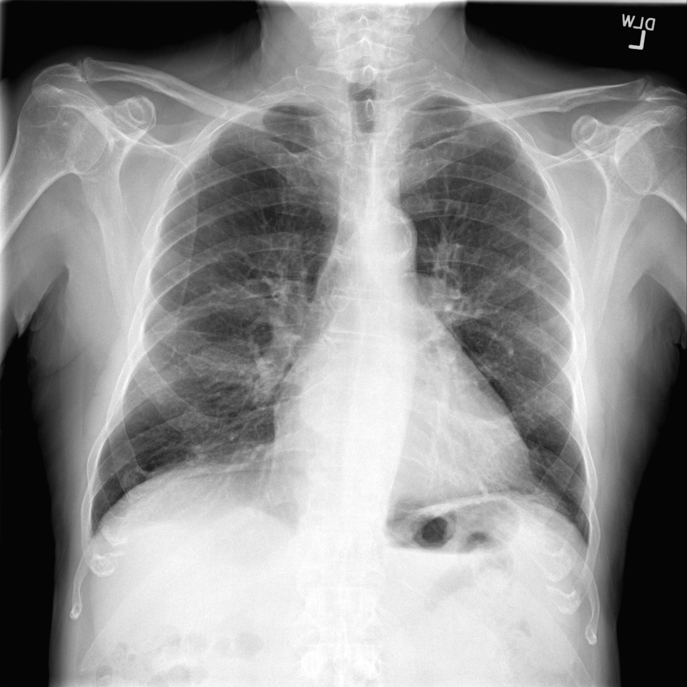

**Indication given to model:** Pneumonia

| | Radiologist report | Model |
|---|---|---|
| Findings | There is flattening of hemidiaphragms. There are prominent interstitial markings. There is no focal consolidation to suggest pneumonia. There are atherosclerotic institutions of the aorta. The heart is of the first limits of normal size. No pneumothorax or pleural effusion. | Chest X-ray showing bilateral pulmonary infiltrates. |
| Impression | 1. Hyperexpanded lungs with flattened hemidiaphragm suggesting COPD. 2. Borderline enlarged heart. 3. No acute cardiopulmonary abnormality. | The patient was diagnosed with a left-sided pleural effusion and [history not provided]. A chest X-ray revealed bilateral pulmonary infiltrates (Figure 1). |
| Next steps | - | 1. Immediate stabilisation: The patient was treated with oxygen inhalation and intravenous fluid therapy. 2. Immediate stabilisation: The patient's condition was stabilized with oxygen inhalation and intravenous fluid therapy. 3. Immediate stabilisation: The patient's condition was stabilized with oxygen inhalation and intravenous fluid therapy. 4. Immediate stabilisation: The patient's condition was stabilized with oxygen inhalation and intravenous fluid therapy. |

## Open-i 342 (abnormal: calcified granuloma, cardiomegaly)

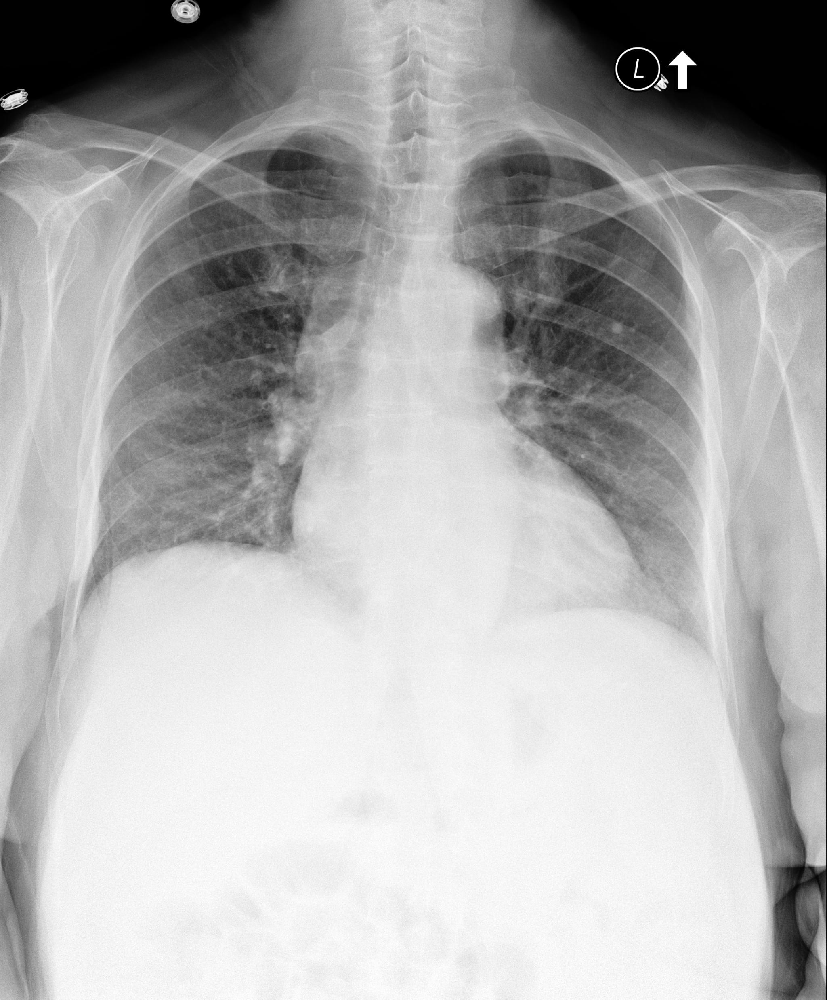

**Indication given to model:** Preoperative renal transplant.

| | Radiologist report | Model |
|---|---|---|
| Findings | The lungs and pleural spaces show no acute abnormality. Stable left upper lobe calcified granuloma. Heart size is mildly enlarged, pulmonary vascularity within normal limits. Mild tortuosity of the descending thoracic aorta. | Chest X-ray showing cardiomegaly and pulmonary edema. |
| Impression | 1. No acute pulmonary findings. 2. Mild cardiomegaly. | The patient with a history of end-stage renal disease due to diabetic nephropathy, hypertension, and hyperlipidemia, was diagnosed with a left renal tumor. The patient was diagnosed with a left renal tumor and underwent a left nephrectomy. |
| Next steps | - | 1. Immediate stabilisation: The patient [history not provided]. 2. Immediate stabilisation: The patient was transferred to the intensive care unit and was treated with oxygen, diuretics, and inotropic support. 3. Immediate stabilisation: The patient was transferred to the intensive care unit and was treated with oxygen, diuretics, and inotropic support. 4. Immediate stabilisation: The patient was transferred to the intensive care unit and was treated with oxygen, diuretics, and inotropic support. |

## Open-i 560 (normal)

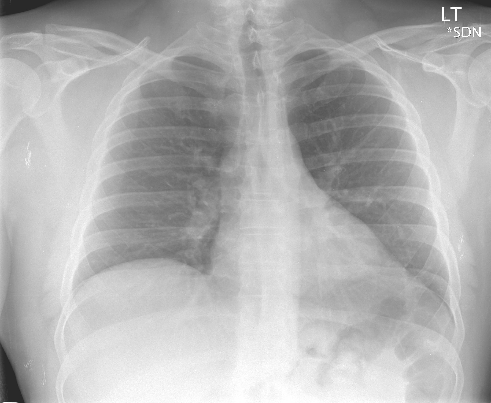

**Indication given to model:** with chest pain

| | Radiologist report | Model |
|---|---|---|
| Findings | The cardiomediastinal silhouette is within normal limits. The lungs are clear without areas of focal consolidation. No pneumothorax or large pleural effusion. No acute bone abnormality. | Chest X-ray showing a normal heart size and no pulmonary congestion. |
| Impression | No acute cardiopulmonary process. | The patient [history not provided]. The patient was diagnosed with a left ventricular thrombus and was started on anticoagulation therapy. |
| Next steps | - | 1. Investigate: A chest X-ray was performed, which showed a normal heart size and no pulmonary congestion (Figure 1). 2. Investigate: A transthoracic echocardiogram was performed, which showed a normal left ventricular ejection fraction and no evidence of left ventricular thrombus. 3. Investigate: A CT scan of the chest was performed, which showed a normal heart size and no evidence of pulmonary embolism. 4. Definitive treatment: The patient was started on anticoagulation therapy with heparin and [history not provided]. |

## Open-i 784 (abnormal: pleural effusion, pulmonary atelectasis)

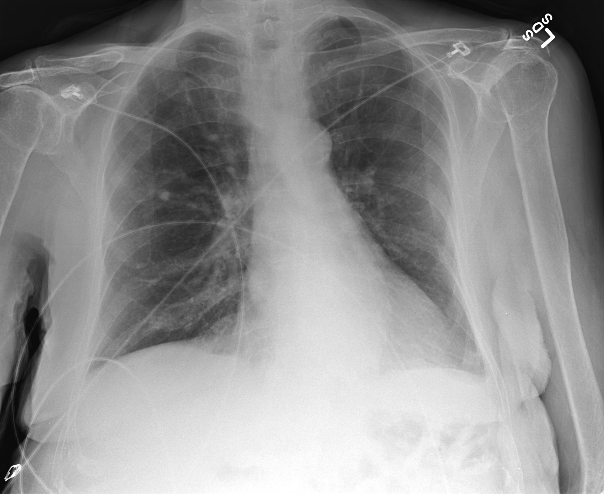

**Indication given to model:** Vomiting and right-sided abdominal pain

| | Radiologist report | Model |
|---|---|---|
| Findings | Normal heart size. Tortuous calcified aorta. Scattered granulomas. No lobar pneumonia. Probable post your recess effusions. Kyphotic degenerated osteopenic thoracic spine. | Chest X-ray showing a right lower lobe opacity. |
| Impression | Probable posterior recess effusions with mild basilar atelectasis. No lobar pneumonia. | The patient [history not provided]. The patient was diagnosed with acute pancreatitis and [history not provided]. |
| Next steps | - | 1. Immediate stabilisation: The patient was intubated and mechanically ventilated. 2. Immediate stabilisation: The patient was intubated and mechanically ventilated. 3. Immediate stabilisation: The patient was intubated and mechanically ventilated. 4. Immediate stabilisation: The patient was intubated and mechanically ventilated. |

## Open-i 144 (abnormal: pulmonary atelectasis)

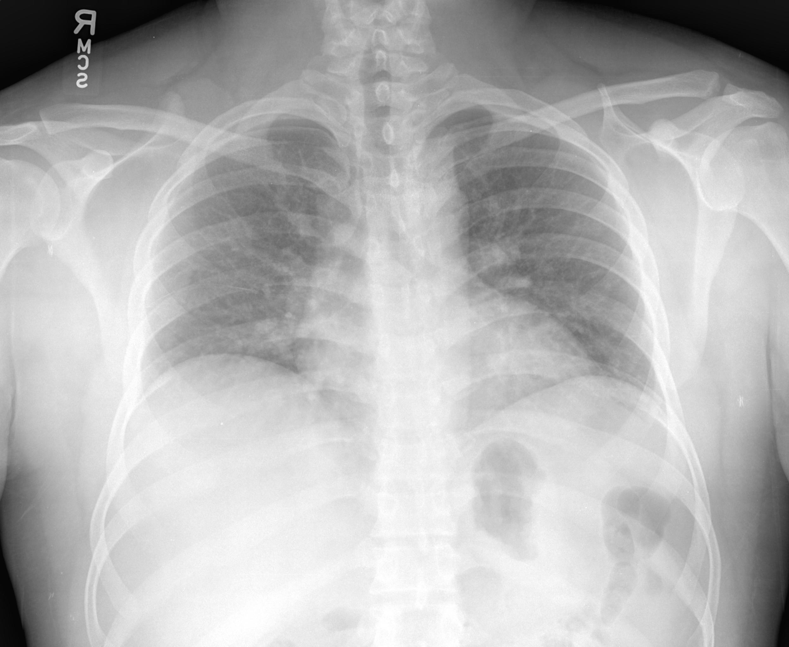

**Indication given to model:** (none)

| | Radiologist report | Model |
|---|---|---|
| Findings | Overall low lung volumes with mild patchy bibasilar airspace disease. This most represents atelectasis given the low lung volumes. No pleural effusions or pneumothoraces. Heart and mediastinum of normal size and contour. | Chest X-ray showing bilateral interstitial infiltrates. |
| Impression | Mild patchy bibasilar airspace disease most representing atelectasis given the low lung volumes. | The patient was diagnosed with a left-sided pleural effusion and [history not provided]. A chest X-ray revealed bilateral interstitial infiltrates (Figure 1). |
| Next steps | - | 1. Immediate stabilisation: The patient was treated with oxygen inhalation and intravenous fluid therapy. 2. Immediate stabilisation: The patient's condition stabilized after the treatment. 3. Investigate: A chest X-ray was performed, which showed bilateral interstitial infiltrates (Figure 1). 4. Investigate: A chest X-ray was performed, which showed bilateral interstitial infiltrates (Figure 2). |

## Open-i 102 (abnormal: -)

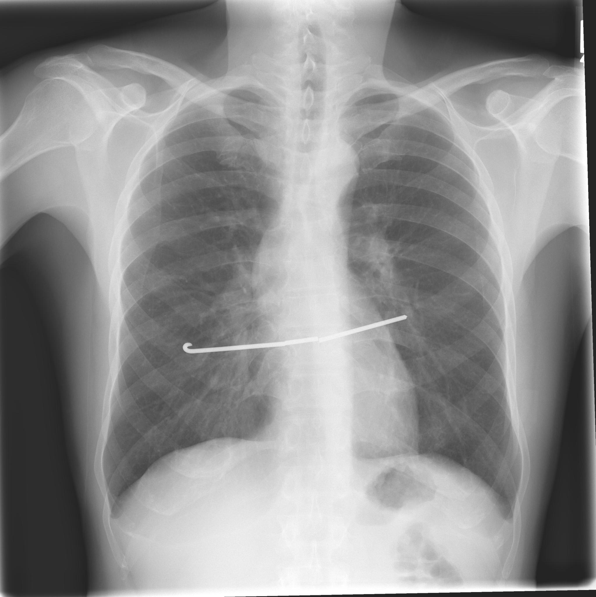

**Indication given to model:** Syncope. attack.

| | Radiologist report | Model |
|---|---|---|
| Findings | Normal heart size. Clear, hyperaerated lungs. No pneumothorax. No pleural effusion. substernal density may be related to a pectus deformity. | Chest X-ray showing the position of the lead. |
| Impression | No acute cardiopulmonary abnormality. | The patient was diagnosed with a left ventricular outflow tract obstruction (LVOTO) and underwent a successful septal myectomy. |
| Next steps | - | 1. Investigate: A chest X-ray was performed (Figure 1) and showed that the lead was in the correct position. 2. Investigate: A chest X-ray was performed (Figure 2) and showed that the lead was in the correct position. 3. Investigate: A chest X-ray was performed (Figure 3) and showed that the lead was in the correct position. 4. Investigate: A chest X-ray was performed (Figure 4) and showed that the lead was in the correct position. |

## Open-i 318 (normal)

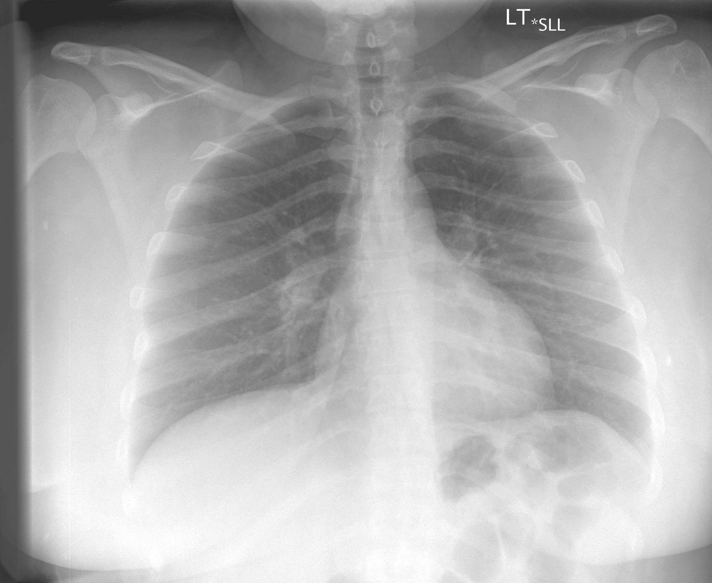

**Indication given to model:** Dyspnea

| | Radiologist report | Model |
|---|---|---|
| Findings | Lungs are clear bilaterally. Cardiac and mediastinal silhouettes are normal. Pulmonary vasculature is normal. No pneumothorax or pleural effusion. No acute bony abnormality. | Chest X-ray showing no abnormalities. |
| Impression | No acute cardiopulmonary abnormality. | The patient was diagnosed with a left breast cancer and underwent a modified radical mastectomy. The patient was diagnosed with a left breast cancer and underwent a modified radical mastectomy. |
| Next steps | - | 1. Immediate stabilisation: The patient [history not provided]. 2. Immediate stabilisation: The patient was intubated and mechanically ventilated. 3. Immediate stabilisation: The patient was intubated and mechanically ventilated. 4. Immediate stabilisation: The patient was intubated and mechanically ventilated. |

## Open-i 761 (abnormal: -)

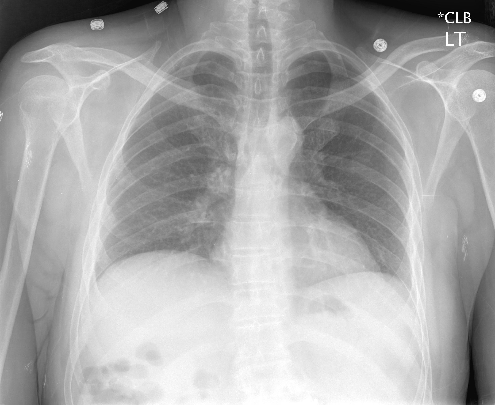

**Indication given to model:** XXXXyo with hepatic encephalopathy with persistent altered mental status despite t

| | Radiologist report | Model |
|---|---|---|
| Findings | Lung volumes are low. No focal infiltrates. Heart size normal. | Chest x-ray showing no acute process. |
| Impression | change. Hypoinflation with no visible active cardiopulmonary disease. | The patient was diagnosed with a left frontal lobe mass and underwent resection. The patient was diagnosed with a left frontal lobe mass and underwent resection. |
| Next steps | - | 1. Immediate stabilisation: The patient was intubated and [history not provided]. 2. Immediate stabilisation: The patient was intubated and [history not provided]. 3. Immediate stabilisation: The patient was intubated and [history not provided]. 4. Immediate stabilisation: The patient was intubated and [history not provided]. |

## Open-i 355 (abnormal: -)

**Indication given to model:** rib pain

| | Radiologist report | Model |
|---|---|---|
| Findings | Lung volumes are low. Prominent increased interstitial markings in both lungs are unchanged in the interval. Bullae are present both upper lobes, right worse than left. No pleural air collections. Heart size normal. | Chest X-ray showing bilateral pulmonary infiltrates. |
| Impression | Chronic interstitial and bullous disease. No acute findings. | The patient was diagnosed with a left-sided rib fracture and was prescribed analgesics. A chest X-ray revealed bilateral pulmonary infiltrates (Figure 1). |
| Next steps | - | 1. Immediate stabilisation: The patient [history not provided]. 2. Immediate stabilisation: The patient was weaned from the ventilator and was discharged on a home oxygen device. 3. Investigate: A computed tomography (CT) scan of the chest was performed, which showed bilateral ground-glass opacities with a few areas of consolidation (Figure 2). 4. Investigate: A CT-guided biopsy of the right lower lobe was performed, which showed a few clusters of lymphocytes and macrophages with a few multinucleated giant cells. |

## Open-i 18 (abnormal: pleural effusion)

**Indication given to model:** male, pain

| | Radiologist report | Model |
|---|---|---|
| Findings | Heart size within normal limits. No focal alveolar consolidation, no definite pleural effusion seen. No typical findings of pulmonary edema. No pneumothorax. | Chest X-ray showing no abnormalities. |
| Impression | No acute cardiopulmonary findings | The patient was diagnosed with a left-sided inguinal hernia and underwent surgery. The patient was diagnosed with a left inguinal hernia and underwent surgery. |
| Next steps | - | 1. Immediate stabilisation: The patient [history not provided]. 2. Immediate stabilisation: The patient [history not provided]. 3. Immediate stabilisation: The patient [history not provided]. 4. Immediate stabilisation: The patient [history not provided]. |

## Open-i 80 (normal)

**Indication given to model:** (none)

| | Radiologist report | Model |
|---|---|---|
| Findings | Heart size and mediastinal contour within normal limits. No focal airspace consolidation, pneumothorax, or large pleural effusion. No acute osseous abnormality. | Chest X-ray showing no evidence of pulmonary disease. |
| Impression | No acute cardiopulmonary abnormality. | The patient was diagnosed with a left renal mass and underwent a left nephrectomy. The patient was diagnosed with a left renal mass and underwent a left nephrectomy. |
| Next steps | - | 1. Investigate: A chest X-ray was performed and showed no evidence of pulmonary disease (Figure 1). 2. Investigate: A chest X-ray was performed and showed no evidence of pulmonary disease (Figure 2). 3. Investigate: A chest X-ray was performed and showed no evidence of pulmonary disease (Figure 3). 4. Investigate: A chest X-ray was performed and showed no evidence of pulmonary disease (Figure 4). |

## Open-i 534 (abnormal: opacity, pulmonary atelectasis)

**Indication given to model:** and hypoxia

| | Radiologist report | Model |
|---|---|---|
| Findings | The heart is normal in size. The mediastinum is unremarkable. Left perihilar scarring is noted in the upper lobe. Streaky opacities in the retrocardiac region reflect mild subsegmental atelectasis. There is no focal infiltrate or pleural effusion. | Chest X-ray showing a normal heart size and no pulmonary congestion. |
| Impression | Mild left-sided scarring/subsegmental atelectasis. No definite infiltrate. | The patient with a [history not provided]. Physical examination revealed a normal heart rate and blood pressure. |
| Next steps | - | 1. Immediate stabilisation: The patient was treated with oxygen inhalation and intravenous fluid therapy. 2. Investigate: A chest X-ray was performed and showed a normal heart size and no pulmonary congestion (Figure 1). 3. Investigate: A transthoracic echocardiogram was performed to evaluate the cardiac function. 4. Investigate: A chest X-ray was performed and showed a normal heart size and no pulmonary congestion (Figure 2). |

## Open-i 294 (abnormal: emphysema)

**Indication given to model:** Shortness of breath

| | Radiologist report | Model |
|---|---|---|
| Findings | The heart is normal in size. The mediastinum is unremarkable. The lungs are grossly clear. Underlying emphysematous changes are noted. | Chest X-ray showing a left lower lobe mass. |
| Impression | Emphysema without acute disease. | The patient with a [history not provided]. The patient was diagnosed with a left lower lobe lung adenocarcinoma. |
| Next steps | - | 1. Investigate: A chest X-ray was obtained (Figure 1). 2. Investigate: A chest X-ray was obtained (Figure 2). 3. Investigate: A chest X-ray was obtained (Figure 3). 4. Investigate: A chest X-ray was obtained (Figure 4). |

## Open-i 298 (normal)

**Indication given to model:** for one with vomiting

| | Radiologist report | Model |
|---|---|---|
| Findings | The lungs are clear. There is no pleural effusion or pneumothorax. The heart and mediastinum are normal. The skeletal structures are normal. | Chest X-ray of the patient. |
| Impression | No acute pulmonary disease. | The patient was diagnosed with a left breast mass and underwent a left mastectomy with axillary lymph node dissection. The patient was diagnosed with a left breast mass and underwent a left mastectomy with axillary lymph node dissection. |
| Next steps | - | 1. Immediate stabilisation: The patient was diagnosed with a left breast mass and underwent a left mastectomy with axillary lymph node dissection. 2. Immediate stabilisation: The patient was diagnosed with a left breast mass and underwent a left mastectomy with axillary lymph node dissection. 3. Immediate stabilisation: The patient was diagnosed with a left breast mass and underwent a left mastectomy with axillary lymph node dissection. 4. Immediate stabilisation: The patient was diagnosed with a left breast mass and underwent a left mastectomy with axillary lymph node dissection. |

## Open-i 70 (abnormal: -)

**Indication given to model:** chest pain

| | Radiologist report | Model |
|---|---|---|
| Findings | Sequelae of old granulomatous disease. Lungs are clear without focal airspace disease. No pleural effusions or pneumothoraces. Heart and mediastinum of normal size and contour. | Chest X-ray showing a small left apical nodule. |
| Impression | Clear lungs. | The patient [history not provided]. The patient had been diagnosed with a left apical nodule on a chest X-ray performed at another hospital. |
| Next steps | - | 1. Investigate: A chest X-ray performed at the hospital showed a small left apical nodule (Fig. 2. Investigate: A chest CT scan was performed to determine whether the nodule was benign or malignant. 3. Investigate: A biopsy was performed to determine whether the nodule was benign or malignant. 4. Definitive treatment: The patient was treated with a 10-day course of oral prednisolone (1 mg/kg/day) and a 10-day course of oral prednisolone (1 mg/kg/day). |

## Open-i 772 (abnormal: cardiomegaly)

**Indication given to model:** The patient is a female with chest pain and onset right hand numbness and inability to. History of heart bypass surgery many years ago.

| | Radiologist report | Model |
|---|---|---|
| Findings | sternotomy and numerous mediastinal clips appear stable in position. There is aortic atherosclerotic calcification. The thoracic aorta is tortuous. Stable widening of the upper mediastinum. Stable cardiomegaly. Prominent mitral annular calcification demonstrated on the lateral view. No pneumothorax, pleural effusion or airspace consolidation. appear intact. | Chest X-ray showing cardiomegaly. |
| Impression | 1. No acute cardiopulmonary abnormality. 2. Stable cardiomegaly, tortuous thoracic aorta and atherosclerotic calcification.. | The patient was diagnosed with a left-sided stroke and [history not provided]. The patient was diagnosed with a left-sided stroke and [history not provided]. |
| Next steps | - | 1. Immediate stabilisation: The patient was intubated and [history not provided]. 2. Immediate stabilisation: The patient was intubated and [history not provided]. 3. Immediate stabilisation: The patient was intubated and [history not provided]. 4. Immediate stabilisation: The patient was intubated and [history not provided]. |

## Open-i 690 (normal)

**Indication given to model:** Shortness of breath

| | Radiologist report | Model |
|---|---|---|
| Findings | Mediastinal contours are normal. Lungs are clear. There is no pneumothorax or large pleural effusion. | Chest X-ray showing a normal heart size and clear lungs. |
| Impression | No acute cardiopulmonary abnormality. | The patient was diagnosed with a left-sided pleural effusion and was [history not provided]. A chest X-ray revealed a normal heart size and clear lungs (Figure 1). |
| Next steps | - | 1. Immediate stabilisation: The patient was started on a low-molecular-weight heparin drip and was discharged on a therapeutic dose of warfarin. 2. Investigate: A CT scan of the chest was performed, which showed a small left-sided pleural effusion. 3. Investigate: A CT scan of the abdomen and pelvis was performed, which showed a small amount of ascites. 4. Investigate: A CT scan of the chest was performed, which showed a small amount of left-sided pleural effusion. |

## Open-i 606 (abnormal: -)

**Indication given to model:** male with chest pain.

| | Radiologist report | Model |
|---|---|---|
| Findings | sternotomy are in and intact. Normal cardiomediastinal silhouette. The bilateral costophrenic are excluded from the image on the PA view. Lungs are clear without focal areas of consolidation, pleural effusion, or pneumothorax. are intact without acute osseous abnormality. Mild degenerative changes throughout the thoracic spine. | Chest X-ray showing normal heart size and clear lungs. |
| Impression | Chest radiograph. 1. No acute radiographic cardiopulmonary process. | The patient was diagnosed with a left ventricular aneurysm and was referred to hospital for further evaluation. |
| Next steps | - | 1. Investigate: A transthoracic echocardiogram was performed and showed a large left ventricular aneurysm with a maximum diameter of 10 cm. 2. Investigate: A CT scan was performed and showed a large aneurysm of the left ventricle with a maximum diameter of 10 cm. 3. Investigate: A CT scan was performed and showed a large aneurysm of the left ventricle with a maximum diameter of 10 cm. 4. Definitive treatment: The patient was started on warfarin and was discharged with a plan to be seen in 6 months. |

