# Held-out annotated cases (green = expected box, red = model box)

## fracatlas / IMG0002600.jpg (x_ray)

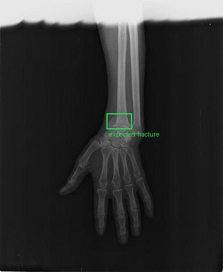

| | Expected | Model |
|---|---|---|
| Finding | fracture | none |
| Location | box (green) | - (IoU 0.0) |
| Text | - | Lateral. Impression: The patient was diagnosed with a left-sided ulnar-sided carpal tunnel syndrome and was treated with a corticosteroid injection. The patient was diagnosed with a left-sided ulnar-sided carpal tunnel syndrome and was treated with a corticosteroid injection. Suggested next steps (most to least suitable): 1. Immediate stabilisation: The patient was treated with a corticosteroid injection and a splint. 2. Immediate stabilisation: The patient was treated with a corticosteroid... |

## fracatlas / IMG0002486.jpg (x_ray)

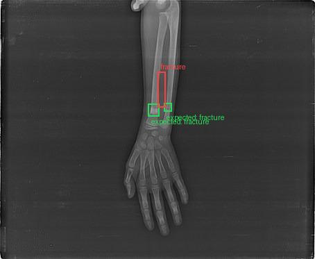

| | Expected | Model |
|---|---|---|
| Finding | fracture | fracture |
| Location | box (green) | middle third, centre; box covers about 0% of the image (IoU 0.01920154544431877) |
| Text | - | X-ray of the left forearm. Impression: The patient was diagnosed with a left forearm fracture and was treated with a cast. Suggested next steps (most to least suitable): 1. Definitive treatment: The patient was treated with a cast for 6 weeks. |

## fracatlas / IMG0002319.jpg (x_ray)

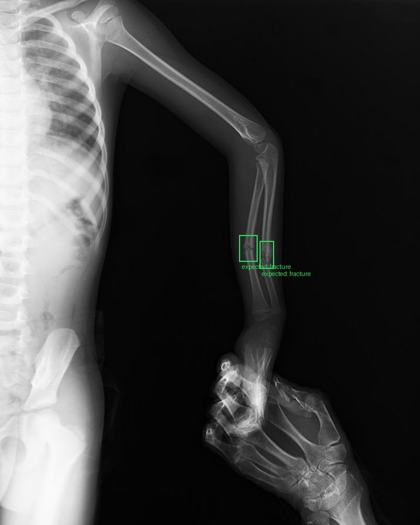

| | Expected | Model |
|---|---|---|
| Finding | fracture | none |
| Location | box (green) | - (IoU 0.0) |
| Text | - | Lateral view of the left arm. Impression: The patient was diagnosed with a left humerus fracture and was treated with a cast. Suggested next steps (most to least suitable): 1. Immediate stabilisation: The patient was treated with a splint and a cast. 2. Definitive treatment: The patient was treated with a cast. 3. Definitive treatment: The patient was treated with a cast. 4. Definitive treatment: The patient was treated with a cast. |

## fracatlas / IMG0003234.jpg (x_ray)

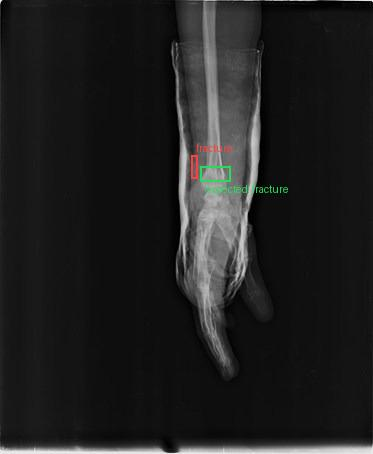

| | Expected | Model |
|---|---|---|
| Finding | fracture | fracture |
| Location | box (green) | middle third, centre; box covers about 0% of the image (IoU 0.0) |
| Text | - | Lateral. Impression: The patient was diagnosed with a left hand fracture and was referred to hospital for surgical treatment. Suggested next steps (most to least suitable): 1. Definitive treatment: The patient underwent surgical fixation of the fracture. 2. Definitive treatment: The patient was treated with a splint and discharged. 3. Definitive treatment: The patient was treated with a splint and discharged. 4. Definitive treatment: The patient was treated with a splint and discharged. |

## fracatlas / IMG0003564.jpg (x_ray)

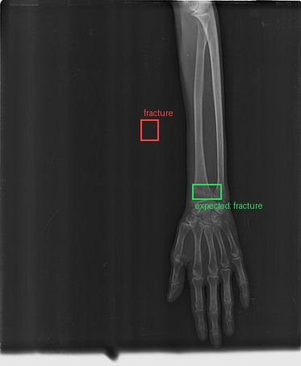

| | Expected | Model |
|---|---|---|
| Finding | fracture | fracture |
| Location | box (green) | middle third, centre; box covers about 0% of the image (IoU 0.0) |
| Text | - | X-ray of the left forearm showing a fracture of the distal radius. Impression: The patient was diagnosed with a distal radius fracture and was treated with a cast. Suggested next steps (most to least suitable): 1. Immediate stabilisation: The patient was treated with a splint and a cast. 2. Investigate: The patient was [history not provided]. 3. Definitive treatment: The patient was treated with a cast. 4. Definitive treatment: The patient was treated with a cast. |

## fracatlas / IMG0003925.jpg (x_ray)

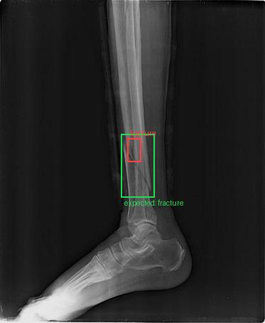

| | Expected | Model |
|---|---|---|
| Finding | fracture | fracture |
| Location | box (green) | middle third, centre; box covers about 0% of the image (IoU 0.1617714520332069) |
| Text | - | Lateral radiograph of the left ankle. Impression: The patient was diagnosed with a left ankle fracture and was treated with a cast. The patient was diagnosed with a left ankle fracture and was treated with a cast. Suggested next steps (most to least suitable): 1. Immediate stabilisation: The patient was treated with a cast. 2. Investigate: The patient was referred to hospital for further evaluation and treatment. 3. Definitive treatment: The patient was treated with a cast. 4. Definitive... |

## fracatlas / IMG0002484.jpg (x_ray)

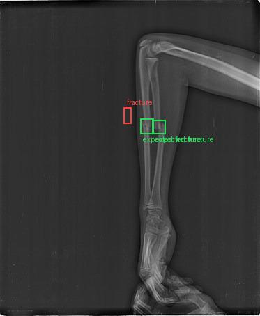

| | Expected | Model |
|---|---|---|
| Finding | fracture | fracture |
| Location | box (green) | middle third, centre; box covers about 0% of the image (IoU 0.0) |
| Text | - | Lateral. Impression: The patient was diagnosed with a left forearm fracture and was treated with a cast. Suggested next steps (most to least suitable): 1. Immediate stabilisation: The patient was treated with a cast for 6 weeks. 2. Definitive treatment: The patient was treated with a cast for 6 weeks. 3. Definitive treatment: The patient was treated with a cast for 6 weeks. 4. Definitive treatment: The patient was treated with a cast for 6 weeks. |

## fracatlas / IMG0002372.jpg (x_ray)

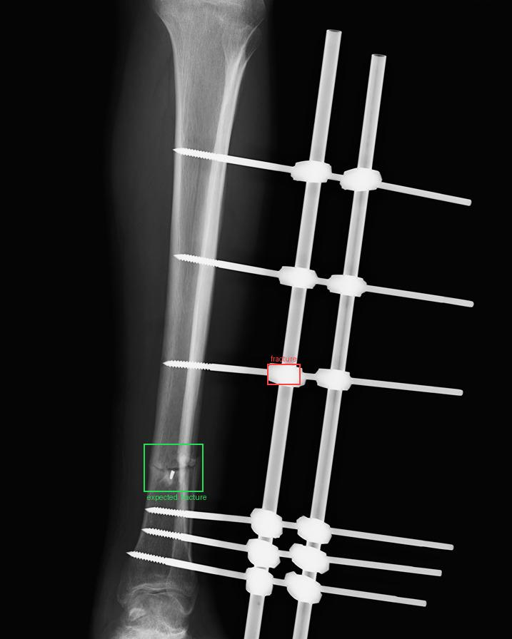

| | Expected | Model |
|---|---|---|
| Finding | fracture | fracture |
| Location | box (green) | middle third, centre; box covers about 0% of the image (IoU 0.0) |
| Text | - | Lateral radiograph of the left tibia after open reduction and internal fixation. Impression: The patient was diagnosed with a comminuted open fracture of the tibia and fibula. Suggested next steps (most to least suitable): 1. Definitive treatment: The patient was treated with open reduction and internal fixation (ORIF) of the tibia and fibula fracture. 2. Definitive treatment: The patient was treated with a posterior tibial splint for 6 weeks. 3. Definitive treatment: The patient was treated... |

## fracatlas / IMG0001461.jpg (x_ray)

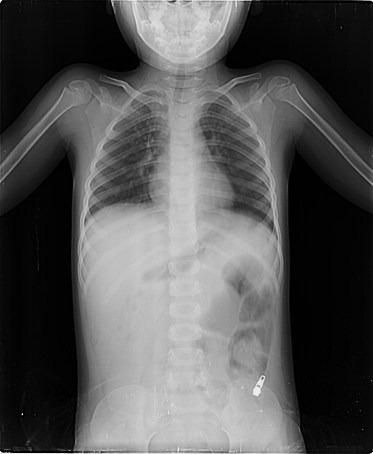

| | Expected | Model |
|---|---|---|
| Finding | no abnormality | none |
| Location | box (green) | - (IoU -) |
| Text | - | Chest X-ray. Impression: The patient was diagnosed with a left-sided diaphragmatic hernia and underwent surgical repair at the patient. The patient was diagnosed with a left-sided diaphragmatic hernia and underwent surgical repair at the patient. Suggested next steps (most to least suitable): 1. Immediate stabilisation: The patient [history not provided]. 2. Immediate stabilisation: The patient [history not provided]. 3. Immediate stabilisation: The patient [history not provided]. 4. Immediate... |

## fracatlas / IMG0001608.jpg (x_ray)

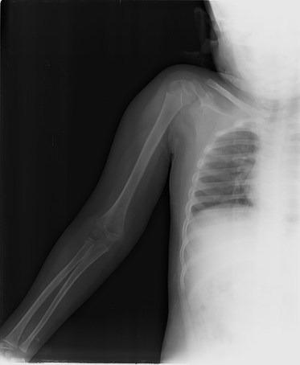

| | Expected | Model |
|---|---|---|
| Finding | no abnormality | none |
| Location | box (green) | - (IoU -) |
| Text | - | X-ray of the left arm. Impression: The patient was diagnosed with a left humerus fracture and was treated with a cast. Suggested next steps (most to least suitable): 1. Immediate stabilisation: The patient was intubated and mechanically ventilated. 2. Immediate stabilisation: The patient was intubated and mechanically ventilated. 3. Immediate stabilisation: The patient was intubated and mechanically ventilated. 4. Immediate stabilisation: The patient was intubated and mechanically ventilated. |

## nih_cxr14 / 00020113_017.png (x_ray)

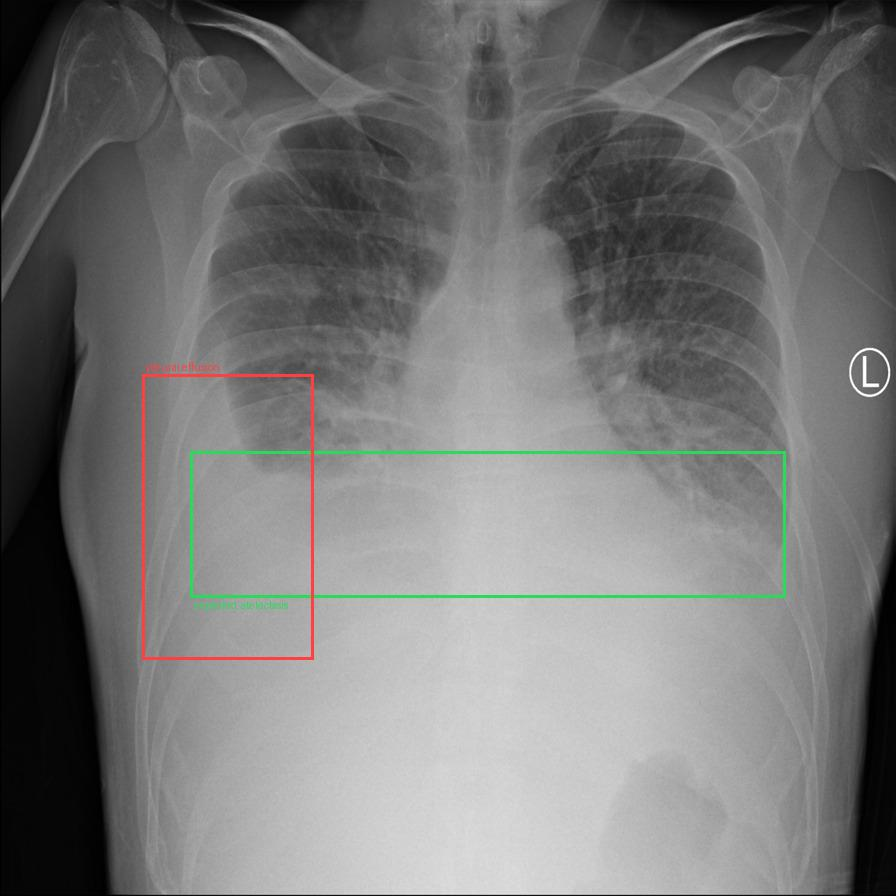

| | Expected | Model |
|---|---|---|
| Finding | atelectasis | pleural effusion |
| Location | box (green) | middle third, image-left (on a standard frontal chest radiograph or axial CT this is usually the patient's right); box covers about 6% of the image (IoU 0.15325335009775193) |
| Text | - | Chest X-ray showing bilateral pleural effusions and pulmonary edema. Impression: The patient was diagnosed with HIV infection and was started on antiretroviral therapy (ART) with tenofovir disoproxil fumarate (TDF)/lamivudine (3TC)/efavirenz (EFV) (TDF/3TC/EFV) 100 mg/300 mg/600 mg, respectively, once daily. The patient was diagnosed with HIV infection and was started on ART with TDF/3TC/EFV (TDF/3TC/EFV) 100 mg/300 mg/600 mg, respectively, once daily. Suggested next steps (most to least... |

## nih_cxr14 / 00025969_000.png (x_ray)

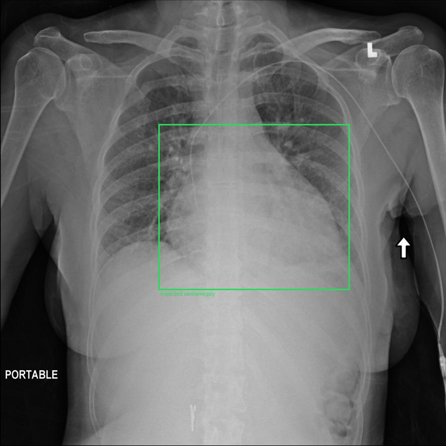

| | Expected | Model |
|---|---|---|
| Finding | cardiomegaly | none |
| Location | box (green) | - (IoU 0.0) |
| Text | - | Chest X-ray showing cardiomegaly and pulmonary edema. Impression: The patient [history not provided]. The patient was diagnosed with heart failure and was treated with intravenous diuretics and vasodilators. Suggested next steps (most to least suitable): 1. Immediate stabilisation: The patient was intubated and mechanically ventilated. 2. Immediate stabilisation: The patient was transferred to the intensive care unit (ICU) and treated with mechanical ventilation. 3. Immediate stabilisation: The... |

## nih_cxr14 / 00020259_002.png (x_ray)

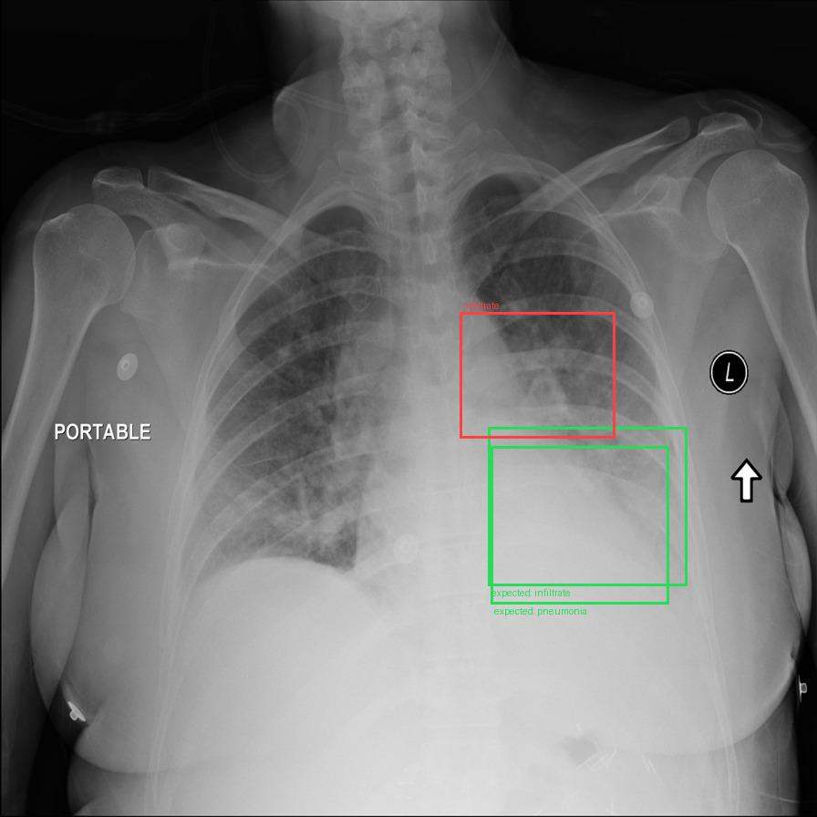

| | Expected | Model |
|---|---|---|
| Finding | infiltrate, pneumonia | infiltrate |
| Location | box (green) | middle third, centre; box covers about 3% of the image (IoU 0.014982964004184689) |
| Text | - | Portable chest x-ray. Impression: The patient with a [history not provided]. Her initial vital signs were as follows: temperature [value]F, blood pressure [value], heart rate [value], respiratory rate [value], and oxygen saturation [value] on room air. Suggested next steps (most to least suitable): 1. Immediate stabilisation: Her oxygen saturation [value] on room air. 2. Immediate stabilisation: Her oxygen saturation [value] on room air. 3. Immediate stabilisation: Her oxygen saturation [value]... |

## nih_cxr14 / 00028873_004.png (x_ray)

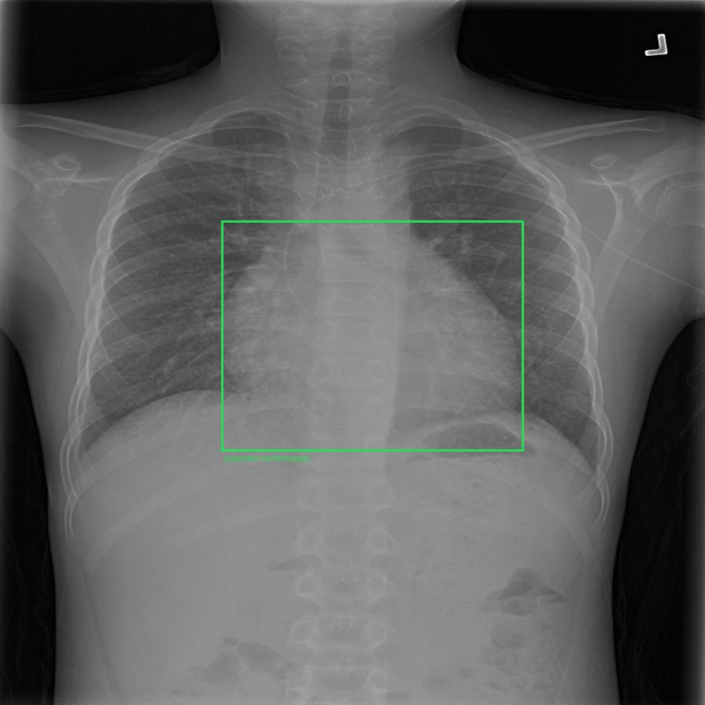

| | Expected | Model |
|---|---|---|
| Finding | cardiomegaly | none |
| Location | box (green) | - (IoU 0.0) |
| Text | - | Chest X-ray showing cardiomegaly and pulmonary edema. Impression: The patient was diagnosed with a left ventricular outflow tract obstruction (LVOTO) due to a membranous coarctation of the aorta (CoA) and a left ventricular (LV) noncompaction cardiomyopathy (LVNC). Suggested next steps (most to least suitable): 1. Immediate stabilisation: He [history not provided]. 2. Immediate stabilisation: He was treated with intravenous (IV) furosemide, IV nitroglycerin, and IV dobutamine. 3. Immediate... |

## nih_cxr14 / 00013471_002.png (x_ray)

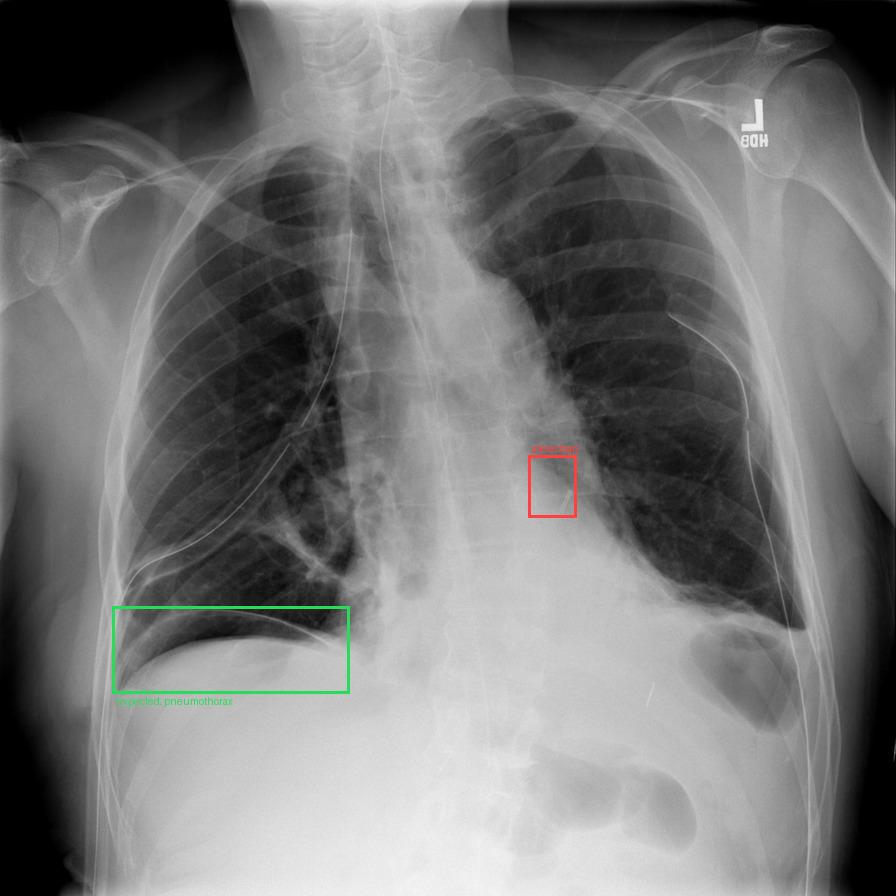

| | Expected | Model |
|---|---|---|
| Finding | pneumothorax | atelectasis |
| Location | box (green) | middle third, centre; box covers about 0% of the image (IoU 0.0) |
| Text | - | Chest X-ray after the second chest tube insertion. Impression: The patient [history not provided]. The patient was diagnosed with pneumopericardium and pneumomediastinum. Suggested next steps (most to least suitable): 1. Immediate stabilisation: The patient was intubated and mechanically ventilated. 2. Immediate stabilisation: The patient was treated with a 10-day course of intravenous antibiotics (ceftriaxone 2 g/day and metronidazole 500 mg/day). 3. Immediate stabilisation: The patient was... |

## nih_cxr14 / 00021818_026.png (x_ray)

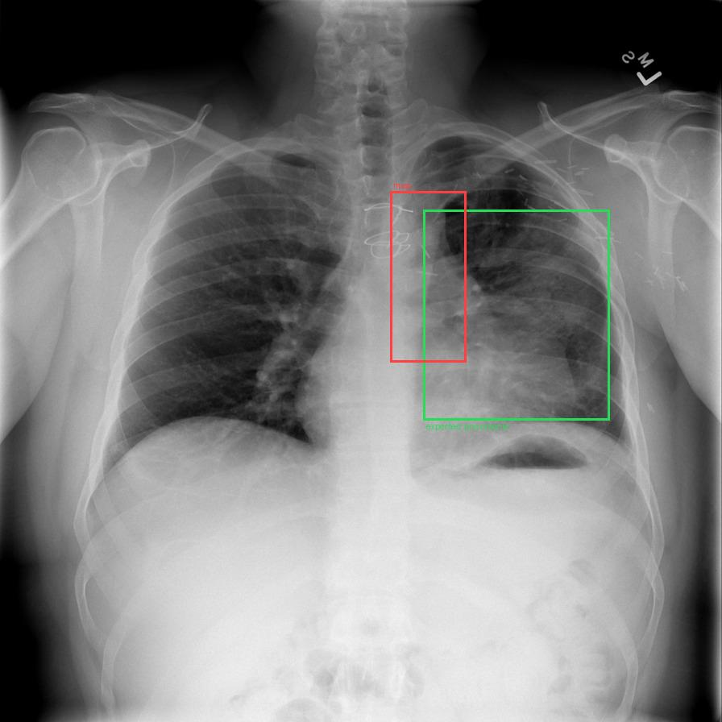

| | Expected | Model |
|---|---|---|
| Finding | pneumonia | mass |
| Location | box (green) | middle third, centre; box covers about 3% of the image (IoU 0.1447503992287288) |
| Text | - | Chest X-ray showing left lung mass. Impression: The patient was diagnosed with left lung mass and was referred to hospital for further evaluation and treatment. The patient was diagnosed with left lung mass and was referred to hospital for further evaluation and treatment. Suggested next steps (most to least suitable): 1. Investigate: A chest X-ray was performed and showed a left lung mass (Figure 1). 2. Investigate: A chest X-ray was performed and showed a left lung mass (Figure 2). 3.... |

## nih_cxr14 / 00020810_003.png (x_ray)

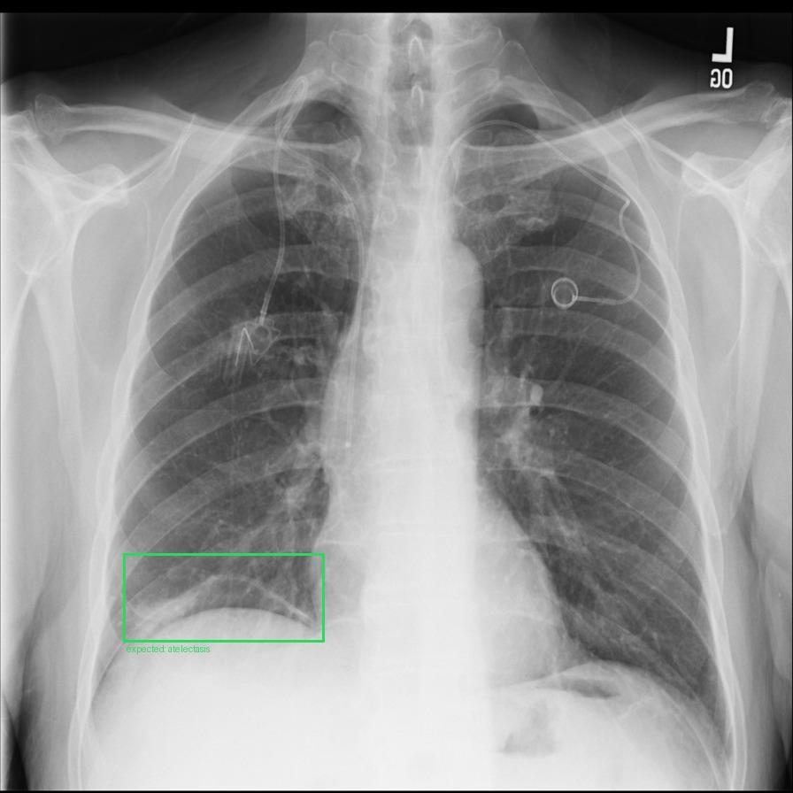

| | Expected | Model |
|---|---|---|
| Finding | atelectasis | none |
| Location | box (green) | - (IoU 0.0) |
| Text | - | Chest X-ray. Impression: The patient was diagnosed with a left-sided pneumothorax and was treated with a chest tube. A chest X-ray revealed a right-sided pneumothorax (Figure 1). Suggested next steps (most to least suitable): 1. Immediate stabilisation: The patient [history not provided]. 2. Immediate stabilisation: The patient was intubated and mechanically ventilated. 3. Immediate stabilisation: The patient was intubated and mechanically ventilated. 4. Immediate stabilisation: The patient was... |

## nih_cxr14 / 00011023_004.png (x_ray)

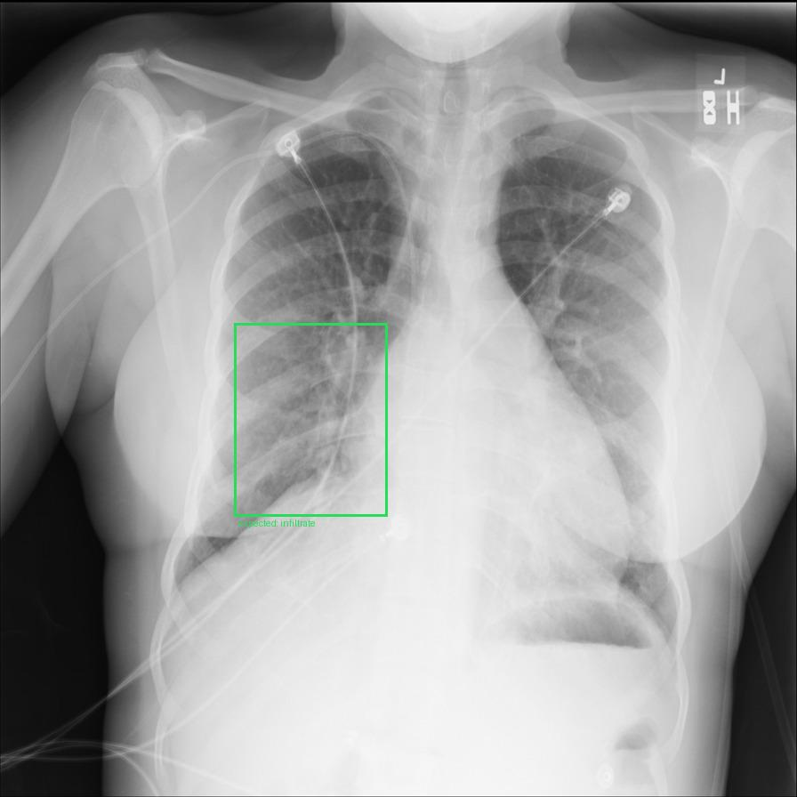

| | Expected | Model |
|---|---|---|
| Finding | infiltrate | none |
| Location | box (green) | - (IoU 0.0) |
| Text | - | Chest X-ray showing bilateral pulmonary edema. Impression: The patient was diagnosed with a left breast abscess and [history not provided]. The patient was diagnosed with a left breast abscess and [history not provided]. Suggested next steps (most to least suitable): 1. Immediate stabilisation: The patient [history not provided]. 2. Immediate stabilisation: The patient was given oxygen therapy and was discharged. 3. Investigate: A chest X-ray was performed, which showed bilateral pulmonary... |

## nih_cxr14 / 00021818_006.png (x_ray)

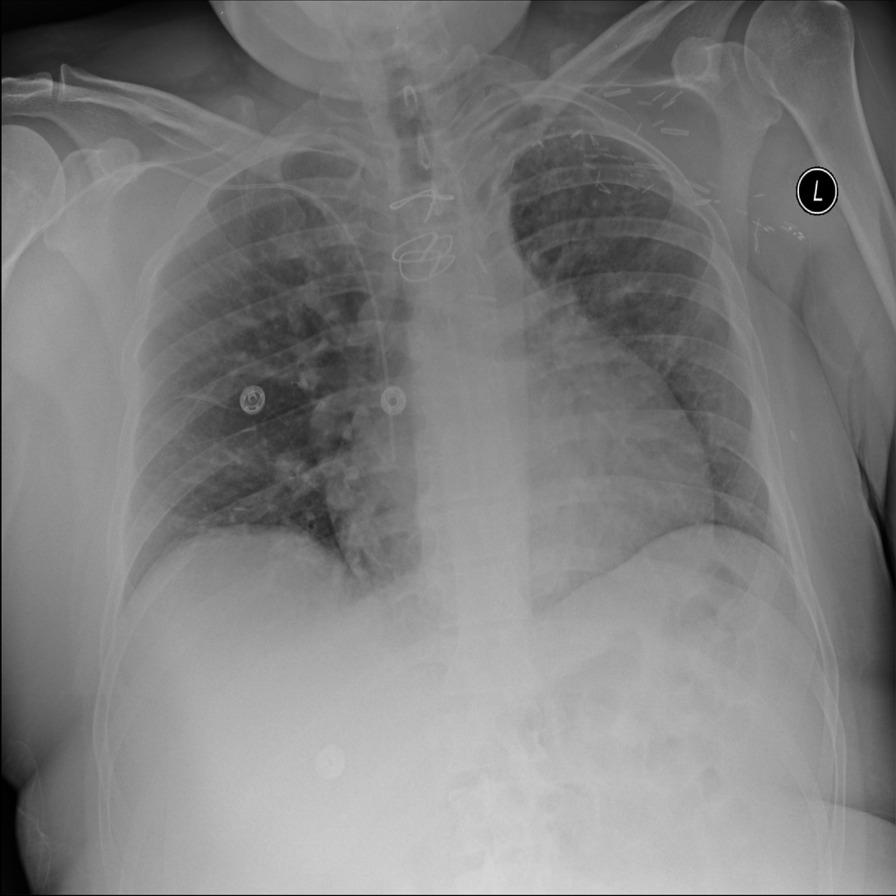

| | Expected | Model |
|---|---|---|
| Finding | no abnormality | none |
| Location | box (green) | - (IoU -) |
| Text | - | Chest X-ray showing cardiomegaly and pulmonary congestion. Impression: The patient was diagnosed with a left-sided pleural effusion and [history not provided]. The patient was diagnosed with a left-sided pleural effusion and [history not provided]. Suggested next steps (most to least suitable): 1. Immediate stabilisation: The patient [history not provided]. 2. Immediate stabilisation: The patient [history not provided]. 3. Immediate stabilisation: The patient [history not provided]. 4.... |

## nih_cxr14 / 00016647_000.png (x_ray)

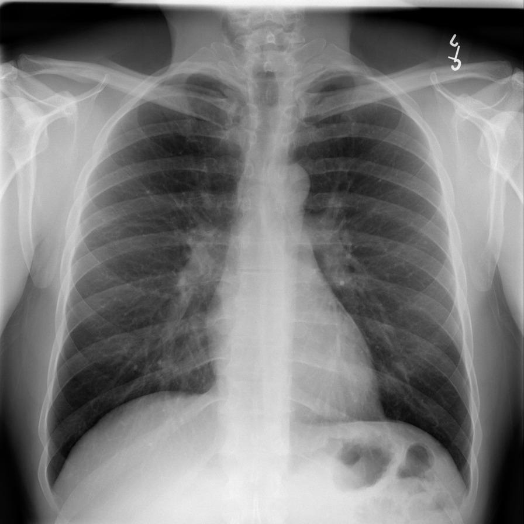

| | Expected | Model |
|---|---|---|
| Finding | no abnormality | none |
| Location | box (green) | - (IoU -) |
| Text | - | Chest X-ray. Impression: The patient was diagnosed with a left inguinal hernia and underwent surgery. The patient was diagnosed with a left inguinal hernia and underwent surgery. Suggested next steps (most to least suitable): 1. Immediate stabilisation: The patient [history not provided]. 2. Immediate stabilisation: The patient [history not provided]. 3. Immediate stabilisation: The patient [history not provided]. 4. Immediate stabilisation: The patient [history not provided]. |

## slake / xmlab371 (x_ray)

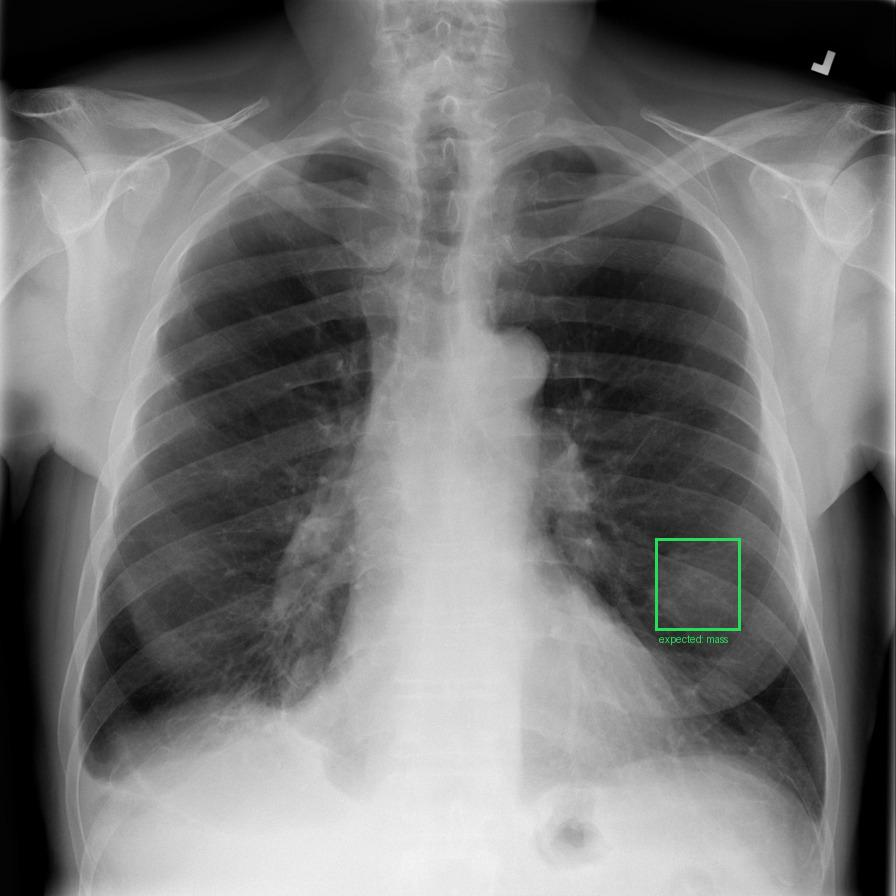

| | Expected | Model |
|---|---|---|
| Finding | mass | none |
| Location | box (green) | - (IoU 0.0) |
| Text | - | Chest X-ray showing right lower lobe consolidation. Impression: The patient was diagnosed with a left breast mass and underwent a lumpectomy and sentinel node biopsy. The patient was diagnosed with a left breast mass and underwent a lumpectomy and sentinel node biopsy. Suggested next steps (most to least suitable): 1. Immediate stabilisation: The patient [history not provided]. 2. Immediate stabilisation: The patient [history not provided]. 3. Immediate stabilisation: The patient [history not... |

## slake / xmlab65 (mri)

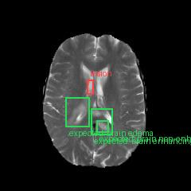

| | Expected | Model |
|---|---|---|
| Finding | brain edema, brain enhancing tumor, brain non-enhancing tumor | lesion |
| Location | box (green) | middle third, centre; box covers about 0% of the image (IoU 0.0) |
| Text | - | (b) DWI shows hyperintense signal in the right corona radiata. Impression: The patient [history not provided]. The patient was diagnosed with acute cerebral infarction. Suggested next steps (most to least suitable): 1. Investigate: The patient was transferred to the MRI room and MRI was performed. 2. Definitive treatment: The patient was treated with intravenous thrombolysis (0.9 mg/kg of alteplase) and intravenous heparin (5000 U). 3. Definitive treatment: The patient was treated with... |

## slake / xmlab70 (mri)

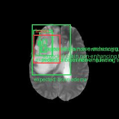

| | Expected | Model |
|---|---|---|
| Finding | brain edema, brain enhancing tumor, brain non-enhancing tumor | lesion |
| Location | box (green) | middle third, centre; box covers about 5% of the image (IoU 0.21605970726494914) |
| Text | - | (a) MRI T2-weighted image showing a large right frontal lesion with surrounding edema. Impression: The patient was diagnosed with a right frontal lesion and underwent a right frontal craniotomy and gross total resection. The patient was diagnosed with a recurrent right frontal lesion and underwent a right frontal craniotomy and gross total resection. Suggested next steps (most to least suitable): 1. Definitive treatment: The patient underwent a right frontal craniotomy and gross total... |

## slake / xmlab333 (x_ray)

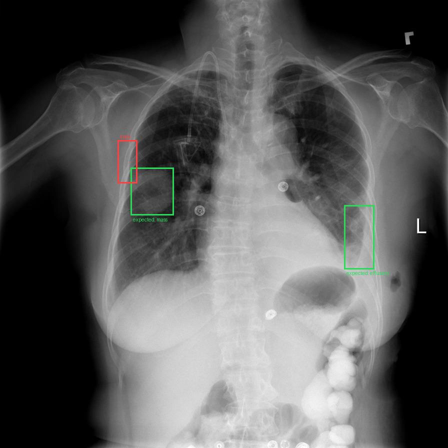

| | Expected | Model |
|---|---|---|
| Finding | effusion, mass | mass |
| Location | box (green) | middle third, image-left (on a standard frontal chest radiograph or axial CT this is usually the patient's right); box covers about 0% of the image (IoU 0.018476996579572053) |
| Text | - | Chest X-ray showing right lung mass and left pleural effusion. Impression: The patient was diagnosed with a right lung mass and left pleural effusion. The patient was diagnosed with a right lung mass and left pleural effusion. Suggested next steps (most to least suitable): 1. Investigate: A chest X-ray was performed and showed a right lung mass and left pleural effusion (Figure 1). 2. Investigate: A chest X-ray was performed and showed a right lung mass and left pleural effusion (Figure 2). 3.... |

## slake / xmlab60 (mri)

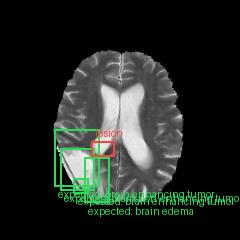

| | Expected | Model |
|---|---|---|
| Finding | brain edema, brain enhancing tumor, brain non-enhancing tumor | lesion |
| Location | box (green) | middle third, centre; box covers about 1% of the image (IoU 0.013800010763127703) |
| Text | - | (b) Axial T2-weighted image shows a hyperintense lesion in the right parietal lobe. Impression: The patient was diagnosed with a right parietal lobe lesion on magnetic resonance imaging (MRI) and was referred to hospital for further evaluation and treatment. The patient was diagnosed with a right parietal lobe lesion on MRI and was referred to hospital for further evaluation and treatment. Suggested next steps (most to least suitable): 1. Investigate: MRI was performed and showed a right... |

## slake / xmlab322 (x_ray)

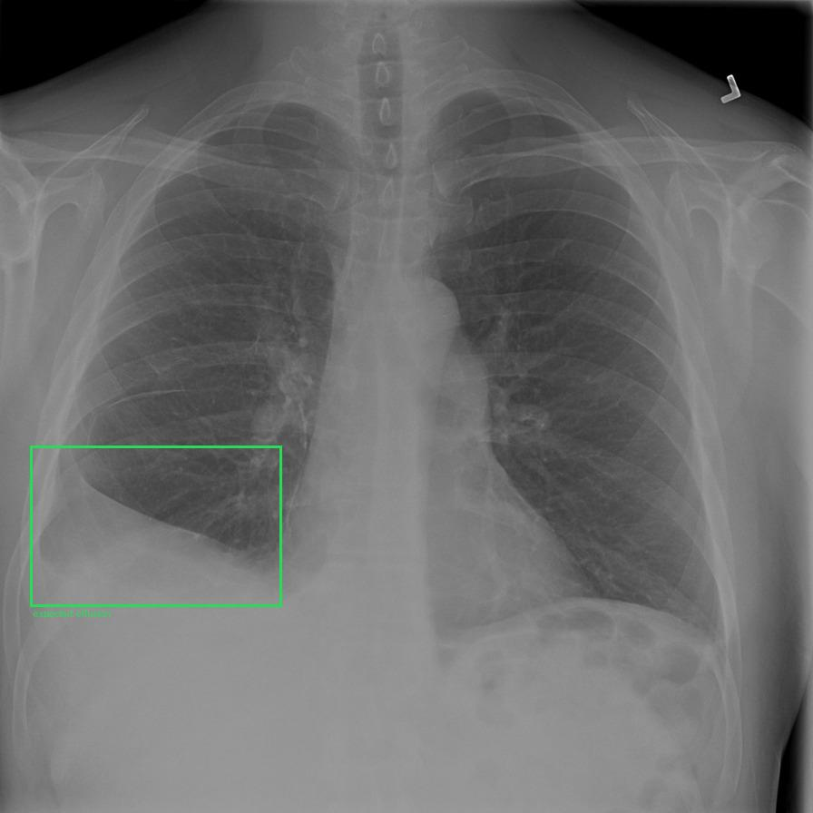

| | Expected | Model |
|---|---|---|
| Finding | effusion | none |
| Location | box (green) | - (IoU 0.0) |
| Text | - | Chest X-ray showing right-sided pleural effusion. Impression: The patient [history not provided]. The patient was diagnosed with community-acquired pneumonia and was treated with ceftriaxone and azithromycin. Suggested next steps (most to least suitable): 1. Immediate stabilisation: The patient was treated with oxygen and intravenous fluids. 2. Immediate stabilisation: The patient was treated with oxygen and intravenous fluids. 3. Immediate stabilisation: The patient was treated with oxygen and... |

## slake / xmlab66 (mri)

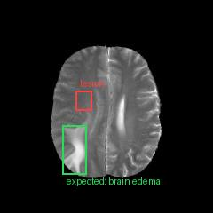

| | Expected | Model |
|---|---|---|
| Finding | brain edema | lesion |
| Location | box (green) | middle third, centre; box covers about 1% of the image (IoU 0.0) |
| Text | - | (b) T2-weighted image showing hyperintense signal in the right frontal lobe. Impression: The patient was diagnosed with a left frontal lobe infarct and was prescribed aspirin and clopidogrel. The patient was diagnosed with a right occipital infarct and was prescribed aspirin and clopidogrel. Suggested next steps (most to least suitable): 1. Investigate: A repeat MRI was performed, which showed a new infarct in the right occipital lobe. 2. Investigate: A repeat MRI was performed, which showed a... |

## slake / xmlab360 (x_ray)

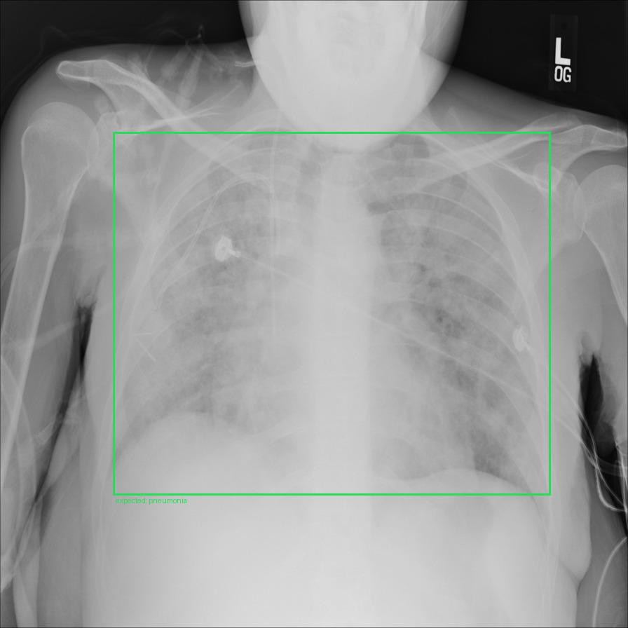

| | Expected | Model |
|---|---|---|
| Finding | pneumonia | none |
| Location | box (green) | - (IoU 0.0) |
| Text | - | Chest X-ray showing diffuse bilateral pulmonary infiltrates. Impression: The patient [history not provided]. The patient was diagnosed with COVID-19 pneumonia and was treated with dexamethasone and remdesivir. Suggested next steps (most to least suitable): 1. Immediate stabilisation: The patient was intubated and mechanically ventilated. 2. Immediate stabilisation: The patient was transferred to the ICU and was intubated and mechanically ventilated. 3. Immediate stabilisation: The patient was... |

## slake / xmlab370 (x_ray)

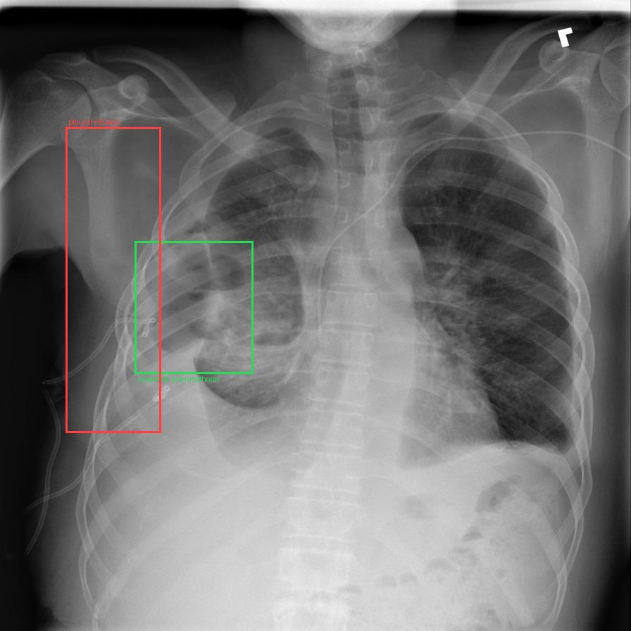

| | Expected | Model |
|---|---|---|
| Finding | pneumothorax | pleural effusion |
| Location | box (green) | middle third, image-left (on a standard frontal chest radiograph or axial CT this is usually the patient's right); box covers about 7% of the image (IoU 0.08223196416052074) |
| Text | - | Chest X-ray showing right-sided pleural effusion and pneumothorax. Impression: The patient was diagnosed with a left-sided pleural effusion and was treated with a thoracentesis. The patient was diagnosed with a right-sided pleural effusion and was treated with a thoracentesis. Suggested next steps (most to least suitable): 1. Immediate stabilisation: The patient was treated with a thoracentesis and a chest tube was inserted. 2. Immediate stabilisation: The patient was treated with a... |

## slake / xmlab96 (ct)

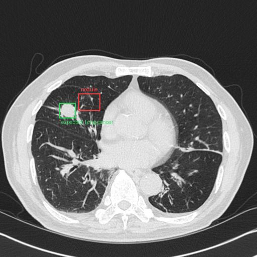

| | Expected | Model |
|---|---|---|
| Finding | lung cancer | nodule |
| Location | box (green) | middle third, centre; box covers about 1% of the image (IoU 0.0) |
| Text | - | Chest CT scan showing multiple cavitary lesions in the right lung. Impression: The patient was diagnosed with pulmonary tuberculosis and was treated with a standard regimen of isoniazid, rifampicin, pyrazinamide, and ethambutol. A chest X-ray revealed multiple cavitary lesions in the right lung (Figure 1). Suggested next steps (most to least suitable): 1. Immediate stabilisation: The patient [history not provided]. 2. Investigate: A chest CT scan was performed, which showed multiple cavitary... |

