# MedPix 2.0 held-out check - for clinician review

Lexical scores are proxies only.

## MPX2087 (MR - T1W - noncontrast, age 40, female)

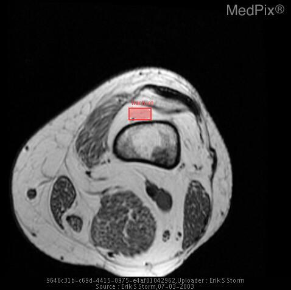

**Note given to model:** Now c/o progressive left knee pain.

| | Ground truth | Model (adapted) |
|---|---|---|
| Diagnosis | Metastatic Disease (Presumed Breast) | The patient was diagnosed with a left knee effusion and [history not provided]. The patient was diagnosed with a left knee effusion and [history not provided]. |
| Action | Patient is awaiting formal bone marrow biopsy for confirmation, and will undergo chemotherapy for known breast cancer. | 1. Immediate stabilisation: The patient was treated with a knee brace and a non-steroidal anti-inflammatory drug (NSAID). 2. Investigate: MRI was performed and showed a large effusion and a large amount of fluid in the popliteal bursa. 3. Definitive treatment: The patient was treated with a knee brace and an NSAID. 4. Definitive treatment: The patient was treated with a knee brace and an NSAID. |
| Location | - | [{"label": "fracture", "box_2d": [0.3711, 0.4435, 0.413, 0.5209], "location": "middle third, centre; box covers about 0% of the image"}] |

## MPX1387 (CT w/contrast (IV), age 1, male)

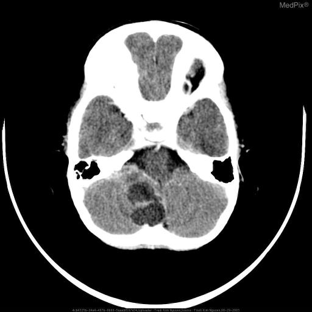

**Note given to model:** 21 month old male with high fever, mental status changes and possible seizure.

| | Ground truth | Model (adapted) |
|---|---|---|
| Diagnosis | RSNA-COTD Infected Dermoid Cyst | The patient was admitted to the hospital with a diagnosis of high fever and possible seizure. The patient was diagnosed with acute necrotizing encephalopathy (ANE) and was treated with intravenous methylprednisolone (1 g/day for 5 days) and intravenous acyclovir (500 mg/day for 14 days). |
| Action | The patient underwent surgery with the posterior fossa mass removed by neurosurgery. The patient was placed on the appropriate pre and post antibiotic prophylaxis. The patient continued to improve during the postoperative period without complications. Histopathologic workup showed a portion of scalp with a dermal sinus tract. A benign squamous lined cyst with evidence of rupture were included. Additional specimen consisted of typical hair elements and pearly white soft tissue . | 1. Immediate stabilisation: Cerebrospinal fluid (CSF) analysis showed normal cell count, normal protein, and normal glucose. 2. Investigate: A CT scan of the brain was performed and showed a large right posterior fossa mass (Fig. 3. Investigate: A CT scan of the brain was performed and showed a large right posterior fossa mass (Fig. 4. Investigate: A CT scan of the brain was performed and showed a large right posterior fossa mass (Fig. |
| Location | - | [] |

## MPX2442 (CT w/contrast (IV), age 75, male)

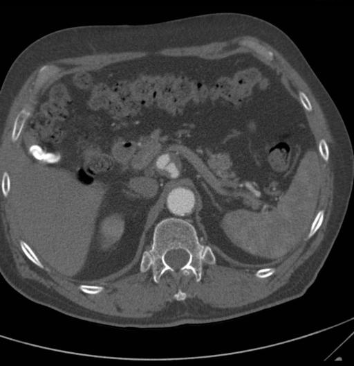

**Note given to model:** A 75-year-old white man with a history of smoking and mid-abdomen pain.

| | Ground truth | Model (adapted) |
|---|---|---|
| Diagnosis | Celiac, Abdominal Aorta, & Common Iliac Aneurysms | The patient was diagnosed with a 1.5 cm right adrenal mass on CT scan (Fig. The patient was diagnosed with a 1.5 cm left adrenal mass on CT scan (Fig. |
| Action | Treatment of abdominal aneurysm includes vascular surgical options such as vascular repair and/or stent placement. If aneurysms remain stable overtime close observation may also be an effective management strategy. Altering risk factors that can aggravate aneurysms such as cessation of smoking, maintaining adequately managing hyperlipidemia & hypertension to help control atherosclerosis. | 1. Investigate: A CT scan of the abdomen and pelvis was performed, which showed a 1.5 cm right adrenal mass and a 1.5 cm left adrenal mass. 2. Definitive treatment: The patient underwent a laparoscopic left adrenalectomy. 3. Definitive treatment: The patient underwent a laparoscopic right adrenalectomy. 4. Definitive treatment: The patient underwent a laparoscopic left adrenalectomy. |
| Location | - | [] |

## MPX1856 (CT - noncontrast, age 22, male)

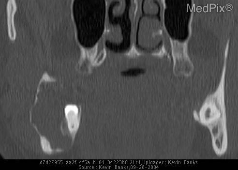

**Note given to model:** A 22 yo military basic trainee had routine screening dental evaluation - no symptoms reported.

| | Ground truth | Model (adapted) |
|---|---|---|
| Diagnosis | Ameloblastoma | The patient was [history not provided]. The patient was diagnosed with a benign lesion of the mandible. |
| Action | The lesion was treated by enbloc resection of the lesion and surrounding mandible. | 1. Investigate: A cone-beam computed tomography (CBCT) was obtained and showed a well-defined, unilocular radiolucency in the right mandibular body. 2. Investigate: A biopsy was performed and the specimen was sent for histopathological evaluation. 3. Definitive treatment: The patient was [history not provided]. 4. Definitive treatment: The patient was scheduled for surgery. |
| Location | - | [] |

## MPX2515 (CT - noncontrast, age 18, male)

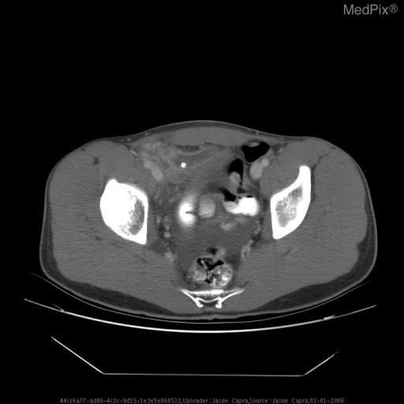

**Note given to model:** 18yo man presents to the ER c/o 5d of RLQ abdominal pain and nausea. The patient states that his siblings have had flu-like illnesses recently with nausea and vomiting, so he initially attributed his symptoms to a virus.

| | Ground truth | Model (adapted) |
|---|---|---|
| Diagnosis | Ruptured Appendicitis | The patient was diagnosed with appendicitis and [history not provided]. |
| Action | The patient was admitted and taken to the OR the evening of admission where he underwent an open appendectomy. The patient tolerated the procedure well, and was transferred to the surgical ward post op. On post op day 4 the patient had a normal white count, was tolerating a regular diet, and was transitioned to oral abx, oral pain medicine, and d/c to home. | 1. Immediate stabilisation: He was afebrile, with a temperature [value]F, a heart rate [value], a respiratory rate [value], and a blood pressure [value]. 2. Immediate stabilisation: He was given IV fluids and analgesics. 3. Immediate stabilisation: He was discharged home the following day with instructions to continue his oral antibiotics and follow up with his primary care physician. 4. Investigate: A CT abdomen/pelvis was obtained and showed right lower quadrant inflammatory changes and a small amount of free fluid (Fig. |
| Location | - | [] |

## MPX2001 (CT - GI Contrast, age 41, female)

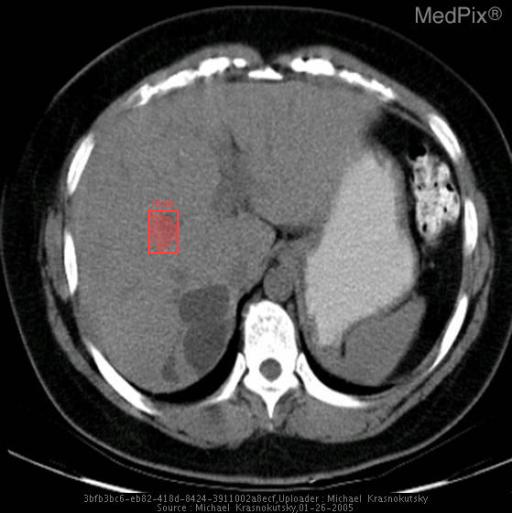

**Note given to model:** 41 year old samoan woman presented with recurrent bouts of pancreatitis.

| | Ground truth | Model (adapted) |
|---|---|---|
| Diagnosis | Recurrent pyogenic cholangitis (a.k.a. oriental cholangitis or oriental cholangiohepatitis) | The patient was diagnosed with recurrent acute pancreatitis and was treated with intravenous fluids and analgesia. |
| Action | Cholecystectomy and choledocojejunostomy | 1. Immediate stabilisation: She [history not provided]. 2. Investigate: A CT scan of the abdomen was performed and showed multiple hepatic cysts (Fig. 3. Definitive treatment: She was treated with intravenous fluids and analgesia. 4. Definitive treatment: She was treated with intravenous fluids and analgesia. |
| Location | - | [{"label": "mass", "box_2d": [0.4113, 0.2891, 0.4932, 0.3496], "location": "middle third, image-left (on a standard frontal chest radiograph or axial CT this is usually the patient's right); box covers about 0% of the image"}] |

## MPX1723 (CT w/contrast (IV), age 87, female)

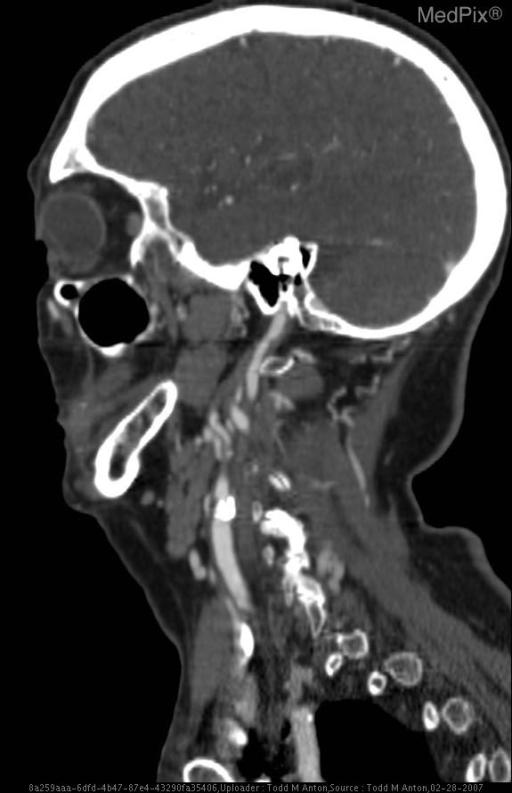

**Note given to model:** -87 year old woman -Left upper extremity weakness and numbness for past couple days -Son says her left face is “droopy” -No documented medical history -On no medications

| | Ground truth | Model (adapted) |
|---|---|---|
| Diagnosis | Ischemic stoke in right temporal-parietal lobes secondary to emboli from carotid bulb atheroma | The patient [history not provided]. |
| Action | Treatment: ASA, heparin if no bleed and large vessel atherothrombosis, thrombolytic (t-PA) if within 3 hours of symptom onset Disposition: Often long term inpatient stroke rehabilitation | 1. Immediate stabilisation: She was intubated and [history not provided]. 2. Immediate stabilisation: She was intubated and [history not provided]. 3. Immediate stabilisation: She was intubated and [history not provided]. 4. Immediate stabilisation: She was intubated and [history not provided]. |
| Location | - | [] |

## MPX1264 (CT - GI & IV Contrast, age 85, female)

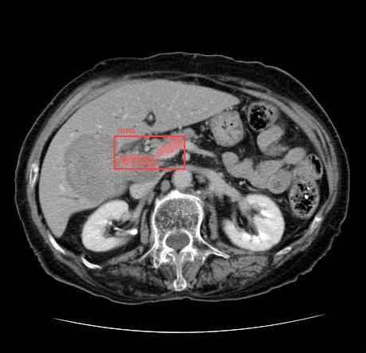

**Note given to model:** One month of abdominal pain, nausea, and vomiting.

| | Ground truth | Model (adapted) |
|---|---|---|
| Diagnosis | Large B cell lymphoma of the liver with malignant biliary obstruction | The patient was diagnosed with a 5.5 cm x 5.5 cm x 5.5 cm right adrenal mass with a CT scan of the abdomen and pelvis. The patient was diagnosed with a right adrenal mass and was [history not provided]. |
| Action | >> Treatment for advanced disease usually includes chemotherapy (traditionally CHOP although this is evolving and has changed significantly over the last 30 years). >> Other interventions are usually palliative, as in this case where percutaneous biliary drainage followed by endobiliary stenting with internal drainage was performed. | 1. Investigate: A CT scan of the abdomen and pelvis was performed and showed a large right adrenal mass with a CT scan of the abdomen and pelvis. 2. Definitive treatment: The patient underwent a right laparoscopic adrenalectomy. 3. Definitive treatment: The patient was discharged home the surgery. |
| Location | - | [{"label": "mass", "box_2d": [0.386, 0.313, 0.4808, 0.5065], "location": "middle third, centre; box covers about 2% of the image"}] |

## MPX2481 (CT - GI & IV Contrast, age 27, female)

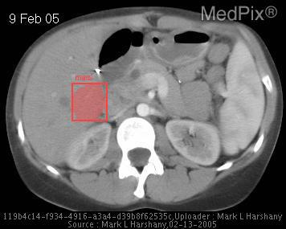

**Note given to model:** 27 y/o woman with sudden onset of periumbilical abdominal pain relieved only by "bending forward".

| | Ground truth | Model (adapted) |
|---|---|---|
| Diagnosis | Transmesenteric internal hernia, small bowel volvulus | The patient was admitted to the hospital with a diagnosis of acute pancreatitis. The patient was diagnosed with acute pancreatitis and was treated with intravenous fluids and analgesics. |
| Action | Procedure - Exploratory laparotomy with detorsion of small intestine, lysis of adhesions and closure of mesenteric defect. Surgical findings included: large mesenteric defect at root of mesentery with volvulus of small bowel around SMA axis. Some mesenteric venous congestion but bowel pink and healthy after detorsed. No evidence of congenital malrotation. | 1. Investigate: A CT scan of the abdomen was performed and showed a 1.5 cm splenic artery aneurysm (Fig. 2. Definitive treatment: The patient was treated with a 10-day course of oral antibiotics. 3. Definitive treatment: The patient was treated with a 10-day course of oral antibiotics. 4. Disposition: The patient was admitted to the hospital with a diagnosis of acute pancreatitis. |
| Location | - | [{"label": "mass", "box_2d": [0.3649, 0.25, 0.5298, 0.3736], "location": "middle third, image-left (on a standard frontal chest radiograph or axial CT this is usually the patient's right); box covers about 2% of the image"}] |

## MPX1072 (CT - noncontrast, age 45, male)

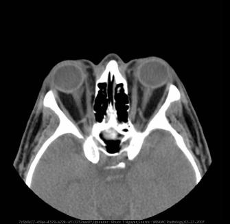

**Note given to model:** 45 year-old man with a past history of malignant testicular neoplasm and Hashimoto’s thyroiditis, presents now with a several-month history of worsening eye swelling, dryness, and irritation, gradually progressing to lid retraction and intermittent blurry vision, prompting a referral to...

| | Ground truth | Model (adapted) |
|---|---|---|
| Diagnosis | Grave's Ophthalmopathy | The patient was diagnosed with a malignant testicular neoplasm and underwent a radical orchiectomy. The patient was diagnosed with a malignant orbital neoplasm and underwent a right orbital exenteration. |
| Action | Treatment for Grave's ophthalmopathy depends on severity of symptoms. If present, treat hyperthyroidism with methimazole. For mild involvement including dry, irritated eyes, natural tears are helpful during the day and an eye lubricant (methycellulose) is appropriate at night. For moderate disease that can include conjunctival erythema, progressive proptosis, and diplopia, prednisone 30mg daily for 4 weeks should be initiated additionally. External radiation may be used in conjunction with prednisone if high dose is contraindicated or not tolerated in the case of persistent orbital edema. In... | 1. Investigate: A CT scan of the orbits was performed and showed bilateral proptosis and periorbital soft tissue swelling (Fig. 2. Investigate: A CT scan of the orbits was performed and showed bilateral proptosis and periorbital soft tissue swelling (Fig. 3. Investigate: A CT scan of the orbits was performed and showed bilateral proptosis and periorbital soft tissue swelling (Fig. 4. Definitive treatment: The patient was treated with a course of steroids and underwent a right orbital exenteration. |
| Location | - | [] |

## MPX1495 (CT - GI & IV Contrast, age 33, male)

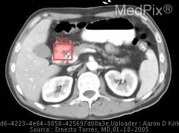

**Note given to model:** Active duty soldier with three week history of nausea, vomiting, and epigastric abdominal pain while deployed in Iraq.

| | Ground truth | Model (adapted) |
|---|---|---|
| Diagnosis | Non-Hodgkins Lymphoma (Large B-cell) of the proximal small bowel | The patient [history not provided].5 cm ulcerated mass in the antrum of the stomach. The patient was diagnosed with gastric cancer and underwent a laparotomy and gastrectomy. |
| Action | Surgical resection and started on chemotherapy | 1. Immediate stabilisation: The patient [history not provided]. 2. Investigate: A CT scan of the abdomen and pelvis was obtained and showed a large mass in the stomach and multiple enlarged lymph nodes in the abdomen and pelvis (Fig. 3. Investigate: A CT scan of the chest was obtained and showed a 1.5 cm mass in the right lower lobe of the lung (Fig. 4. Investigate: A CT scan of the abdomen and pelvis was obtained and showed a large mass in the stomach and multiple enlarged lymph nodes in the abdomen and pelvis (Fig. |
| Location | - | [{"label": "mass", "box_2d": [0.3273, 0.2973, 0.4545, 0.4054], "location": "middle third, centre; box covers about 1% of the image"}] |

## MPX1971 (CT - GI Contrast, age 0, n/a)

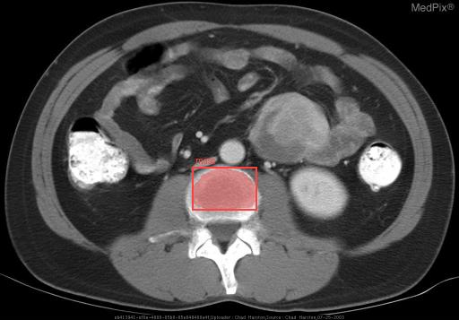

**Note given to model:** (none)

| | Ground truth | Model (adapted) |
|---|---|---|
| Diagnosis | Primary adenocarcinoma of small bowel | The patient [history not provided]. The patient was diagnosed with left retroperitoneal hematoma and was treated with bed rest and analgesics. |
| Action | Unknown | 1. Immediate stabilisation: The patient [history not provided]. 2. Investigate: A CT scan of the abdomen and pelvis was performed, which showed a large left retroperitoneal mass (Fig. 3. Investigate: A CT scan of the abdomen and pelvis was performed, which showed a large left retroperitoneal mass (Fig. 4. Investigate: A CT scan of the abdomen and pelvis was performed, which showed a large left retroperitoneal mass (Fig. |
| Location | - | [{"label": "mass", "box_2d": [0.5238, 0.418, 0.6555, 0.5605], "location": "middle third, centre; box covers about 2% of the image"}] |

## MPX2215 (CT w/contrast (IV), age 63, female)

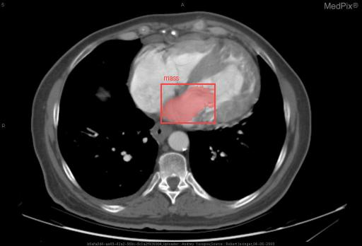

**Note given to model:** A 63 year old lady is being evaluated for cirrhosis.

| | Ground truth | Model (adapted) |
|---|---|---|
| Diagnosis | Congenitally Corrected Transposition of the Great Vessels | The patient was diagnosed with cirrhosis secondary to chronic hepatitis C. |
| Action | Surgery is recommended only for treatment of symptomatic lesions and only when significant hemodynamic benefit is expected. This woman has lived for six decades without significant cardiac symptoms. | 1. Immediate stabilisation: The patient [history not provided]. 2. Immediate stabilisation: The patient was treated with intravenous diuretics and was discharged with a pleural drain in situ. 3. Immediate stabilisation: The patient [history not provided]. 4. Immediate stabilisation: The patient was treated with intravenous diuretics and was discharged with a pleural drain in situ. |
| Location | - | [{"label": "mass", "box_2d": [0.3391, 0.4434, 0.5, 0.5957], "location": "middle third, centre; box covers about 2% of the image"}] |

## MPX1953 (CT - noncontrast, age 35, male)

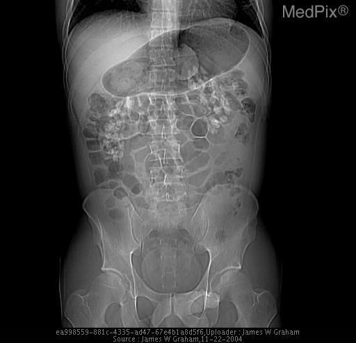

**Note given to model:** 35 year old white male with flank pain. Patient has history of frequent stone passage, sometimes as frequently as every other day

| | Ground truth | Model (adapted) |
|---|---|---|
| Diagnosis | Renal Tubular Acidosis, Medullary Nephrocalcinosis | The patient was admitted to the hospital with a diagnosis of nephrolithiasis. The patient was discharged home the following day with a prescription for oral analgesics and instructions to increase fluid intake. |
| Action | Treated with a mixture of sodium and potassium bicarbonate, constant hydration. | 1. Immediate stabilisation: The patient was admitted to the hospital with a diagnosis of nephrolithiasis. 2. Investigate: A CT scan of the abdomen and pelvis was obtained and showed a 1.5 cm x 1.5 cm x 1.5 cm staghorn calculus in the right kidney. 3. Definitive treatment: The patient was treated with oral analgesics and discharged home. 4. Definitive treatment: The patient was treated with oral analgesics and discharged home. |
| Location | - | [] |

## MPX1481 (CT w/contrast (IV), age 54, female)

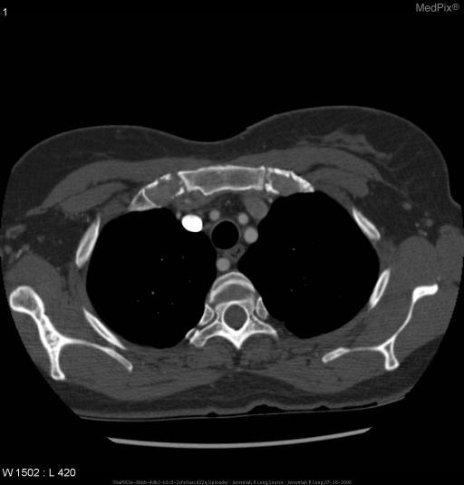

**Note given to model:** 54 year-old female with acute onset chest pain.

| | Ground truth | Model (adapted) |
|---|---|---|
| Diagnosis | Aberrant Right Subclavian Artery | The patient was admitted to the hospital with a diagnosis of acute coronary syndrome. The patient was diagnosed with a 1.5 cm right upper lobe pulmonary nodule (Fig. |
| Action | None needed. | 1. Investigate: A CT scan of the chest was performed and showed a 1.5 cm right upper lobe pulmonary nodule (Fig. 2. Investigate: A CT scan of the chest was performed and showed a 1.5 cm right upper lobe pulmonary nodule (Fig. 3. Investigate: A CT scan of the chest was performed and showed a 1.5 cm right upper lobe pulmonary nodule (Fig. 4. Investigate: A CT scan of the chest was performed and showed a 1.5 cm right upper lobe pulmonary nodule (Fig. |
| Location | - | [] |

## MPX2354 (CT - noncontrast, age 34, male)

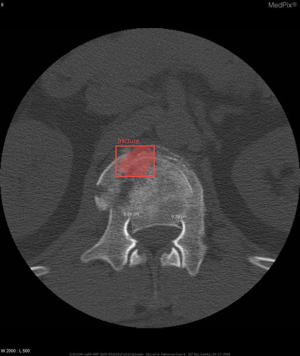

**Note given to model:** History: 34 y/o active duty white male with 2/10 lower back pain after a fall. The fall occurred while exiting a helicopter at an unknown height by “fast-roping:” sliding down a rope suspended from the helicopter using only hands and feet to control speed of descent.

| | Ground truth | Model (adapted) |
|---|---|---|
| Diagnosis | Diagnosis: L1 Burst Fracture. | The patient was diagnosed with a L1 compression fracture and was treated with a lumbar brace. |
| Action | Treatment and Follow-up: Surgical stabilization of the L1 vertebral body spine to prevent compression of the spinal cord was done. An L1 corpectomy and T12 to L2 fixation posteriorly with pedicle screws and rods and laterally with a single parallel rod was performed. An intervertebral cage with bone graft was inserted into the body of L1. Follow up was scheduled at 3 and 6 months to ensure that L1 remained stable without encroaching into the spinal canal and that the patient remained free of neurological deficits. | 1. Immediate stabilisation: The patient was treated with a lumbar brace and discharged home. 2. Investigate: A CT scan of the lumbar spine was obtained and showed a L1 compression fracture (Fig. 3. Definitive treatment: The patient was treated with a lumbar brace and discharged home. 4. Definitive treatment: The patient was treated with a lumbar brace and discharged home. |
| Location | - | [{"label": "fracture", "box_2d": [0.4086, 0.3848, 0.4975, 0.5156], "location": "middle third, centre; box covers about 1% of the image"}] |

## MPX2021 (MR - T2 weighted, age 0, n/a)

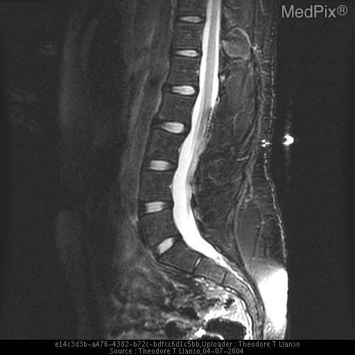

**Note given to model:** (none)

| | Ground truth | Model (adapted) |
|---|---|---|
| Diagnosis | Tethered spinal cord with terminal spinal lipoma. | The patient was diagnosed with a left L4-L5 disc herniation and was treated with a lumbar MRI. The patient was diagnosed with a left L4-L5 disc herniation and was treated with a lumbar MRI. |
| Action | Surgical, if symptomatic. | 1. Immediate stabilisation: The patient was treated with a lumbar MRI. 2. Investigate: The patient was treated with a lumbar MRI. 3. Investigate: The patient was treated with a lumbar MRI. 4. Investigate: The patient was treated with a lumbar MRI. |
| Location | - | [] |

## MPX1172 (CT - noncontrast, age 60, male)

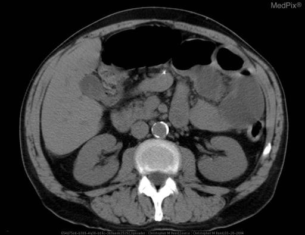

**Note given to model:** 60 year old male with metastatic colorectal cancer and acute renal failure has acute onset abdominal pain and distension.

| | Ground truth | Model (adapted) |
|---|---|---|
| Diagnosis | Small Bowel Volvulus | The patient was admitted to the hospital with a diagnosis of acute renal failure secondary to metastatic colorectal cancer. The patient [history not provided]. |
| Action | Patient's Small Bowel Volvulus was corrected surgically. | 1. Immediate stabilisation: The patient was intubated and mechanically ventilated. 2. Immediate stabilisation: The patient was started on a heparin drip and was transfused with 4 units of packed red blood cells. 3. Immediate stabilisation: The patient was started on a heparin drip and was transfused with 4 units of packed red blood cells. 4. Immediate stabilisation: The patient was started on a heparin drip and was transfused with 4 units of packed red blood cells. |
| Location | - | [] |

## MPX1665 (CT w/contrast (IV), age 57, female)

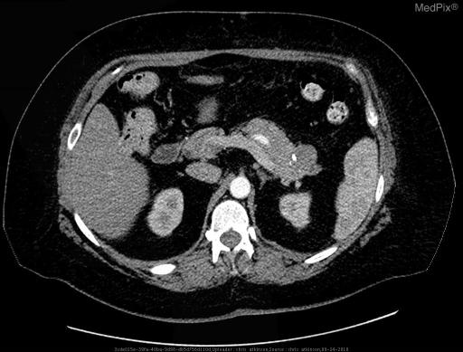

**Note given to model:** (none)

| | Ground truth | Model (adapted) |
|---|---|---|
| Diagnosis | Pancreatic Mucinous Cystic Neoplasm (Mucinous Cystadenoma) | The patient was diagnosed with left adrenal pheochromocytoma and underwent laparoscopic left adrenalectomy. The patient was diagnosed with left adrenal pheochromocytoma and underwent laparoscopic left adrenalectomy. |
| Action | Surgical resection was performed because of malignant potential of neoplasm. | 1. Investigate: A CT scan of the abdomen and pelvis was performed and showed a 1.5 cm left adrenal mass (Fig. 2. Investigate: A CT scan of the abdomen and pelvis was performed and showed a 1.5 cm left adrenal mass (Fig. 3. Investigate: A CT scan of the abdomen and pelvis was performed and showed a 1.5 cm left adrenal mass (Fig. 4. Investigate: A CT scan of the abdomen and pelvis was performed and showed a 1.5 cm left adrenal mass (Fig. |
| Location | - | [] |

## MPX2502 (MR - T1W - noncontrast, age 21, female)

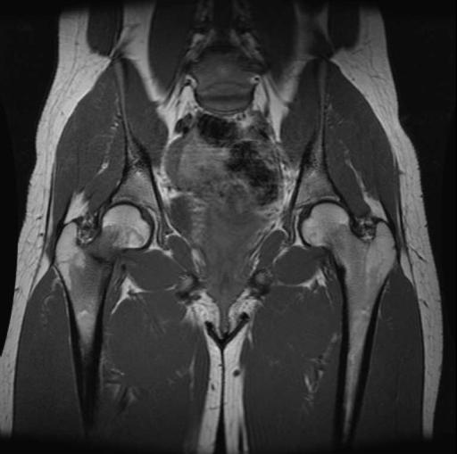

**Note given to model:** 21 year old female with right hip pain after recent increase in physical activity.

| | Ground truth | Model (adapted) |
|---|---|---|
| Diagnosis | Stress fracture right femoral neck. | The patient was [history not provided]. The patient was diagnosed with a large right hip joint effusion and synovitis. |
| Action | Patient underwent closed reduction internal fixation of right femoral neck. Post-reduction films for this patient revealed three intertrochanteric screws and good alignment of the bony tissues. | 1. Immediate stabilisation: The patient was treated with a 10-day course of oral prednisolone (40 mg daily) and a 10-day course of oral antibiotics (amoxicillin/clavulanate). 2. Investigate: MRI of the hip was performed and showed a large right hip joint effusion and synovitis (Figure 1). 3. Investigate: MRI of the hip was performed and showed a large right hip joint effusion and synovitis (Figure 2). 4. Investigate: MRI of the hip was performed and showed a large right hip joint effusion and synovitis (Figure 3). |
| Location | - | [] |

## MPX1796 (MR - T1W - noncontrast, age 78, male)

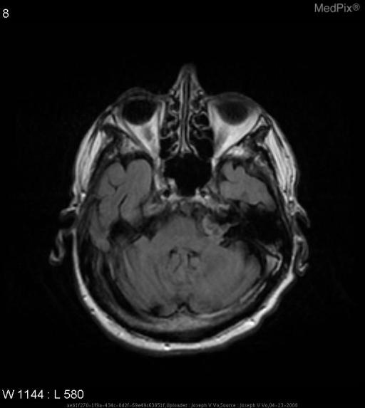

**Note given to model:** This 78 year old man came to the hospital for recent seizure like activity. Past medical history is significant for seizures.

| | Ground truth | Model (adapted) |
|---|---|---|
| Diagnosis | Intracranial Epidermoid Tumor | The patient was diagnosed with left temporal lobe infarct (Figure 1). |
| Action | See description of intracranial epidermoid tumor. | 1. Investigate: MRI brain was obtained and showed left temporal lobe infarct (Figure 2). 2. Definitive treatment: He was started on levetiracetam 1000 mg BID and clozapine 12.5 mg daily. 3. Definitive treatment: He was started on levetiracetam 1000 mg BID and clozapine 12.5 mg daily. 4. Disposition: He was admitted to the hospital for further work up. |
| Location | - | [] |

## MPX2352 (CT - noncontrast, age 65, female)

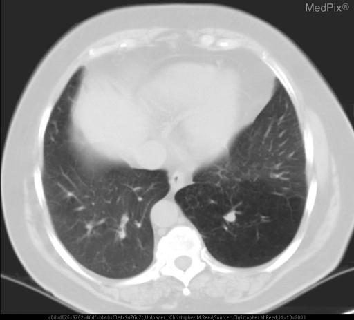

**Note given to model:** 65 year old female, afebrile with cough.

| | Ground truth | Model (adapted) |
|---|---|---|
| Diagnosis | Congenital Bronchial Atresia | The patient was admitted to the hospital with a diagnosis of community-acquired pneumonia. A chest X-ray revealed bilateral pleural effusions and a CT scan of the chest revealed bilateral pleural effusions (Figure 1). |
| Action | None. | 1. Immediate stabilisation: The pleural fluid was exudative and cytology was negative for malignancy. 2. Immediate stabilisation: The pleural fluid was negative for malignant cells, but cytology was positive for a few malignant cells. 3. Investigate: A CT scan of the chest was performed and showed bilateral pleural effusions (Figure 1). 4. Investigate: A CT scan of the chest was performed and showed bilateral pleural effusions (Figure 1). |
| Location | - | [] |

## MPX2532 (MR - T1W - noncontrast, age 35, male)

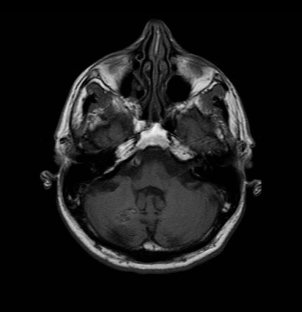

**Note given to model:** However, patient's with studies similar to the one presented for review here can present with headache or seizures

| | Ground truth | Model (adapted) |
|---|---|---|
| Diagnosis | Cavernous Malformation (preferred name) | The patient was diagnosed with a right cerebellar hemangioblastoma. |
| Action | In most cases treatement is comprised of medical management of symptoms. Radiosurgery is an option for lesions not associate with venous angiomas (which subserve normal brain). Surgerical resection is indicated for severe lesions. | 1. Definitive treatment: The patient underwent a right posterior fossa craniotomy and resection of the cerebellar hemangioblastoma. 2. Definitive treatment: The patient was started on adjuvant temozolomide and was scheduled for radiation therapy. 3. Definitive treatment: The patient was started on adjuvant temozolomide and was scheduled for radiation therapy. 4. Definitive treatment: The patient was started on adjuvant temozolomide and was scheduled for radiation therapy. |
| Location | - | [] |

## MPX1366 (CT - noncontrast, age 0, male)

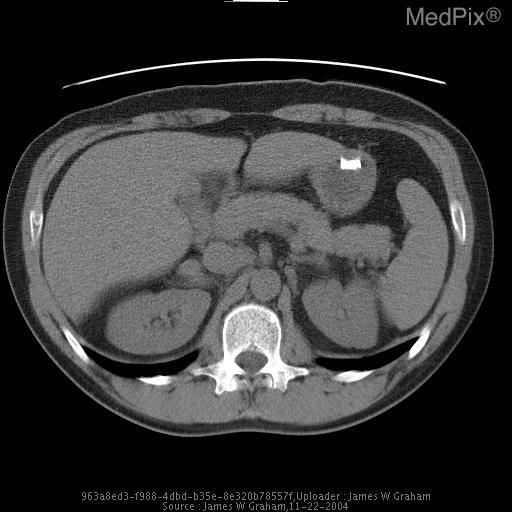

**Note given to model:** 38 year old healthy male with past medical history significant only for recent onset hypertension. Presented to the Emergency Department with acute onset of left flank pain.

| | Ground truth | Model (adapted) |
|---|---|---|
| Diagnosis | Fibromuscular Dysplasia, Renal Infarct | The patient [history not provided]. The CT scan revealed a 1.5 cm left renal mass with a central area of low attenuation consistent with necrosis (Fig. |
| Action | Although intervention with angioplasty was considered, it was felt that the risk for further renal injury outweighed any immediate benefits of PTA, given that hypertension is currently controlled with 2 medications. He will continue on Plavix indefinitely to prevent recurrence of renal infarction. Should the patient become symptomatic again (either infarct or hypertension), percutaneous intervention will be reconsidered. | 1. Investigate: A CT scan of the abdomen and pelvis with contrast was obtained. 2. Investigate: A CT scan of the abdomen and pelvis with contrast was obtained. 3. Investigate: A CT scan of the abdomen and pelvis with contrast was obtained. 4. Investigate: A CT scan of the abdomen and pelvis with contrast was obtained. |
| Location | - | [] |

## MPX1298 (CT w/contrast (IV), age 51, male)

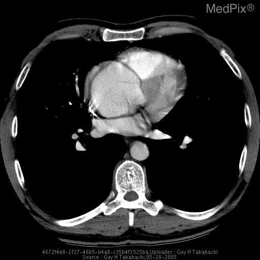

**Note given to model:** 51 y/o Caucasian male with sudden onset of chest and mid back pain. No prior history of acute chest syndrome, angina, or other heart disease.

| | Ground truth | Model (adapted) |
|---|---|---|
| Diagnosis | Ascending thoracic aortic aneurysm | The patient [history not provided]. The patient [history not provided]. |
| Action | Surgery | 1. Immediate stabilisation: The patient [history not provided]. 2. Immediate stabilisation: The patient [history not provided]. 3. Immediate stabilisation: The patient [history not provided]. 4. Immediate stabilisation: The patient [history not provided]. |
| Location | - | [] |

