# Held-out annotated cases (green = expected box, red = model box)

## fracatlas / IMG0000466.jpg (x_ray)

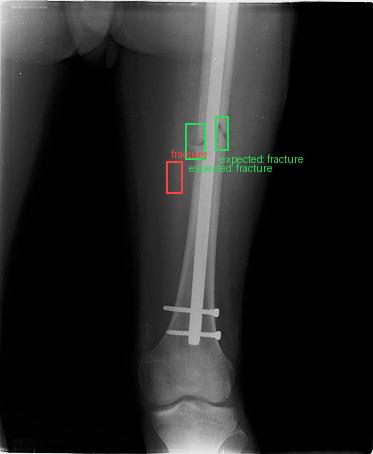

| | Expected | Model |
|---|---|---|
| Finding | fracture | fracture |
| Location | box (green) | middle third, centre; box covers about 0% of the image (IoU 0.0) |
| Text | - | Radiograph showing the fracture of the distal femur with internal fixation. Impression: The patient was [history not provided]. Suggested next steps (most to least suitable): 1. Definitive treatment: The patient underwent open reduction and internal fixation (ORIF) of the distal femur fracture with a 4.5 mm cannulated screw (Figure 1). 2. Definitive treatment: The patient was [history not provided]. 3. Definitive treatment: The patient underwent open reduction and internal fixation (ORIF) of... |

## fracatlas / IMG0002549.jpg (x_ray)

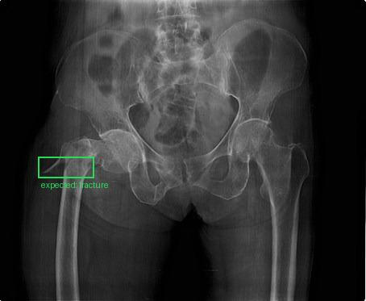

| | Expected | Model |
|---|---|---|
| Finding | fracture | none |
| Location | box (green) | - (IoU 0.0) |
| Text | - | Hip and pelvic X-ray showing a well-defined lytic lesion in the left iliac bone. Impression: The patient was [history not provided]. Physical examination revealed a palpable mass in the left iliac region. Suggested next steps (most to least suitable): 1. Definitive treatment: The patient underwent a biopsy of the mass, which revealed a poorly differentiated carcinoma. 2. Definitive treatment: The patient underwent a left iliac bone resection with a 1.5 cm margin and a 1.5 cm margin on the... |

## fracatlas / IMG0003906.jpg (x_ray)

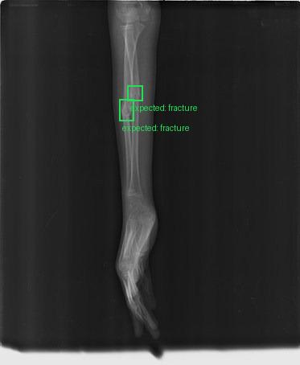

| | Expected | Model |
|---|---|---|
| Finding | fracture | none |
| Location | box (green) | - (IoU 0.0) |
| Text | - | Radiograph of the right forearm showing a fracture of the distal radius. Impression: The patient was [history not provided]. The patient was [not provided] with a [history not provided]. Suggested next steps (most to least suitable): 1. Definitive treatment: The patient was treated with a closed reduction and casting. 2. Definitive treatment: The patient was treated with a closed reduction and casting. 3. Definitive treatment: The patient was treated with a closed reduction and casting. 4.... |

## fracatlas / IMG0002987.jpg (x_ray)

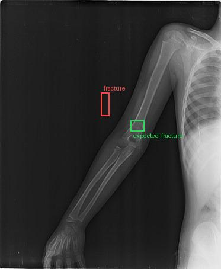

| | Expected | Model |
|---|---|---|
| Finding | fracture | fracture |
| Location | box (green) | middle third, centre; box covers about 0% of the image (IoU 0.0) |
| Text | - | Fracture of the distal humerus. Impression: The patient was [history not provided].5 m, resulting in a fracture of the distal humerus. Suggested next steps (most to least suitable): 1. Immediate stabilisation: The patient was treated with a closed reduction and percutaneous pinning (CRPP) of the distal humerus fracture. 2. Definitive treatment: The patient was [history not provided].5 m, resulting in a fracture of the distal humerus. 3. Definitive treatment: The patient was [history not... |

## nih_cxr14 / 00018693_004.png (x_ray)

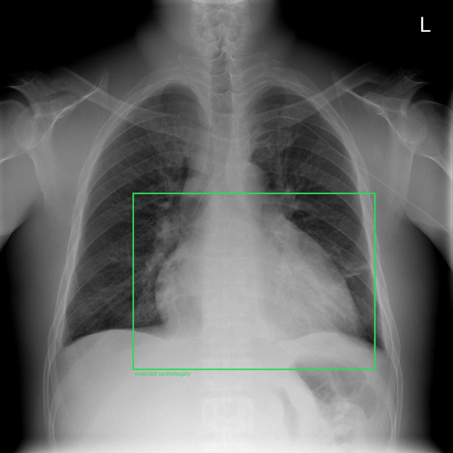

| | Expected | Model |
|---|---|---|
| Finding | cardiomegaly | none |
| Location | box (green) | - (IoU 0.0) |
| Text | - | Chest X-ray showing cardiomegaly and left-sided picc line. Impression: The patient [history not provided]. Suggested next steps (most to least suitable): 1. Immediate stabilisation: He was started on intravenous antibiotics and was given a nebulizer treatment of albuterol and ipratropium bromide. 2. Immediate stabilisation: He was given a nebulizer treatment of albuterol and ipratropium bromide. 3. Immediate stabilisation: He was given a nebulizer treatment of albuterol and ipratropium bromide.... |

## nih_cxr14 / 00014839_017.png (x_ray)

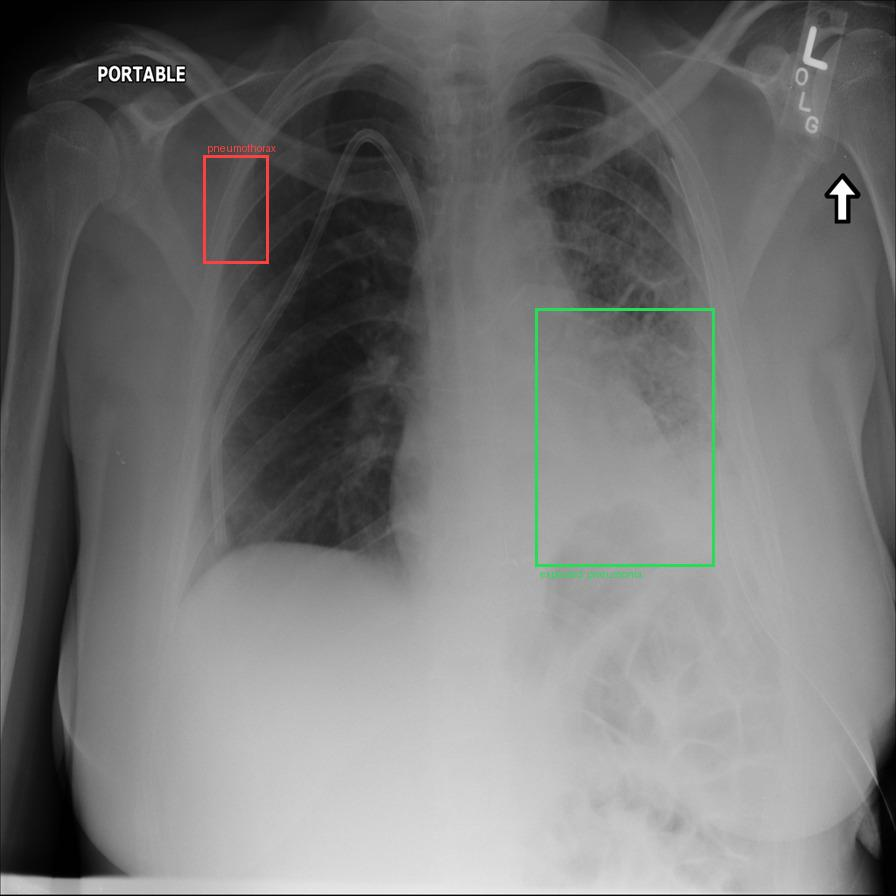

| | Expected | Model |
|---|---|---|
| Finding | pneumonia | pneumothorax |
| Location | box (green) | upper third, image-left (on a standard frontal chest radiograph or axial CT this is usually the patient's right); box covers about 1% of the image (IoU 0.0) |
| Text | - | Chest radiograph showing a right subclavian central venous catheter, a left chest tube, and left-sided atelectasis. Impression: The patient was diagnosed with a left-sided pleural effusion and [history not provided]. Suggested next steps (most to least suitable): 1. Immediate stabilisation: The patient was started on a heparin drip and was transferred to the intensive care unit. 2. Immediate stabilisation: The patient was started on a heparin drip and was transferred to the intensive care unit.... |

## nih_cxr14 / 00018101_012.png (x_ray)

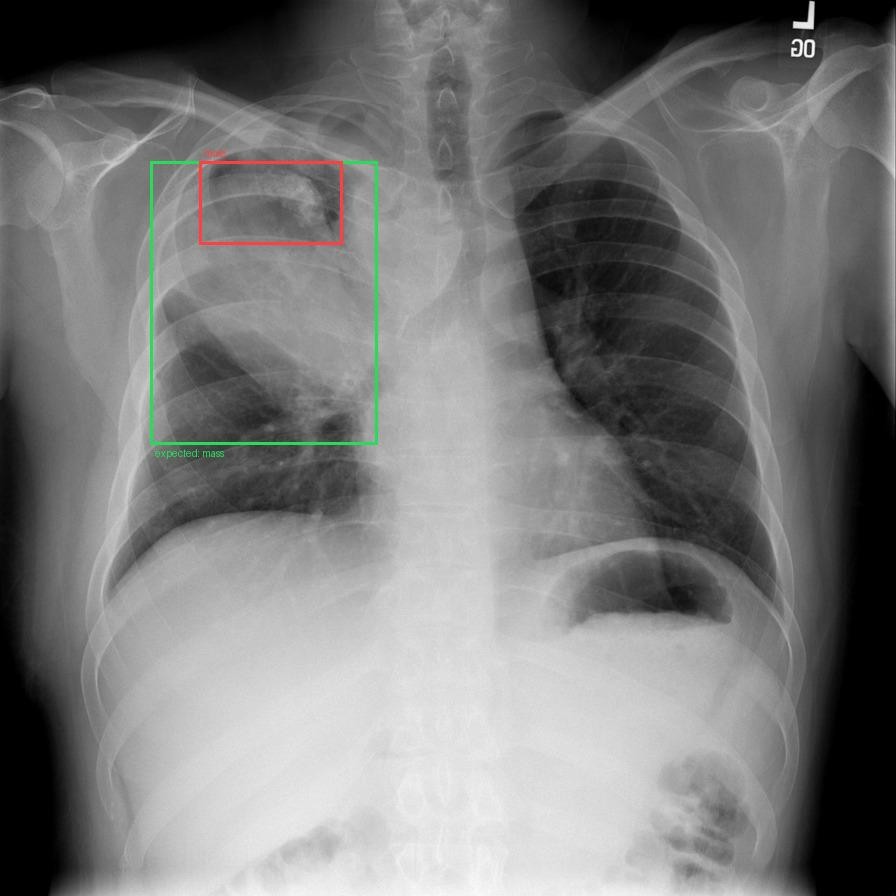

| | Expected | Model |
|---|---|---|
| Finding | mass | mass |
| Location | box (green) | upper third, image-left (on a standard frontal chest radiograph or axial CT this is usually the patient's right); box covers about 1% of the image (IoU 0.1864172009612054) |
| Text | - | Chest radiograph showing a large mass in the right upper zone. Impression: The patient was [history not provided]. A CT scan of the chest was performed, which revealed a 10 x 10 cm mass in the right upper zone with a central lucent area (Figure 1). Suggested next steps (most to least suitable): 1. Definitive treatment: The patient underwent a right upper lobectomy with mediastinal lymph node dissection. 2. Definitive treatment: The patient underwent a right upper lobectomy with mediastinal... |

## nih_cxr14 / 00008413_000.png (x_ray)

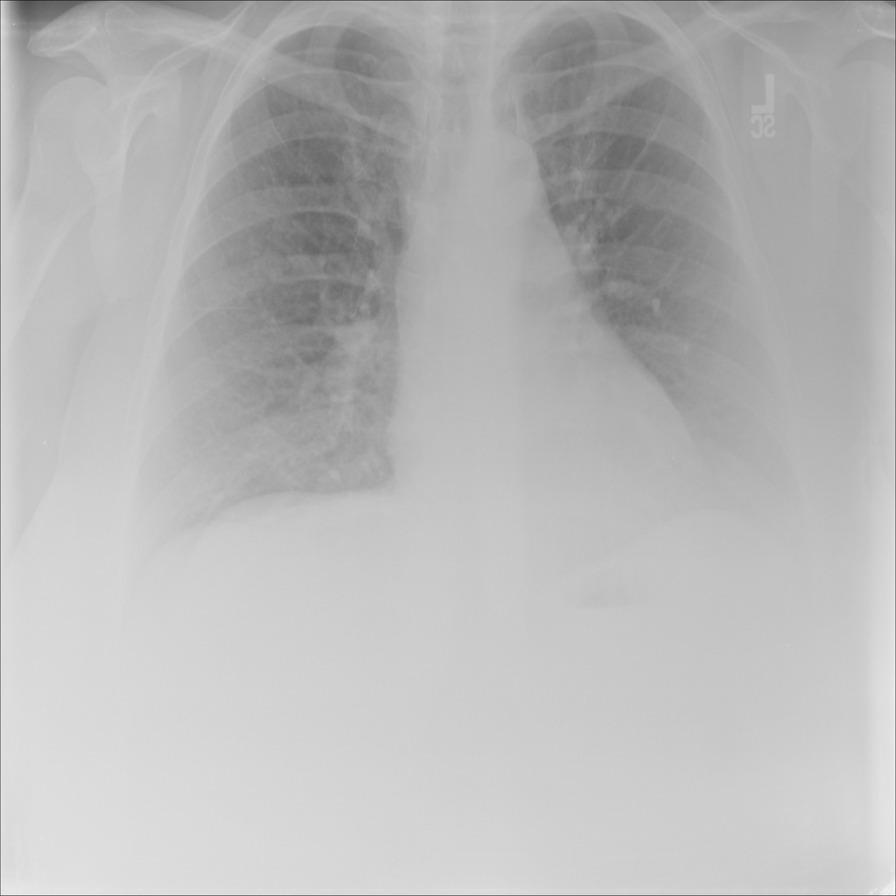

| | Expected | Model |
|---|---|---|
| Finding | no abnormality | none |
| Location | box (green) | - (IoU -) |
| Text | - | Chest X-ray showing no acute process. Impression: The patient was [history not provided]. Her [history not provided]. Suggested next steps (most to least suitable): 1. Immediate stabilisation: She was given oxygen via nasal cannula and was started on intravenous fluids. 2. Immediate stabilisation: Her oxygen saturation improved to 96% on room air, and she was started on intravenous fluids. 3. Immediate stabilisation: Her oxygen saturation improved to 96% on room air, and she was started on... |

## slake / xmlab605 (ct)

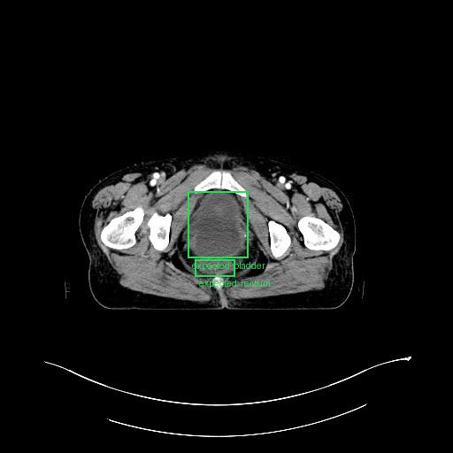

| | Expected | Model |
|---|---|---|
| Finding | bladder, rectum | none |
| Location | box (green) | - (IoU -) |
| Text | - | CT scan showing a 1.5 x 1.5 cm solid mass in the anterior wall of the urinary bladder. Impression: The patient was [history not provided].5 x 1.5 cm solid mass in the anterior wall of the urinary bladder. Suggested next steps (most to least suitable): 1. Immediate stabilisation: The patient was [history not provided].5 x 1.5 cm solid mass in the anterior wall of the urinary bladder. 2. Investigate: A biopsy was performed and the histopathological examination revealed a poorly differentiated... |

## slake / xmlab110 (ct)

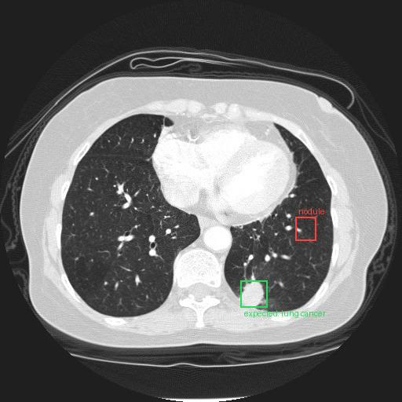

| | Expected | Model |
|---|---|---|
| Finding | lung cancer | nodule |
| Location | box (green) | middle third, image-right (on a standard frontal chest radiograph or axial CT this is usually the patient's left); box covers about 0% of the image (IoU 0.0) |
| Text | - | Chest CT scan showing multiple bilateral lung nodules. Impression: The patient was [history not provided]. Physical examination revealed a right-sided pleural effusion. Suggested next steps (most to least suitable): 1. Immediate stabilisation: The patient [history not provided]. 2. Investigate: A CT scan of the chest was performed, which revealed multiple bilateral lung nodules (Figure 1). 3. Investigate: A biopsy of the left lower lobe nodule was performed, which revealed a poorly... |

## slake / xmlab105 (ct)

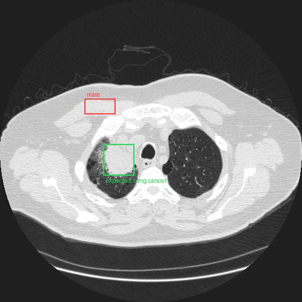

| | Expected | Model |
|---|---|---|
| Finding | lung cancer | mass |
| Location | box (green) | middle third, image-left (on a standard frontal chest radiograph or axial CT this is usually the patient's right); box covers about 1% of the image (IoU 0.0) |
| Text | - | Chest CT scan showing a large mass in the right upper lobe with mediastinal lymphadenopathy. Impression: The patient was [history not provided]. A CT scan of the chest revealed a large mass in the right upper lobe with mediastinal lymphadenopathy. Suggested next steps (most to least suitable): 1. Definitive treatment: The patient underwent a right upper lobectomy with mediastinal lymph node dissection. 2. Definitive treatment: The patient was diagnosed with lung adenocarcinoma and underwent a... |

## slake / xmlab600 (ct)

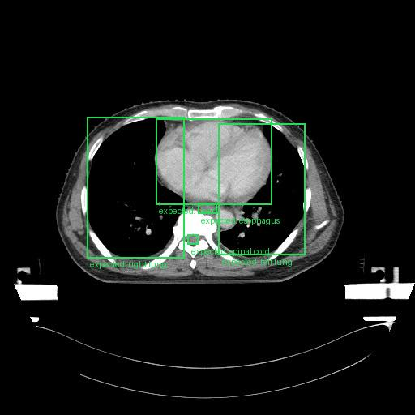

| | Expected | Model |
|---|---|---|
| Finding | esophagus, heart, left lung, right lung, spinal cord | none |
| Location | box (green) | - (IoU -) |
| Text | - | Chest CT scan showing a large mass in the left upper zone. Impression: A CT scan of the chest was performed, which revealed a large mass in the left upper zone (Figure 1). Suggested next steps (most to least suitable): 1. Definitive treatment: The patient underwent a median sternotomy and a biopsy of the mass was performed. 2. Definitive treatment: The patient underwent a median sternotomy and a biopsy of the mass was performed. 3. Definitive treatment: The patient underwent a median sternotomy... |

