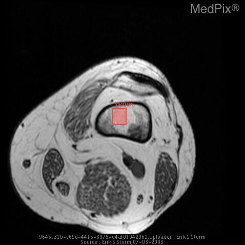
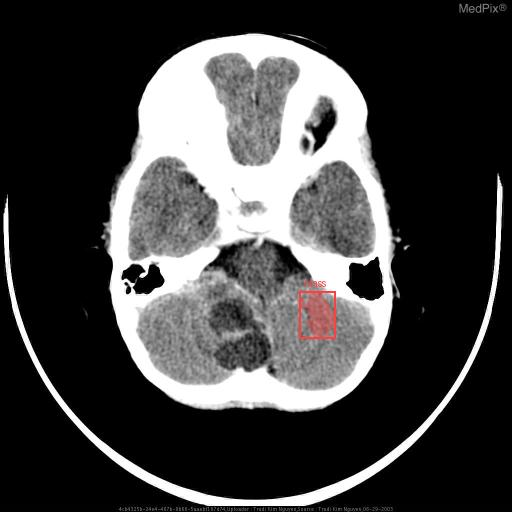
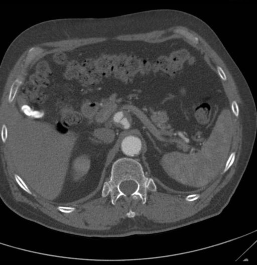
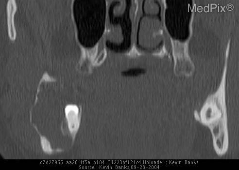
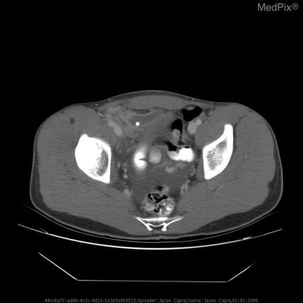
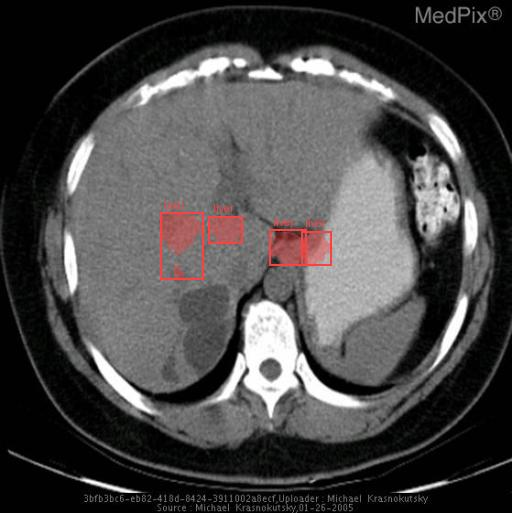
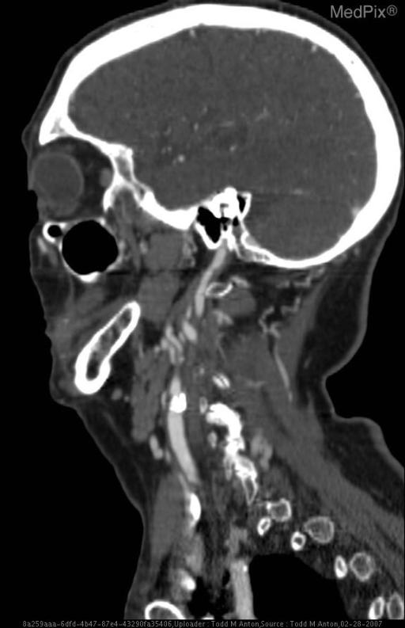
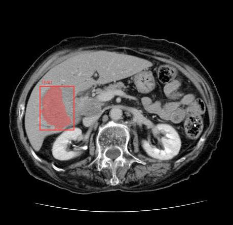

# MedPix 2.0 held-out check - for clinician review

Lexical scores are proxies only.

## MPX2087 (MR - T1W - noncontrast, age 40, female)

**Note given to model:** Now c/o progressive left knee pain.

| | Ground truth | Model (adapted) |
|---|---|---|
| Diagnosis | Metastatic Disease (Presumed Breast) | The patient was [history not provided]. Physical examination revealed a palpable mass in the posterior aspect of the knee joint. |
| Action | Patient is awaiting formal bone marrow biopsy for confirmation, and will undergo chemotherapy for known breast cancer. | 1. Investigate: MRI of the left knee revealed a 2.5 x 1.5 x 1.5 cm mass in the posterior aspect of the knee joint. 2. Definitive treatment: The patient underwent surgical excision of the mass. 3. Definitive treatment: The patient was [history not provided]. |
| Location | - | [{"label": "fracture", "box_2d": [0.4423, 0.4582, 0.5094, 0.5167], "location": "middle third, centre; box covers about 0% of the image"}] |

## MPX1387 (CT w/contrast (IV), age 1, male)

**Note given to model:** 21 month old male with high fever, mental status changes and possible seizure.

| | Ground truth | Model (adapted) |
|---|---|---|
| Diagnosis | RSNA-COTD Infected Dermoid Cyst | The patient was diagnosed with acute lymphoblastic leukemia (ALL) at 10 months of age and was treated with a combination of chemotherapy and intrathecal methotrexate. |
| Action | The patient underwent surgery with the posterior fossa mass removed by neurosurgery. The patient was placed on the appropriate pre and post antibiotic prophylaxis. The patient continued to improve during the postoperative period without complications. Histopathologic workup showed a portion of scalp with a dermal sinus tract. A benign squamous lined cyst with evidence of rupture were included. Additional specimen consisted of typical hair elements and pearly white soft tissue . | 1. Immediate stabilisation: The patient was admitted to the hospital with a 2-day history of high fever, irritability, and poor feeding. 2. Immediate stabilisation: The patient was intubated and placed on mechanical ventilation. 3. Immediate stabilisation: The patient was started on empiric antibiotics and was given a lumbar puncture with cerebrospinal fluid (CSF) analysis. 4. Immediate stabilisation: The patient was started on empiric antibiotics and was given a lumbar puncture with cerebrospinal fluid (CSF) analysis. |
| Location | - | [{"label": "mass", "box_2d": [0.5684, 0.5859, 0.6621, 0.6543], "location": "middle third, centre; box covers about 1% of the image"}] |

## MPX2442 (CT w/contrast (IV), age 75, male)

**Note given to model:** A 75-year-old white man with a history of smoking and mid-abdomen pain.

| | Ground truth | Model (adapted) |
|---|---|---|
| Diagnosis | Celiac, Abdominal Aorta, & Common Iliac Aneurysms | The patient was admitted to the hospital with a chief complaint of mid-abdomen pain. Physical examination revealed a palpable mass in the right upper quadrant of the abdomen. |
| Action | Treatment of abdominal aneurysm includes vascular surgical options such as vascular repair and/or stent placement. If aneurysms remain stable overtime close observation may also be an effective management strategy. Altering risk factors that can aggravate aneurysms such as cessation of smoking, maintaining adequately managing hyperlipidemia & hypertension to help control atherosclerosis. | 1. Immediate stabilisation: The patient was started on a proton pump inhibitor and a stool softener. 2. Immediate stabilisation: The patient was started on a proton pump inhibitor and a stool softener. 3. Immediate stabilisation: The patient was started on a proton pump inhibitor and a stool softener. 4. Immediate stabilisation: The patient was started on a proton pump inhibitor and a stool softener. |
| Location | - | [] |

## MPX1856 (CT - noncontrast, age 22, male)

**Note given to model:** A 22 yo military basic trainee had routine screening dental evaluation - no symptoms reported.

| | Ground truth | Model (adapted) |
|---|---|---|
| Diagnosis | Ameloblastoma | A panoramic radiograph revealed a radiopaque lesion in the posterior mandible. |
| Action | The lesion was treated by enbloc resection of the lesion and surrounding mandible. | 1. Definitive treatment: The patient was [history not provided]. 2. Definitive treatment: The patient was [history not provided]. 3. Definitive treatment: The patient was [history not provided]. 4. Definitive treatment: The patient was [history not provided]. |
| Location | - | [] |

## MPX2515 (CT - noncontrast, age 18, male)

**Note given to model:** 18yo man presents to the ER c/o 5d of RLQ abdominal pain and nausea. The patient states that his siblings have had flu-like illnesses recently with nausea and vomiting, so he initially attributed his symptoms to a virus.

| | Ground truth | Model (adapted) |
|---|---|---|
| Diagnosis | Ruptured Appendicitis | The patient was diagnosed with acute appendicitis and underwent a laparoscopic appendectomy. |
| Action | The patient was admitted and taken to the OR the evening of admission where he underwent an open appendectomy. The patient tolerated the procedure well, and was transferred to the surgical ward post op. On post op day 4 the patient had a normal white count, was tolerating a regular diet, and was transitioned to oral abx, oral pain medicine, and d/c to home. | 1. Immediate stabilisation: The patient was started on IV fluids and pain medication. 2. Investigate: The patient [history not provided]. 3. Definitive treatment: The patient was started on IV antibiotics and [history not provided]. 4. Disposition: The patient [history not provided]. |
| Location | - | [] |

## MPX2001 (CT - GI Contrast, age 41, female)

**Note given to model:** 41 year old samoan woman presented with recurrent bouts of pancreatitis.

| | Ground truth | Model (adapted) |
|---|---|---|
| Diagnosis | Recurrent pyogenic cholangitis (a.k.a. oriental cholangitis or oriental cholangiohepatitis) | The patient was diagnosed with acute pancreatitis and was treated with intravenous fluids, pain medication, and a proton pump inhibitor. |
| Action | Cholecystectomy and choledocojejunostomy | 1. Immediate stabilisation: She was admitted to the hospital with a diagnosis of acute pancreatitis. 2. Immediate stabilisation: She was treated with intravenous fluids, pain medication, and a proton pump inhibitor. 3. Immediate stabilisation: She was treated with intravenous fluids, pain medication, and a proton pump inhibitor. 4. Immediate stabilisation: She was treated with intravenous fluids, pain medication, and a proton pump inhibitor. |
| Location | - | [{"label": "liver", "box_2d": [0.4152, 0.3125, 0.5458, 0.3965], "location": "middle third, centre; box covers about 1% of the image"}, {"label": "liver", "box_2d": [0.4211, 0.4082, 0.4756, 0.4727], "location": "middle third, centre; box covers about 0% of the image"}, {"label": "liver", "box_2d": [0.4483, 0.5254, 0.5185, 0.5977], "location": "middle third, centre; box covers about 1% of the image"}, {"label": "liver", "box_2d": [0.4503, 0.5879, 0.5166, 0.6465], "location": "middle third, centre; box covers about 0% of the image"}] |

## MPX1723 (CT w/contrast (IV), age 87, female)

**Note given to model:** -87 year old woman -Left upper extremity weakness and numbness for past couple days -Son says her left face is “droopy” -No documented medical history -On no medications

| | Ground truth | Model (adapted) |
|---|---|---|
| Diagnosis | Ischemic stoke in right temporal-parietal lobes secondary to emboli from carotid bulb atheroma | The patient was brought to the ED by her son due to a 2-day history of left upper extremity weakness and numbness. Her son also noted that her left face was "droopy". |
| Action | Treatment: ASA, heparin if no bleed and large vessel atherothrombosis, thrombolytic (t-PA) if within 3 hours of symptom onset Disposition: Often long term inpatient stroke rehabilitation | 1. Immediate stabilisation: The patient was found to have a right-sided stroke on a CT scan of the head. 2. Immediate stabilisation: The patient was started on a heparin drip and a heparin flush was performed. 3. Immediate stabilisation: The patient was started on a heparin drip and a heparin flush was performed. 4. Immediate stabilisation: The patient was started on a heparin drip and a heparin flush was performed. |
| Location | - | [] |

## MPX1264 (CT - GI & IV Contrast, age 85, female)

**Note given to model:** One month of abdominal pain, nausea, and vomiting.

| | Ground truth | Model (adapted) |
|---|---|---|
| Diagnosis | Large B cell lymphoma of the liver with malignant biliary obstruction | The patient [history not provided]. Physical examination revealed a palpable mass in the right upper quadrant of the abdomen. |
| Action | >> Treatment for advanced disease usually includes chemotherapy (traditionally CHOP although this is evolving and has changed significantly over the last 30 years). >> Other interventions are usually palliative, as in this case where percutaneous biliary drainage followed by endobiliary stenting with internal drainage was performed. | 1. Immediate stabilisation: The patient was diagnosed with acute pancreatitis and [history not provided]. 2. Investigate: A CT scan of the abdomen was performed, which revealed a 4.5 x 4.5 cm mass in the right lobe of the liver. 3. Investigate: A biopsy of the liver mass was performed, which revealed a diagnosis of hepatocellular carcinoma. 4. Definitive treatment: The patient was treated with a combination of chemotherapy and radiation therapy. |
| Location | - | [{"label": "liver", "box_2d": [0.3815, 0.1717, 0.5801, 0.3174], "location": "middle third, image-left (on a standard frontal chest radiograph or axial CT this is usually the patient's right); box covers about 3% of the image"}] |

